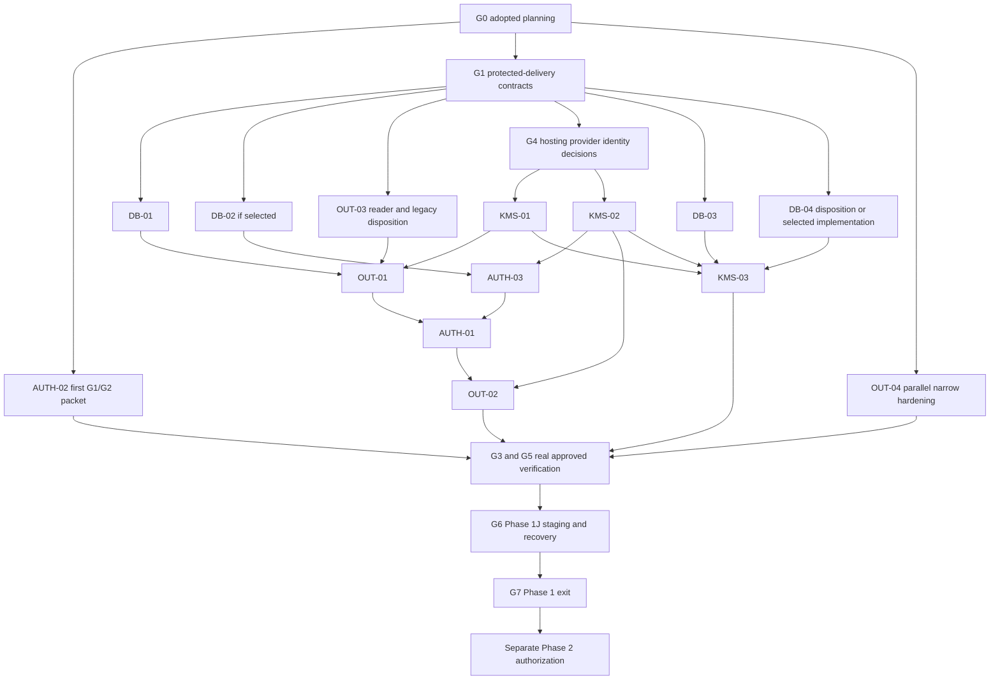
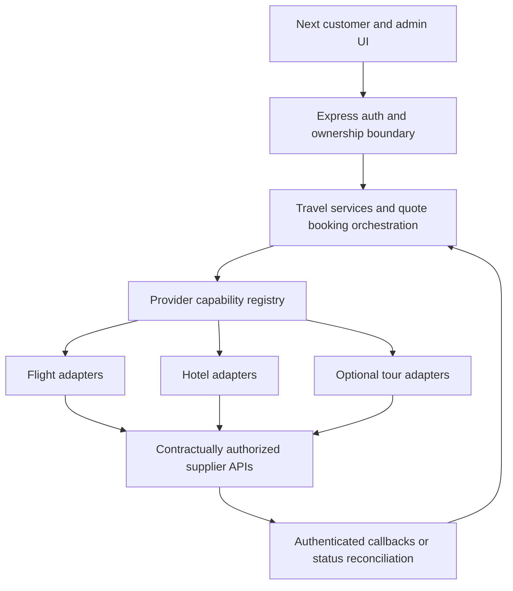

# FlyWithSafe — Phase 1–6 Gated Execution Master Plan

> **Current governance (owner-directed 2026-10-28):** [Tracker section 0](PHASE_1_INTERIM_STATUS_AND_EXIT_CHECKLIST.md#0-governing-owner-decision--2026-10-28-supersedes-prior-engineering-gate-wording) supersedes older bespoke legal-checklist and automatic counsel-signature requirements for G7 engineering acceptance. All technical controls remain mandatory. Real-data/production activation remains separately gated. Dated findings and acceptance evidence below are preserved, not re-certified.


Prepared 2026-10-25 (Asia/Dhaka). **PLANNING BASELINE — G0 ADOPTED ONLY.** G1 design acceptance, G2 implementation, database/provider operations and every later phase require separate explicit authorization. This session creates documentation only.

## 1. Executive Summary

Finish Phase 1 by correcting the smallest independent security defect first, then integrating protected issuance/outbox and trusted cryptography with the minimum required persistence changes, followed by real authorized integration/staging/recovery verification. Reuse accepted D-1/D-2/D-3B principles and vectors; do not build another prototype or replace working lifecycle systems.

AUTH-02 is the first proposed production-code package. The 14 existing roadmap units remain the complete security integration inventory for this plan; no new AUTH/OUT/KMS/DB identifier is invented. Business priorities are not a permission to activate code before its database/key dependencies. Mandatory P0 findings must be resolved before G7; no generic waiver or documentation-only milestone closes them.

After explicit Phase 1 exit and separate Phase 2 authorization, deliver quote/booking/payment foundations, SSLCommerz sandbox integration, approved supplier search, supplier booking/fulfillment, then authorized deployment/launch. Actual inventory belongs to authorized external suppliers. Cloudflare is a domain/DNS/security preference, not a selected application runtime. No live vendor, account, pricing, legal or API availability claim was verified externally in this task.

## 2. Current Accepted Milestones

| Milestone | Recorded owner disposition | Evidence boundary |
|---|---|---|
| D-1 | [Owner-accepted — synthetic only](PHASE_1I_D_D1_FORMAL_ACCEPTANCE.md) | Passenger cipher design and synthetic tests; no production identity/KMS/storage approval. |
| D-2 | [Owner-accepted — offline synthetic only](PHASE_1I_D_D2_FORMAL_ACCEPTANCE.md) | Reported 155 cases per loader, bounded awaited policy/key operations, strict TypeScript. Not rerun now. |
| D-3A | Design completed | [Auth-delivery scope](PHASE_1I_D_D3_AUTH_DELIVERY_SECURITY_SCOPE.md); production ADR-03 not approved. |
| D-3B | [Owner-accepted — offline synthetic only](PHASE_1I_D_D3B_FORMAL_OWNER_ACCEPTANCE.md) | [145 cases per loader/T01–T20 report](PHASE_1I_D_D3B_VERIFICATION_REPORT.md), fake key/outbox/transport and strict TypeScript; no PostgreSQL or real provider proof. |

Previous Phase 1H 16/16 PostgreSQL success and clean fixtures are historical owner-reported evidence, not a current database check or proof of future auth/encryption changes. Preserve F01–F07 controls, privacy DTOs and database-backed pagination. Phase 1I-D remains incomplete. Phase 1I-E, Phase 1J and Phase 2–6 execution are not authorized.

## 3. Verified Repository Baseline

Branch development, HEAD 154cf93. Seven tracked D-2 files were modified before this session. Fourteen untracked files existed: nine auth-delivery prototype files and five acceptance/design/roadmap documents. Both current output documents were absent. No existing file is writable in this task.

All 649 tracked/nonignored-untracked preexisting files were hashed before writes. Aggregate SHA-256 over sorted JSON `[path,sha256(bytes)]` entries: `fd7f1f88b108c640ca36c7fdbb6a750b0b93be4897bc771f051601e45798cba4`. Recheck excluding only these two new documents. No .env/credential inspection, application/test execution, database connection, remote API or cloud access was performed.

Current inspected paths and symbols:

| Existing repository-relative path | Actual behavior / use in plan |
|---|---|
| `server/src/services/auth.service.ts` — verifyEmail/resetPassword | Checks unused/expiry before array transaction; token update is by id alone. AUTH-02 correction target. |
| Same file — issueVerificationToken/register/resendVerification/requestPasswordReset | Random credential/hash; token/user/supersession/enqueue are separate operations; raw token URL built. AUTH-01/03. |
| `server/prisma/schema.prisma` — EmailVerificationToken/PasswordResetToken | id, userId, token/hash, expiresAt, usedAt; no revokedAt/generation/job FK. No schema access or modification now. |
| `server/src/services/notification.service.ts` — sendEmailVerification/sendPasswordReset/sendEmailRaw | Raw credential URL params forwarded; explicit suppressed/submitted outcome exists. |
| `server/src/services/outbox.service.ts` — enqueueNotification/processOutboxBatch/redriveFailedNotification | Params JSON and direct-send fallbacks; claim/ack updatedAt ownership/expiry fencing; bounded retry and redrive. Preserve working controls. |
| `server/src/routes/outbox-worker.routes.ts`; `server/src/middleware/oauth-state.ts`; `server/src/middleware/request-origin.ts` | Protected scheduler trigger, durable browser-bound OAuth state consume and cross-site mutation checks. Outside AUTH-02 edits. |
| `server/src/services/booking.service.ts`; `server/src/utils/booking-dto.ts`; `server/src/services/idempotency.service.ts` | Plaintext passenger writes; minimized HTTP DTOs; logical caller/payload-scoped durable idempotency. |
| `server/src/services/inquiry-page-query.ts`; `server/src/services/account.service.ts` | Parameterized database paging; name-only profile update. No need to reimplement F06. |
| `server/src/services/flight-aggregator.service.ts` — FlightAggregatorService | Defaults to MockFlightProvider; search timeout race/raw error warning and simplistic flight dedupe are not a safe reservation adapter template. |
| `server/src/services/hotel.service.ts` — searchHotels | Uses MockHotelProvider; isLiveData=false. |
| `server/src/services/providers/flight.provider.ts`; `server/src/services/providers/hotel.provider.ts` | Search-only interfaces; no authoritative quote/reserve/cancel/refund API defined. |
| `server/src/routes/future-stubs.routes.ts` | 501 placeholders and older phase comments; not proof of payment/tour/fulfillment implementation. Current owner's delivery sequence takes planning precedence. |
| `netlify.toml`; `server/src/server.ts`; `server/src/lib/prisma.ts`; `server/prisma.config.ts` | Next hosting intent; Node Express development polling; runtime DATABASE_URL versus CLI DIRECT_URL. No deployed topology/region or Cloudflare/real KMS proof. |

No production supplier/payment capability is established by a local BookingStatus=CONFIRMED. No shared isolated server/vitest.config.ts was found. Existing HTTP tests import application/env/Prisma and use per-test spies: they require explicit safe initialization before future execution; a passing historical report is not a current isolation guarantee.

## 4. G0 Adoption Reference

[G0 formal adoption](PHASE_1I_D_G0_ROADMAP_ADOPTION.md) records the owner's current conditional planning adoption after static baseline/consistency verification. Exact adopted [21-section roadmap](PHASE_1I_D_PRODUCTION_INTEGRATION_ROADMAP.md) SHA-256: `671a2f05cc015d01dc400c50e470b4d0e06a02f4d655451710e3a66148b62f11`.

G0 accepts the planning structure, inventory, sequencing and approval boundaries. It does not approve G1/G2, a reduced Phase 1 exit profile, legal applicability, production ADRs, migration files, real services or deployment. Existing acceptance records/ADRs/roadmap bytes remain unchanged. Missing complete historical closure inventory and named reviewers remain explicit G7 dependencies; unknown findings cannot be marked closed.

## 5. All 14 Actual Change Units

Status S0 in the following table means **production change not implemented/accepted; G1 and G2 both NOT APPROVED**. Existing earlier controls may already work; S0 refers to this additional integration requirement. No item is owner-signed merely by G0. Size estimates are relative, not calendar commitments. Basenames below resolve to the full paths in §3; proposed security modules are under server/src/security/, as in adopted roadmap §4. Future migration/adapter/test allowlists must be frozen per package before execution.

| Exact ID / domain | Existing gap and minimum files | Required contract / dependencies | Priority / estimate / current status |
|---|---|---|---|
| AUTH-02 / Authentication | verifyEmail/resetPassword race; auth.service.ts plus two proposed auth-consumption files in §7 | Single conditional consume and atomic user/password/session effects, legacy compatibility; independent of KMS/new schema | First code package; P0; Small–Medium; S0 |
| AUTH-01 / Authentication | Separate user/token/supersession/enqueue writes; auth.service.ts, notification.service.ts | Preallocated identities, one credential/issuance, atomic protected job/account/supersession; OUT-01, AUTH-03, DB-01/selected DB-02, KMS-01 | Priority 2; P0; Medium–Large; S0 |
| AUTH-03 / Authentication | Missing trusted recipient/generation admission; auth.service.ts, account.service.ts boundary, proposed auth-delivery.ts | Purpose/customer/account generation, no retarget/refresh; DB-02 and KMS-02; do not rewrite name-only profile unnecessarily | Priority 2; P0; Medium; S0 |
| OUT-01 / Outbox | Raw params/fallback; notification.service.ts, outbox.service.ts, proposed auth-delivery.ts | Strict version-aware protected auth branch/no secret fallback; DB-01, KMS-01, approved OUT-03 reader disposition | Priority 2–3; P0; Medium; S0 |
| OUT-02 / Outbox | No current token checks before send/redrive; outbox.service.ts, worker route preserved | Credential/account/grant/lease admission, original-message retries; AUTH-01/03, OUT-01, KMS-02; current CAS/expiry preserved | Priority 3; P0; Medium; S0 |
| OUT-03 / Outbox | Legacy unversioned plaintext; outbox.service.ts/auth.service.ts reader branches, exact later tests TBD | V1/V2 inventory/disposition, reader-first/writer-off rollback; before protected writer activation; no automatic data action | Priority 2–3; P0 if retained data, unknown until authorized inventory; Medium; S0 |
| OUT-04 / Outbox/security sinks | Raw exception sinks remain; server/src/server.ts, server/src/lib/logger.ts, notification/outbox error paths | Existing safe serializer and allowlisted reasons, no secret diagnostics; independent narrow sink change, coordinate activated paths | Parallel Priority 2–3; P0 for secret sinks; Small–Medium; S0 |
| KMS-01 / KMS/crypto | Only fake providers; proposed envelope.ts/data-key-provider.ts/auth-delivery.ts and adapter path TBD | Shared reviewed primitives, fixed provider/resource/version registry and production wire vectors; G4 host/provider decisions; no fake fallback | Priority 4 dependency may precede protected app activation; P0; external decision + Medium–Large; S0 |
| KMS-02 / KMS/authorization | Synthetic grants are not trusted identities; proposed auth-delivery.ts/passenger-document.ts policy | Workload IAM plus customer/purpose/assignment/step-up/expiry before unwrap; bounded operations/no persistent plaintext cache; G4 | Priority 4; P0 for decrypt; external decision + Medium; S0 |
| KMS-03 / KMS/passenger integration | Plaintext passenger writes; booking.service.ts, booking-dto.ts, proposed passenger-document.ts | Preallocated immutable IDs, encrypted writes and approved masks; KMS-01/02, DB-03, DB-04 disposition and approved collection/grants | Priority 4–5; P0 for enabled sensitive flows; Large; S0 |
| DB-01 / Database | Plaintext required recipient/no durable token-job FK; schema.prisma and future separately named migration | Protected routing/token-job uniqueness/purpose/FK lifecycle; G1 auth contract before preparation; required before protected app activation | Priority 5 dependency precedes writers; P0; Medium; S0 |
| DB-02 / Database | No durable revocation/generation/issuance uniqueness; schema.prisma plus auth/account writer scope | Minimum selected lifecycle fields/constraints, not all fake state; AUTH-03 design; real concurrent supersession tests | Priority 5; P1 planning → P0 when selected; Medium; S0 |
| DB-03 / Database | No passenger envelope/revision/mask metadata; schema.prisma/booking readers and future migration | Additive compatible format/CAS/minimal mask, immutable IDs; KMS-03 design, independent restore/revision decision | Priority 5; P0 for passenger confidentiality; Large; S0 |
| DB-04 / Database/idempotency | Legacy logical SHA-256 compatibility/privacy unresolved; schema.prisma/idempotency.service.ts/relevant callers | Separately selected keyed logical digest/version with old serializer/principal replay; never randomized-ciphertext equality | Priority 5; P1 disposition → P0 if required; Medium; S0 |

Each row is completed by its matching control row below. All named owners are accountable roles; actual people/signatures are **PENDING**. Test evidence here is required future evidence, not PASS.

| ID | Unit/regression and acceptance evidence | Legal references / gates / sign-off | Rollback and remaining risk |
|---|---|---|---|
| AUTH-02 | Valid/used/expired/missing/legacy, modeled simultaneous consume, side-effect rollback, safe reset hash/session effect, API/OAuth compatibility; actual lock-wait/concurrent proof at G3/G5 | L-03/05/10; G1 then independent G2; no schema/KMS execution; auth + security/reliability owner PENDING | Only scoped code reversal/forward fix; no data rollback. Offline model cannot prove PostgreSQL; explicit revocation absent today. |
| AUTH-01 | One token/job/account unit; all failure points; lost-response replay/conflict; concurrent issuance/supersession; no fallback | L-02/03/05/08/09/10/11/14; G1/G2 + relevant G3/G4/G5; auth/DB/reliability PENDING | Pause new writers, keep compatible reader; no orphan token or retry-generated credential. |
| AUTH-03 | Wrong identity/purpose, changed email away/back, expired/revoked generation, no new grant on retry | L-02/03/06/10; G1/G2/G3/G4/G5 as selected; auth/security PENDING | Fail closed; do not lower generation/restore superseded credentials. |
| OUT-01 | No raw token/URL/recipient duplicate in job storage; corrupt/unknown versions denied; ordinary notifications preserved | L-02/03/05/08/11/14; G1/G2 plus DB-01/KMS approvals; reliability/security PENDING | Readers before writers; writer off; no plaintext fallback. KMS/reader availability remains dependency. |
| OUT-02 | Multiple workers/expired leases/stale ack; valid send, suppression/max retry/redrive; accepted-send crash and credential state races | L-03/05/09/10; G1/G2/G5; reliability/auth PENDING | Pause secret dispatch, preserve messages/fences; SMTP ambiguity and duplicate sends remain possible. |
| OUT-03 | Authorized format inventory, V1 disposition, mixed readers/writer off, historic keys; no corrupt-V2 legacy fallback | L-01/03/07/08/12/13/14; G1/G2; each inventory/data action separately; data owner/privacy/reliability PENDING | Never V1-only rollback after protected writes; no blind purge/backfill. Backup exposure remains until approved handling. |
| OUT-04 | Sentinel-free exceptions/logs/APM/access traces and safe provider faults; affected outbox/privacy regressions | L-02/05/08/09; G1/G2/G6 operations policy; security/operations PENDING | Keep safe diagnostic codes, not raw bodies/stacks. External log sinks need separate review. |
| KMS-01 | Real synthetic-data wrap/unwrap, versions/resources/context denial, throttling/timeouts/disabled/historic key and audit limits | L-02/05/10/11/14; G1/G2 interface; G4 provisioning/access separately, G5 proof; infrastructure/security/finance PENDING | Stop writes; retain reader/key recovery; no emergency local KEK or key destruction. |
| KMS-02 | Zero unwrap on denied purpose/customer/role/step-up/expired grant; real identities and no cache leakage | L-02/03/04/05/06/10/11/14; G1/G2/G4/G5; security/identity owner PENDING | Revoke/pause affected identity, not broaden decrypt rights. Compromised authorized process remains risk. |
| KMS-03 | F07 list/detail/guest/mutation non-exposure; encrypted atomic writes/CAS; logical replay; no ordinary-list decrypt | L-02/03/04/05/06/07/08/11/13/14; G1/G2/G3/G4/G5; booking/security/privacy PENDING | Reader-aware rollback, writer off; old plaintext/backups not erased by encryption. |
| DB-01 | Precise additive schema, FK/uniqueness/purpose checks and nullable routing; ordinary rows, rollback/restart/concurrent issuance | L-03/05/07/08/10; G1 + distinct G3 design/file/disposable/staging/production approvals; DBA/auth PENDING | Forward recovery, preserve rows/history; no automatic down migration or reset. |
| DB-02 | Concurrent generation/supersession/consume, revocation persistence and identity change-away/back | L-03/06/07/08/10; G1/G2 and separate G3 execution; DBA/auth PENDING | Preserve generations/revocations; schema absence cannot be hidden in AUTH-02. |
| DB-03 | Schema/CAS/dual-reader/legacy/mask constraints, concurrent updates/restore and key access | L-02/04/05/06/07/08/11/13/14; G1/G2/G3 and each backfill/removal separately; DBA/security/privacy PENDING | Keep columns/ciphertext/historical keys; same-DB CAS is not independent rollback protection. |
| DB-04 | Legacy/new digest vectors, rotation, equality across fresh ciphertext, guest principal/operation/key uniqueness | L-02/05/07/08; separate ADR-14 G1/G2/G3 where needed; reliability/security/DBA PENDING | Version-dispatched old readers/keys; never silently rehash old records or change principal scope. |

## 6. Prioritized Dependency Graph

Priority means order of design attention; dependency arrows govern safe execution/activation. AUTH-02 is first actual code candidate. DB/KMS preparation is allowed to precede later application activation only after its own authorization. Stable contracts can be designed together without combining all code into one change.



Smallest coordinated auth-delivery package after AUTH-02: approve AUTH-01/03 + OUT-01/02/03 contracts and DB-01/selected DB-02 together, then separately implement reader-capable and writer-disabled slices, verify schema/key prerequisites, and enable writes only after relevant gates. Splitting the contract so a token is committed without its protected job is unsafe. OUT-04 remains independently reviewable. Passenger work shares reviewed crypto contracts but keeps distinct keys/authorization and its own DB/legacy proof.

## 7. AUTH-02 Implementation Approval Packet

**DESIGN PACKET PREPARED — G1 NOT APPROVED; G2 NOT AUTHORIZED.** Exact proposed files:

1. Existing `server/src/services/auth.service.ts`: verifyEmail/resetPassword consume/transaction handling and only directly necessary private helper/import changes.
2. New `server/test/auth-consumption.test.ts`: synthetic isolated tests and pre-import mocks/guards.
3. New `server/test/auth-consumption.vitest.config.ts`: dedicated config-only safe runner. Both new paths are currently absent.

Current code evidence: verifyEmail at auth.service.ts:152–169 accepts hash or legacy raw row with usedAt=null/expiry filter, then updates user and token by id in an array transaction. resetPassword at :206–220 reads hash/usedAt/expiry, hashes password, then updates password/token/session. Two requests can pass the preliminary read; token update itself has no unused/expiry predicate. This is source analysis, not a live reproduced race.

Proposed precise concurrency contract:

- Retain preliminary lookup/legacy compatibility and generic invalid-or-expired API responses. No public endpoint/cookie/Google strategy/origin/rate-limit change.
- Hash reset passwords before the short interactive transaction, as today. Do not hold locks during bcrypt/KMS/network work.
- Inside the transaction, conditionally update the selected static token table using parameterized values, matching record/user, intended token/hash or preserved legacy verification value, unused state and unexpired state. A single returned row/count=1 is the consumption linearization point; zero means reject with no user/password/session side effects. Multiple rows is an invariant failure, not permission to update multiple accounts.
- Recommended expiry contract for G1: valid at the winning conditional update, evaluated using current database wall time rather than a timestamp captured before waiting. Use a static-table parameterized Prisma query if the supported Prisma predicate cannot express that boundary. Never interpolate a request table/column/SQL fragment. Test expiry during lock wait later against PostgreSQL; transaction-start time is not proof of consume-time expiry. Commit may follow that valid linearization point; it does not renew token lifetime.
- Commit usedAt plus emailVerified or password/session-revocation effects atomically. Any failure rolls back consumption and effects. Do not automatically reissue/reset a token on serialization/deadlock/unknown failure. Keep rejection/errors secret-safe.
- **Current-schema revocation qualification:** EmailVerificationToken and PasswordResetToken have no revokedAt. Missing/deleted/superseded token rejection is in scope. Explicit durable revokedAt/generation rejection needs DB-02/ AUTH-03; no fictitious field or full durable-revocation claim in AUTH-02. If G1 requires that durable state in the first package, revise scope before G2.

Unit design: hoisted mocks prevent importing actual Prisma adapter, dotenv-backed env, notification/SMTP or Google configuration. Use a synthetic conditional-update model for two contenders and staged rollback/effect failures; assert one winner/effect and unchanged loser state. No real DB, listener, supplier or key service. Cover valid/used/expired/deleted/missing/wrong token, legacy verification, query parameterization, zero/multiple-row invariant handling, hash before transaction, no password/session changes on loss/failure, generic errors and sentinel exclusion. These mocks do not certify actual SQL syntax/locking/isolation.

Runner: config-only CommonJS, envDir=false, bounded tests, one worker, no result/coverage output or app/global setup. Guards activate before service imports; no secrets read from environment. Existing API/OAuth/outbox tests import env/Prisma/app and use Supertest/per-test spies, so cannot simply be included and called isolated. Before G2 execution, the reviewer must prove a safe curated regression initialization within the allowlist, or request a separate harness-scope amendment. Do not use an unreviewed default test command, silently skip mandatory regressions, weaken guards, or add a fourth file. This is an explicit readiness condition, not a completed safety claim.

Proposed commands from server **after separately authorized implementation and runner review**, not run now:

```powershell
& .\node_modules\.bin\tsc.cmd --noEmit --incremental false
& .\node_modules\.bin\tsc.cmd --noEmit --incremental false --strict --target ES2022 --module NodeNext --moduleResolution NodeNext --esModuleInterop --skipLibCheck --types node,vitest/globals test/auth-consumption.test.ts test/auth-consumption.vitest.config.ts
& .\node_modules\.bin\vitest.cmd run --config test/auth-consumption.vitest.config.ts
& .\node_modules\.bin\vitest.cmd run --config test/auth-consumption.vitest.config.ts --configLoader native
git diff --check
```

The future dedicated config must explicitly scope the safe existing regression selection before its commands can be claimed to cover it. Required neighborhood: authentication/API behavior, request-origin, OAuth/state, notification/outbox and relevant privacy/pagination assertions. These are blocked from execution here, not waived. AUTH-02 does not edit those existing files or the accepted crypto suites. Real concurrent consume/expiry/rollback tests require later G3/G5 exact-target permission.

Rollback: preserve current dirty files and evidence; restore only the approved package edits under authorization. No data/schema reversal or destructive Git commands. After activation, disabling affected redemption and a forward fix is preferable to restoring a known vulnerable consumption path. Stop for scope expansion, model/schema mismatch, unsafe test import, unexpected query behavior, secret leakage, or unresolved mandatory test failure.

G1 request: accept this consume-time/atomicity/legacy/API contract, current-schema revocation limitation, exact three-file boundary and test/rollback conditions; assign auth/security/reliability reviewers. **G1 acceptance grants no code execution.** G2 request is distinct: authorize only those files and approved offline commands after runner readiness, with no database/schema/KMS/email/supplier/payment/environment/package/deployment operation. If guards cannot safely cover required regressions, present an amended scope before asking for G2.

## 8. Authentication Integration Plan

After AUTH-02, settle AUTH-01/03 once: registration all-or-nothing policy; stable issuance/token/message IDs; hash-only verification records; encryption outside transaction; atomic account/token/supersession/job commit; logical replay/conflict and deliberate new-issuance semantics. Preserve current generic responses, session behavior, origin checks and rate limits. No process-local authoritative idempotency.

Trusted recipient is original authenticated payload plus current allowed account identity/generation; never a request override or silent retarget. Concurrent supersession must not create multiple intended valid credentials. Token expiry/consume/revocation is checked at worker admission and again before send. Redrive never refreshes a credential. Google OAuth remains a separate protocol/key purpose; do not change state cookies, consume markers, callbacks or redirects to implement email delivery.

## 9. Outbox Integration Plan

Preserve NotificationOutbox, processOutboxBatch and existing leases/status semantics. OUT-01/02 add strict protected-auth version routing, authorized decrypt and lifecycle admission; ordinary messages retain their reviewed path. OUT-03 classifies V1 auth jobs and defines an approved reader/legacy disposition before protected writers. No corrupt-V2 fallback to plaintext/direct send. OUT-04 uses existing sanitized logging instead of raw exception/body sinks.

Retain message/token identity, durable idempotency, current updatedAt claim/ack ownership and expiry fences, bounded retries/max attempts and truthful suppression. Protected recipient cannot also remain copied in a required cleartext field; DB-01 precedes activation. No transaction spans KMS or SMTP. A provider-accepted send can be duplicated after lost acknowledgment; a lease fence cannot undo it. Do not abandon an in-flight send and start another without settled outcome/cancellation evidence. Pause secret dispatch rather than weakening checks during an outage.

## 10. KMS/Cryptography Integration Plan

KMS-01/02 precede real protected writes/decrypt; KMS-03 adapts passenger writes only after DB-03 and grant/retention/digest decisions. Keep accepted prototype files/AAD vectors unchanged. Production parsing must use an explicitly approved provider/resource/version/wrapped-size contract; fake allowlists and ephemeral KEKs must never be promoted to production. Preserve format versions, or approve a new one with exact vectors before changing semantics.

Select compatible host/runtime/region and short-lived workload identity before choosing AWS/GCP/Azure or another provider. None is selected. Cloudflare DNS/security can front compatible Node hosts; Workers/Prisma/SMTP/federation compatibility requires actual separately approved proof. Purpose-separated passenger/auth-delivery/JWT/OAuth/digest keys, least privilege and app-level grants; ordinary lists do not unwrap. No cross-request plaintext DEK cache initially. SDK retries must not multiply application retries; total deadlines, cancellation acknowledgment and late-result clearing remain explicit.

Minimum readiness: environment-separated identities/resources, approved IAM/egress/regions, measured latency/quotas/cost, safe audit/alerts, rotation-versus-rewrap policy, historical-key access, backup/key recovery, dual-control deletion and restore quarantine. G4 design selection is not permission to provision/access keys; real access scopes require their own approval. No new prototype is justified merely by provider selection work.

## 11. Database Integration Plan

AUTH-02 uses existing models and no migration. DB-01 proposes minimum protected routing and token-job uniqueness/FK/purpose constraints; existing JSON can hold an envelope but cannot alone remove the current plaintext recipient requirement. DB-02 adds only selected revocation/generation/issuance constraints. DB-03 adds compatible passenger envelope/version/minimal mask/revision storage. DB-04 separately resolves keyed logical digest/version/legacy replay; never hash randomized ciphertext for equality or change guest-principal scope silently.

No new outbox/lease table or entire copy of fake state by default. Existing updatedAt/status CAS has working lease semantics. Schema design, migration file creation, disposable execution, staging execution and production migration are **five distinct G3 approvals**. Preserve existing seven migrations/history; review locks/timeouts/defaults/FKs/indexes/compatibility and failure recovery. No db push/reset shortcut. Plaintext backfill/removal, old token retirement and fixture cleanup each require exact separate approval.

Before later write-capable tests, privately verify matching runtime/CLI/integration target, exact literal loopback/port/database/role as applicable, owner-designated disposable isolation, current history/schema and empty outbox. Existing guarded Phase 1H target is not presumed disposable/empty now; protected flywithsafe_integration and remote DBs remain untouched. No migration/test/preflight runner is executed now: even its read-only preflight connects to PostgreSQL.

## 12. External Supplier API Architecture



No browser-to-supplier private credentials. FlyWithSafe owns intent, quote/customer/payment linkage, authorization, audit and reconciliation; suppliers own authoritative inventory, booking acceptance and actual fulfillment. Akijair.com is a public UX reference only; no API access, scraping, private-endpoint inference or contractual access is assumed.

Capability-based logical adapter contract: profile reports supported search/availability/reprice/quote/reserve/status/amend/cancel/refund/fulfillment operations, environments and supplier terms. Each optional operation returns a typed UNSUPPORTED_CAPABILITY result before outbound work if absent. Distinguish unsupported, no availability, expired quote, changed price, provider unavailable, rejected request and ambiguous submission. Do not use empty offers as a universal error signal.

Normalized result preserves provider ID, opaque offer reference, offer/version/source timestamp/expiry, availability semantics, exact currency/amount/tax/fee totals, cancellation/refund/change rules and deadlines/timezone, inclusions/baggage/room/fare class/occupancy, required traveler/guest fields, term/version reference and later booking/fulfillment IDs. Money uses exact decimal or integer minor units with verified currency exponent, not float arithmetic or an assumed universal two-decimal scale. Retain lossless provider terms behind validated typed extensions; unknown refundability is not false by default.

Persist a trusted server-side quote snapshot and expose an opaque customer-bound handle; a browser-supplied price/provider URL is not authority. Revalidate inventory and final payable amount at the required commitment/payment boundary. Quote changes/expiry require explicit customer confirmation or safe rejection. Search success does not reserve; supplier acceptance does not always mean issued ticket/confirmed stay/voucher. Never fabricate any fulfillment state.

Security contract: fixed official endpoint allowlist; TLS certificate validation; SSRF-safe path/redirect handling; bounded validated requests/responses/body sizes; server-only scoped secrets; tenant/purpose checks; per-provider request budgets/rate controls and justified circuit breaking; no passenger/token/credential logs; approved freshness/privacy cache policy; environment separation. Authenticated callbacks validate exact payload/signature or supported official verification, timestamp/replay and business IDs; never invent a vendor signing scheme.

Search timeouts may stop waiting but do not prove cancellation. Reservation/amend/cancel/refund timeouts can be ambiguous: persist a stable operation ID, use supplier idempotency where supported, reconcile status before any retry, and route unresolved cases to restricted operations review. No open DB transaction spans supplier HTTP. Idempotency and event/order uniqueness are durable; an in-process map is insufficient. Audit current flight Promise.race/error logging and dedupe before real supplier use; provider/offer/fare identity must not discard distinct terms merely because airline/flight/time matches. This is later Phase 4/5 work, not a fifteenth Phase 1 unit.

## 13. Flight/Hotel/Tour Capability Matrix

All real-provider cells below are **UNVERIFIED / no provider selected**. Existing mock search is not commercial/live capability evidence.

| Operation | Flights | Hotels | Tours/activities |
|---|---|---|---|
| Existing source | FlightProvider.searchFlights and default MockFlightProvider aggregator | HotelProvider.searchHotels and MockHotelProvider | No supplier adapter established; local package content is not authoritative tour stock |
| Search/availability | Define journey/passenger/cabin and inventory freshness; selected supplier must document availability | Define dates/occupancy/room/rate-plan availability and restrictions | Only if owner approves product scope and supplier capability; dates/slots/capacity |
| Reprice/quote | Confirm fare/taxes/baggage/rules and expiry; no presumed guaranteed fare | Confirm total stay/taxes/fees/inclusions/occupancy/cancellation | Confirm activity/participants/add-ons/terms and slot expiry |
| Reserve/status | Optional per profile; PNR/order acceptance distinct from ticket issuance | Reservation acceptance distinct from final confirmation/status | Reservation distinct from voucher/fulfillment |
| Amend/cancel | Supported only under documented fare/supplier rules | Supported only under rate-plan/property rules | Supported only under product/provider rules |
| Refund/settlement | Separate supplier eligibility versus gateway refund and funds reconciliation | Same separation; cancellation is not proof of returned funds | Same, where actually supported |
| Unsupported behavior | Explicit capability error, no dummy success/manual fallback pretending to reserve | Same | Disabled/not offered until scoped and verified |
| Evidence before calls | Official API version, access agreement, endpoint/environment, idempotency/status/error/terms contract | Same plus property/rate/occupancy contract | Product scope plus corresponding official/access evidence |

Provider selection considers Bangladesh/regional route/property coverage, actual access rights, supported operations, payment/cancellation/refund/fulfillment terms, response correctness, data countries/subprocessors, support/SLA, quotas/cost and security. No vendor is ranked or represented as available without current official/commercial evidence. Start with documented mock fixtures, then exact approved sandbox calls, then separately approved production read-only, then separately approved booking/fulfillment.

## 14. External API Credential Checkpoints KEY-0–KEY-6

These are independent from G0–G7. All are gate definitions only; none authorizes provisioning/calls now. No credential is requested in chat, written to fixtures/reports, placed in NEXT_PUBLIC_* or committed .env, or displayed in logs/screenshots.

| Gate / current status | Prerequisites and manual owner action | Permitted scope after exact approval / stop conditions |
|---|---|---|
| KEY-0 — specification prepared; no provider discovery executed | Product/supplier owner identifies candidates; review official public docs/API rights/commercial/environment/capability evidence | Documentation-only comparison; no keys, account purchases, authenticated calls, booking or competitor private endpoints. Stop if evidence unavailable. |
| KEY-1 — NOT APPROVED | Owner selects named provider/environment after official access agreement, capability/terms and relevant legal/country/processing review | Record selection and supported operations only; no credentials/calls implied. Unverified commercial access blocks progression. |
| KEY-2 — NOT APPROVED | Separate provisioning approval: exact sandbox/account/endpoints/scopes, secret manager, environment, quota/budget, expiry/rotation/revocation owner | Owner or separately authorized secure tooling provisions backend-only sandbox access. Never paste a key into this conversation. Stop on production credential/endpoint or scope mismatch. |
| KEY-3 — NOT APPROVED | Independently approve exact sandbox call types/counts/budget, official endpoint, egress, permitted synthetic travelers/guests and redaction | Execute only approved calls, retain sanitized evidence and test failure handling. A sandbox key does not permit live inventory/reservations. |
| KEY-4 — NOT APPROVED | Approved staging topology/adapter, relevant permissions, rotation/webhooks/quote consistency/privacy/security regressions/rollback | Separately authorize staging activation using sandbox/staging supplier access by default. Stop on unverified callback or inconsistent quotes. |
| KEY-5 — NOT APPROVED | Production agreement, legal/security approval, workload/secret storage, read-operation allowlist, rate/cost/monitoring and owner authorization | Only specified live read/search operations with approved minimal inputs. Read-only may still incur charges/transmit search data. No passenger transfer, reserve or payment authority. |
| KEY-6 — NOT APPROVED | Separate owner approvals for reservation, customer data transfer, charge, ticketing/voucher, amendment/cancellation/refund; tested saga/idempotency/reconciliation/recovery/disclosures | Only exact approved write/live operations. Successful sandbox or KEY-5 never grants live booking/payment permission. Pause ambiguous or unreconciled orders, not blind retry. |

Payment sandbox credentials likewise require a named account/environment, least-privilege backend secret handling, exact call authorization and separate live activation. Supplier KEY-6 does not grant a payment-gateway merchant permission, or vice versa. Key access, funds movement and customer-data transfer are independently scoped even when one user journey needs all three.

## 15. L-01–L-14 Legal Dependency Matrix

Exact subjects below come from the unchanged [Legal Verification Matrix](PHASE_1I_D_PASSPORT_ENCRYPTION_RETENTION_DESIGN.md). Section references are original register labels, not new verified legal conclusions. **All 14 remain BLOCKED.** No authoritative legal-source research or counsel review occurred now.

For every row, required evidence retains the original register's full applicable primary text/version/checksum, precise section/page/current rules/notices, retrieval date, applicability, named reviewer, qualified Bangladesh counsel disposition and re-review condition. Table notes identify additional workflow facts. Synthetic-only approved coding/testing can proceed without closing legal rows; it does not permit real-data collection, transfer, retention or activation. “Earliest gate” below means decision assessment versus operational release, not a claim that counsel must approve fake input values.

| ID / exact subject | Status / affected units | Required decision/evidence and reviewer | Earliest affected gate / closed operation; synthetic path |
|---|---|---|---|
| L-01 — Act identity, application, commencement — §1 | BLOCKED; all real-data units | Operative applicable legal baseline and notices; qualified Bangladesh counsel + privacy owner | Assess G1; resolve applicable baseline before G7/real activation. Planning/synthetic yes. |
| L-02 — Data classification — §2 | BLOCKED; AUTH-01/03, OUT-01/04, KMS-01–03, DB-01/03/04 | Actual fields/purposes/classification and safeguard requirements; counsel/privacy/security | Assess G1; affected G4/G5/KEY-1/live processing closed. Synthetic yes. |
| L-03 — Lawful basis/consent — §§5–8 | BLOCKED; AUTH-01/02/03, OUT-01/02, DB-01/02 | Workflow-specific lawful basis/notices/consent where applicable; counsel/privacy/product | Assess G1; changed real collection/notification/supplier disclosure closed until applicable approval. Synthetic yes. |
| L-04 — Child travelers — §9 | BLOCKED; KMS-02/03, DB-03 and later supplier flows | Guardian/age/necessary-data workflow and child-support scope; counsel/privacy/product | Assess G1; child-data processing/KEY-6 closed. No automatic N/A because children are already modeled. Synthetic yes. |
| L-05 — Confidentiality/security — §§16–17, 22 | BLOCKED; all security units | Applicable technical/organizational safeguards and effectiveness evidence; counsel/security/privacy | Assess G1; affected G4/G5/G6/KEY activation closed. Synthetic hardening yes. |
| L-06 — Data subject rights — Chapter III | BLOCKED; AUTH-03, KMS-03, DB-02/03 and recovery | Verified rights/procedures/exceptions/time requirements; counsel/privacy/support | Assess G1; real rights/deletion handling and production acceptance gated. Synthetic yes. |
| L-07 — Retention — §18 | BLOCKED; OUT-03, DB-01–04, retained passenger/token/backup data | Category/start-event/exception/hold/restore policy; counsel/privacy/DBA | Assess G1/G3 design; backfill/removal/purge/unsupported retention policy closed. Synthetic clocks yes, no legal durations selected. |
| L-08 — Processing records — §19 | BLOCKED; AUTH-01, OUT-03/04, DB-01–04/KMS audit | Exact audit/register categories and approved policy; counsel/privacy/security operations | Assess G1; real audit/retention/backup acceptance gated. Not passport-retention authority. Synthetic yes. |
| L-09 — Breach response — §20 | BLOCKED; OUT-02/04 and KMS recovery | Applicable thresholds/procedure/recipients/timing and named response owner; counsel/privacy/security operations | Assess G1/G4; real incident/readiness acceptance before G6/G7/live access. Synthetic tabletop yes. |
| L-10 — Data protection planning — §22 | BLOCKED; all design/activation units | Applicable planning/standards duties, accountable owners/risk evidence; counsel/privacy/project owner | Assess G1; production planning/legal acceptance not satisfied by G0. Synthetic design yes. |
| L-11 — Classification and international transfer — Chapter VII, starting §29 | BLOCKED; KMS-01–03/hosting/email/backup/supplier flows | Actual country/provider/subprocessor/contract and storage/transfer requirements; counsel/privacy/infra/supplier owner | Assess G1/G4/KEY-1; affected real overseas processing and transfers closed. Local synthetic design yes. |
| L-12 — Repeal/authoritative language — §§44–45 | BLOCKED; legal baseline for affected activation | Authenticated applicable text/language/transition interpretation; qualified counsel/privacy | Assess G1; G7/real activation baseline unresolved. Synthetic technical work yes. |
| L-13 — VAT/accounting vs passport retention and start events | BLOCKED; DB-03/legacy lifecycle; later payment/accounting retention | Current primary tax/accounting text and scoped distinction between records/passport data; Bangladesh tax/legal counsel + finance/privacy | Assess G1/G3; unsupported retention/deletion/accounting policy closed, before applicable payment/live obligations. Synthetic yes. |
| L-14 — Cross-border supplier/hosting processing and any EU scope | BLOCKED; KMS/hosting plus later search/booking/payment data flows | Countries, roles, contracts, applicability and transfer opinion; privacy counsel + supplier/infra owner | Assess G1/G4/KEY-1; applicable real cross-border disclosure/activation closed. Synthetic yes. |

No legal row is broadened into a catch-all payment licence or assumed EU obligation. Later merchant/payment/supplier requirements not answered by this register need a separate counsel/product assessment before their activation; do not invent a new legal ID or mark the existing 14 approved. All applicable Phase 1 legal requirements must be resolved for G7. Uncertain scope remains blocked for legal-owner decision, not engineer-created N/A. No blanket permission to keep or delete passport values is inferred.

## 16. G0–G7 Approval Gates

| Gate / current state | Prerequisites / independently authorized scope | Evidence / reviewer / failure and recovery |
|---|---|---|
| G0 — OWNER-ADOPTED, planning only | Verified exact roadmap/hash, four domains/14 units, acceptance and legal/checklist consistency | This session's adoption/static record; owner authority. No implementation grant. Material source mismatch would block adoption. |
| G1 — NOT APPROVED | Package-level exact files, contracts, dependencies/legal assessment, tests/rollback and revocation/expiry semantics | Auth/security/DB/reliability review + explicit owner design acceptance. Stop unresolved contract or unsafe harness; request revised scope. |
| G2 — NOT APPROVED | Separate exact code allowlist, permitted deltas, excluded files, safe test commands/guards, preservation baseline and stop conditions | Actual unit/affected auth/outbox/OAuth/privacy/pagination/TypeScript proof; owner code approval. Failures stop progression; fix within scope or request expansion, never waive assertions. |
| G3 — NOT APPROVED | Separate schema design, migration-file creation, disposable execution, staging execution and production migration approvals | DBA/security/owner accept precise diff, SQL/locks/history/constraints, backup/recovery and real concurrency tests. Wrong target or migration failure stops; no auto reset/retry/resolve/cleanup. |
| G4 — NOT APPROVED | Exact KMS/secret provider, purpose, workload identity/IAM, resource, region/environment, cost/recovery; provisioning/access separately scoped | Infrastructure/security/privacy/owner evidence. No fake-to-real key swap, unapproved egress or broad secret access; preserve historic keys, pause on denial/outage. |
| G5 — NOT APPROVED; proposed Phase 1I-E | Accepted required G2/G3/G4 changes and exact test targets/fixture cleanup/key permissions | Real authorized PostgreSQL transaction/concurrency, cryptographic admission, F01–F07, worker/restore evidence; owner/security/reliability/DBA. Stop failed isolation, disclosure, duplicate consume or stale ack. |
| G6 — NOT APPROVED; proposed Phase 1J | Approved staging topology, relevant G5/legal/operations readiness and exact browser/mail/provider/recovery scope | QA/security/operations + owner accept OAuth/auth/privacy/pagination/outbox/rollback evidence. Not a public launch; quarantine restore/pause writer on failures. |
| G7 — NOT APPROVED | Mandatory P0 resolved; accepted integration/recovery evidence, applicable legal approvals, limitations and owner exit checklist | Owner/security/privacy/reliability sign Phase 1 exit. No unresolved mandatory critical issue hidden by risk wording. Separate Phase 2 scope/authorization still required. |

Later gates do not force all design into serial execution: infrastructure/legal/schema preparation can run in parallel after its scope approval. They cannot be skipped because code compiled. G5/G6 approval labels do not independently grant production data, real email, payment or supplier execution.

## 17. Phase 1 Critical Path and Exit Checklist

Critical path: AUTH-02 → coordinated AUTH-01/03 and OUT-01/02/03 with required DB-01/02 and KMS-01/02 → required KMS-03/DB-03 and DB-04 disposition → G3/G5 real proof → G6 staging/recovery → G7 exit. OUT-04 and legal/hosting/provider decisions run in parallel where independently approved. The slowest of implementation, trustworthy key infrastructure, data/schema readiness and applicable legal decisions determines safe completion; no guaranteed date is fabricated.

| Mandatory exit area | Current state | Required closure |
|---|---|---|
| Synthetic milestone acceptance | VERIFIED — documentary only | D-1/D-2/D-3B accepted within their boundaries; not production proof. |
| Auth secret storage/atomic issuance/single-use consume | PENDING/BLOCKED | Implement and verify AUTH-01/02/03 + OUT controls against actual approved DB/key targets. |
| Outbox truthfulness/fencing/retries/redrive | PENDING | Existing controls preserved and changed secret paths have real failure/concurrency/recovery evidence. |
| Durable idempotency | PENDING | Preserve F01 unique principal/operation/key and payload equality; prove protected-write/digest compatibility. |
| OAuth/origin/session behavior | PENDING | Existing F02/F05 source preserved, fresh safe regression and approved actual-domain staging proof. |
| Passenger confidentiality and DTOs | BLOCKED | Required storage protection/grants/legacy handling plus F07 response tests; no exclusion by merely hiding UI. |
| Pagination | PENDING | Current F06 query retained; actual PostgreSQL ordering/count/isolation/concurrency/plan evidence after changes. |
| Trusted keys/identity/rotation/recovery | BLOCKED | G4/G5 actual identity/key context/denial/historical recovery proof; no production fake keys. |
| Necessary schema/migration/transactions | PENDING | Approved additive history/constraints and real rollback/lock-wait/concurrency/restart tests; protected DBs untouched. |
| Applicable legal and operational readiness | BLOCKED | Relevant legal rows resolved by qualified review, country/processing/retention/incident/restore ownership accepted. All 14 currently BLOCKED. |
| Staging/release recovery | BLOCKED | G6 evidence plus rollback/alerts/runbooks, no production launch inferred. |
| Closure inventory and owner exit sign-off | PENDING/BLOCKED | Reconcile missing historical finding register, assign people, confirm no unresolved mandatory P0, accept checklist/evidence at G7. |

Domain purchase, payment activation, new supplier connectors, optional analytics/UI redesign and unrelated hosting migration do not become Phase 1 work just because this master plan describes them. They remain later scoped milestones; required Phase 1 security/legal/recovery must not be deferred to them. If a retained real-data flow triggers a dependency, it is P0 until resolved, not optional. Phase 1 completion and public launch are distinct approvals.

## 18. Phase 2 Foundation Plan

**NOT AUTHORIZED.** Entry requires explicit G7 exit and a separate Phase 2 file/contracts/test scope. Produce authoritative quote/price/currency/tax/fee/expiry rules; immutable customer/offer/provider linkage; booking intent and state transitions; durable request/event idempotency; payment intent/amount authority; cancellation/refund/reconciliation contracts. Use documented mocks until actual service gates open.

Current Booking PENDING/CONFIRMED/CANCELLED/COMPLETED and AGENCY_INQUIRY/PROVIDER_REDIRECT/DIRECT_API models are not a sufficient proof of supplier/payment state. Propose additive state/model changes with exact migrations separately; distinguish payment pending/validated/settled, reservation pending/unknown/accepted, fulfillment issued/failed and refund eligibility/request/settlement. Do not collapse these into CONFIRMED. No network call while holding a DB transaction.

Exit evidence: deterministic intent/quote/event race and rollback tests; double-click/replay; changed/expired quote and currency mismatch; customer ownership; ambiguous supplier/payment outcome recovery; reviewed next-phase schema/interface contracts. Live provider access, charges or fulfillment are not implied by Phase 2 code approval.

## 19. Phase 3 Payments Plan

**NOT AUTHORIZED.** SSLCommerz is the owner's planned integration candidate; merchant access, exact official API/version and sandbox terms are not verified/selected for execution by this document. Obtain separate sandbox account/credential/call approval, then implement behind server-only gateway interfaces and authoritative Phase 2 booking/amount contracts.

Required design/verification: server-side initiation amount/currency/merchant/order/customer linkage; official authenticated callback/server validation procedure; durable provider-transaction/event uniqueness; reconciliation of settlement versus redirect status; expiry/timeouts/duplicate/out-of-order callbacks; chargeback/refund/cancellation state; restricted admin exceptions. Customer redirects are not payment truth. Do not invent an HMAC/signature scheme if the official protocol requires another validation method.

Callbacks need their official security validation and narrowly scoped routing: do not disable F02 globally or assume ordinary browser CSRF rules validate a provider webhook. Review content type/origin/rate/cache/error behavior explicitly. Keep card/CVV data out of application storage/logs; hosted flow/compliance requirements need actual gateway/counsel/security review, not a compliance claim here.

Phase 3 sandbox can use approved synthetic quotes while real supplier APIs are not yet connected; that cannot authorize real charges. Test invalid/tampered amounts, replay, late settlement, reservation failure after payment and refund recovery. Gateway sandbox success is not live activation. Merchant/provider permissions, supplier/customer disclosure, finance/legal/security sign-off and a separate funds-movement approval remain necessary before production.

## 20. Phase 4 Supplier Search Plan

**NOT AUTHORIZED.** Select flight/hotel providers by contract/capability/regional readiness. Tour support requires explicit product scope. Extend current search interfaces additively, keeping truthful demo labeling and customer API compatibility. Official documented fixtures first; KEY-2/3 sandbox; KEY-4 staging; KEY-5 live reads only after separate approvals.

Preserve lossless offer/rate/fare terms, server-bound handles, final-price breakdown/currency/source timestamp/expiry and supported capability. Correct provider/fare identity deduplication and sanitize errors before real adapters. Bound provider calls and response sizes; monitor quotas/errors; no fallback that labels mock fares live. Cache only under approved tenant/privacy/freshness policy; reprice before dependent booking/payment. A search timeout is not booking cancellation. Exit requires actual authorized supplier response/failure/freshness/terms evidence; no reservation authority yet.

## 21. Phase 5 Booking/Fulfillment Plan

**NOT AUTHORIZED.** Requires accepted Phase 2 intent/state/payment contracts, relevant Phase 3/4 proof, selected supplier reservation capability, applicable legal/customer disclosures and separate KEY-6 authorization per operation.

Persist intent/operation identity and expected quote before submission; use documented supplier idempotency/status reconciliation. After timeout/unknown result, retrieve authoritative status or route to restricted manual review before retry. Persist supplier reservation/PNR/order and ticket/stay/voucher fulfillment references separately. Never fabricate success. Validate callbacks/replay and reconcile polling versus callbacks by durable event identity.

Define compensating workflows for payment accepted but reservation rejected/unknown, supplier accepted but local ack lost, cancellation without refund, amendments with price delta and delayed ticket/voucher issuance. Supplier eligibility, gateway refund execution and financial settlement are separate states and permissions. No promise of globally atomic DB + supplier + payment or exactly-once mail. Use bounded saga/reconciliation with manual exception ownership; only approve necessary customer/passenger fields/countries/transfers. Exit requires contract/failure/duplicate/recovery tests and actual operation-specific staged evidence before live activation.

## 22. Phase 6 Deployment/Launch Plan

**NOT AUTHORIZED.** Approve final compatible hosting/regions/runtime, domain purchase and Cloudflare DNS/security as separate operations. Do not assume Express/Prisma/nodemailer or Node-only crypto works unchanged on Workers. Preserve existing hosting until a selected target is proven; no infrastructure purchase now.

Release prerequisites: required prior-phase evidence, applicable legal/customer processing permissions and supplier/payment activation scope; environment-isolated workload identities/secrets; reviewed DB migrations/backups/restores; production builds; staging acceptance and security configuration; private cache bypass; worker schedule/overlap; token-safe logging/alerts/incident handling; historic-key recovery; authorized mail/provider/payment operations; safe rollback and named on-call/release owner.

Use staged writer/feature activation with an explicit release checklist, owner go/no-go, monitoring thresholds and operation-specific disable controls. Domain/DNS/TLS changes, deploy, customer-facing service activation and live transactions each stay within their approved scopes. Post-deployment smoke tests use approved accounts/data/operations; failure pauses affected workflows and invokes compatible rollback, not data deletion or key destruction. Launch is not automatic because Phase 1/G7 or a build passed.

## 23. Regression and Reliability Strategy

No application or integration tests ran in this documentation-only session. After separately approved code: relevant new unit tests; existing auth/API/origin and affected notification/outbox/OAuth; privacy/pagination where affected; accepted crypto suites when contracts are impacted; strict TypeScript; import/isolation/sentinel/scope/preservation checks. Tests must actually execute before PASS. Fix within the allowlist or request expansion; do not hide failures, disable assertions or report skipped checks as passing.

Actual existing tests to preserve include server/test/api.test.ts, oauth.test.ts, oauth-state.test.ts, request-origin.test.ts, notification-delivery.test.ts, notification-outbox.test.ts, outbox-lease.test.ts, outbox-worker.test.ts, booking-idempotency.test.ts, booking-lifecycle.test.ts, booking-privacy.test.ts and inquiry-pagination.test.ts. Their current direct env/app/Prisma imports are a safety-review requirement, not permission to run them now. The two accepted standalone prototype configs remain available for separately authorized safe reruns; no rerun is necessary to record planning adoption.

Later G3/G5: actual transaction/unique/consume/lock-wait/supersession/idempotency/lease/multi-process/restart/restore cases on the exact approved disposable target, with schema/history and exact fixture cleanup. Later G4: identity/key denial/throttle/rotation/restore/provider timeout and cancellation evidence using synthetic data. KEY gates add official supplier contract tests, no stock/changed quote/currency/expiry, SSRF/replay, duplicate reservation and status reconciliation. Payment adds amount/event/settlement/refund invariants. G6/staging and Phase 6 add real runtime/browser/cache/mail/operations recovery proof only as authorized.

## 24. Rollback and Recovery Strategy

Keep evidence, accepted source hashes, compatible format readers, historic keys, lifecycle versions and durable event/operation IDs. Stop new writes/secret dispatch on security/key/compatibility failures; never invoke a plaintext fallback. Do not downgrade a binary to one that cannot read persisted envelopes or restore known unsafe token consumption as a casual rollback.

Schema/data rollback differs from code rollback. Review additive changes/locks/history and forward recovery; stop immediately on execution failure without auto retry/reset/down migration/resolve. Backfill/clear/deletion/holds/cleanup each have exact separate approvals. Restore into quarantine, reconcile keys/independent revision checkpoints/lifecycle/holds/deletion evidence before release. Same-DB CAS does not prove privileged rollback detection.

Supplier/payment ambiguity requires status reconciliation and operation-specific compensation approval, not blind booking/charge/refund replay. Cache/queue retries cannot revive invalid credentials or invent fulfillment. Preserve current unrelated dirty files; no destructive Git or unauthorized commit/push. Deployment rollback does not authorize funds movement, supplier cancellation, database deletion or key destruction.

## 25. Parallel vs Deferred Work

| Classification | Work / scope | Owner, trigger and residual risk |
|---|---|---|
| P0 Phase 1 | Mandatory auth secrecy/atomicity/consume, trusted crypto/passenger confidentiality, required schema/idempotency, preserved outbox/OAuth/privacy/pagination, real integration/staging/recovery and applicable legal acceptance | Owner/security/reliability/DB/privacy; no unresolved mandatory finding deferred merely for schedule. |
| P1 parallel → P0 dependency | Legal review, host/KMS/identity/region/cost/availability evidence, selected DB-02/04, approved legacy inventory/schema preparation | Named owner assignments needed. Can prepare alongside AUTH-02 without executing live operations; blocks affected integration/activation once selected. |
| P1 later-product planning | Supplier agreements/capability discovery, gateway commercial access, tour scope | Product/supplier/finance/legal; KEY and phase entry approvals. No extension of Phase 1 merely to implement later travel products. |
| P2 | UI redesign, optional analytics/nonessential dashboards, convenience tooling or speculative general abstractions | Future maintenance/product scope, trigger measured need. Minimum safe logs/alerts/accessibility/security are not deferred by this label. Owner disposition required. |
| P2 conditional | Extra F06 indexes, premature provider optimization, unrelated hosting migration | Future performance/infrastructure milestone, trigger authorized plan/SLO/compatibility evidence. Residual known performance/runtime limits remain visible. |

Sizes: AUTH-02 Small–Medium; protected issuance/outbox and selected schema Medium–Large; passenger production integration Large; identity/provider/legal blocked by external decision; real integration/staging Medium–Large; later supplier/payment packages depend on actual commercial capability. No staffing, budget or completion date is fabricated. Keep one agreed package per reviewable change; no new artificial phase labels or repeated prototypes.

## 26. External/Manual Dependencies

Assign actual named reviewers: project owner (scope/approvals), auth/backend lead (contracts), reliability/DBA (transactions/leases/migrations), security/identity lead (grants/crypto/IAM), infrastructure/operations (host/runtime/regions/keys/backup/alerts/recovery), privacy + qualified Bangladesh counsel (all legal dispositions), finance/payment owner (merchant/funds/reconciliation), supplier/product owner (access/capabilities/terms), QA/release owner (staging/go-no-go). No person is invented or treated as already signed.

Owner actions: accept G1 packet; separately approve G2 only after runner readiness; settle registration/revocation/identity/format/legacy/digest decisions; reconcile full historical closure inventory and G7 exit criteria; obtain authorized supplier and merchant agreements; select environments and approve secure sandbox provisioning without exposing secrets; budget quotas/costs; approve exact database targets/cleanup and actual provider/staging operations later; resolve legal applicable gates; authorize domain/Cloudflare/hosting/deploy/launch only when ready.

Unavailable current evidence: actual deployed topology/regions/workload identity, KMS service/SDK/resource/IAM/cost/recovery, live catalog/legacy records, official commercial supplier/gateway access/capabilities, real endpoints/webhook protocol, applicable legal verification/counsel and complete current finding-closure inventory. This plan records dependencies; it does not manufacture vendor access, private data or compliance.

## 27. Exact Next Owner Approval Request

**First decision — G1 AUTH-02 design acceptance only:** accept §7's exact three-file boundary; conditional single-winner consume at current DB-time update; atomic user/password/session effects; unchanged API/legacy/OAuth behavior; current-schema explicit-revocation limitation; isolated synthetic test requirements and mandatory regression harness readiness; rollback/stop conditions. Assign auth/security/reliability reviewers. This authorizes no edit or test execution by itself.

**Second decision — separate G2 AUTH-02 code authorization:** after G1 acceptance and safe test initialization are established, explicitly authorize editing only server/src/services/auth.service.ts and creating server/test/auth-consumption.test.ts plus server/test/auth-consumption.vitest.config.ts, for the agreed consume behavior and safe offline verification. No schema/migration/database/KMS/cloud/SMTP/OAuth/supplier/payment/environment/dependency/deployment/Git-history change. If required regression safety needs another file or broader contract, obtain an amended allowlist before proceeding. Stop after package verification and report; real PostgreSQL proof remains G3/G5.

No G1/G2 approval has been inferred. G0 is recorded; no code, DB, KMS, supplier, payment, credential, infrastructure, email, package or deployment work occurred. No tests were executed. Preserve all existing documents and accepted evidence, including the adopted roadmap's exact bytes. Only this master plan and the G0 adoption record may be added in this session.

Final static checks PASS: 27 required sections; the exact 14 roadmap change-unit IDs, AUTH-02 first; all 14 legal subjects matched verbatim and remain BLOCKED; eight G0–G7 gates and seven KEY-0–KEY-6 checkpoints; 22 fully qualified source references classified/checked; both future AUTH-02 test paths absent; acceptance records, document links and whitespace verified. All 649 preexisting tracked/nonignored-untracked files retain the baseline byte digest. `git diff --check` passed. No application/database/external integration tests ran. **VERDICT: PASS** for the two-document planning deliverable and preservation checks only.
