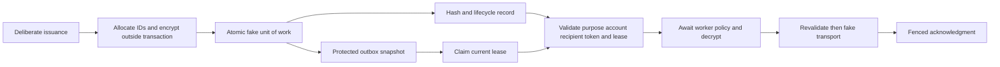

# Phase 1I-D D-3 — authentication delivery security scope

Prepared 2026-10-25 (Asia/Dhaka). **REVIEW DRAFT — DESIGN READY, AWAITING OWNER APPROVAL.** Documentation only. D-3 implementation, production ADR-03 approval and all database/cloud operations remain unauthorized. All legal decisions L-01–L-14 remain **BLOCKED**.

## 1. Authority, baseline and status

This document refines the owner's supplied “D-3: Authentication Token & Notification Secret Protection” proposal. It consolidates its requested scope, threat model, contracts, lifecycle matrix, rollout, test plan and approval register into one document. It supplements, without overwriting, [D-1 acceptance review §5](PHASE_1I_D_D1_ACCEPTANCE_REVIEW.md), [architecture review](PHASE_1I_D_ARCHITECTURE_REVIEW.md) and [approval decision packet](PHASE_1I_D_ARCHITECTURE_APPROVAL_DECISION_PACKET.md).

The older packet labels ADR-03 BLOCKED and the review labels it PROPOSED: these describe an unresolved implementation gate, not contradictory grants of authority. Current normalized decision: **ADR-03 proposed design; implementation requires explicit approval**. This document supplies the previously missing lifecycle analysis; it records no new approval.

Repository inspected: development, HEAD 154cf93. Seven existing D-2 prototype files are modified on entry; preserve their exact bytes. D-2 reported 155 passing cases under both loaders; those results are historical for this design session. Formal D-2 owner acceptance is not inferred. The proposed auth-delivery directory and all nine proposed files are absent. Installed local tools: Node v26.9.0, TypeScript 5.9.3, Vitest 5.0.3. No installation is needed.

## 2. Reconfirmed source evidence and severity

Paths and line references refer to the inspected baseline, not a live database or deployed environment.

| ID / severity | Actual evidence | Impact and proposed response |
|---|---|---|
| D3-F01 High | `server/src/services/auth.service.ts:55–70,183–203` generates 48 random bytes, stores SHA-256 and constructs raw verification/reset URLs. `notification.service.ts:287–315` forwards those URL parameters; `outbox.service.ts:106–117` stores params verbatim in JSON. | An unauthorized reader of stored messages/backups can obtain reusable credentials. Encrypt complete auth-delivery payload under its own purpose and independently controlled key. This does not prove an intrusion occurred. |
| D3-F02 High | `auth.service.ts:59,66,90,191–203`: token creation, account creation, supersession deletion and enqueue are separate awaited writes. Notification functions accept dbClient, but issuance does not supply a transaction client. | Partial failure can leave an account/token without a durable message or remove a prior credential before replacement commits. Make deliberate issuance, supersession and protected enqueue one atomic unit, with encryption outside the transaction. |
| D3-F03 High | `outbox.service.ts:70–92,138–160` directly sends when storage is unavailable or a nontransactional enqueue fails. | Secret notifications can escape the durable protected workflow. Secret jobs must fail closed; ordinary-message fallback needs a separate classification. |
| D3-F04 High | `auth.service.ts:152–169,206–220` reads usedAt/expiry first, then transactionally updates token by id alone. | Two requests can pass the initial read; no conditional consumption predicate inside the transaction is demonstrated. Require a single winner plus account/password/session side effects in the same transaction. Static finding, not a live race reproduction. |
| D3-F05 High | `outbox.service.ts:253–264,328–341` renders/sends stored parameters and redrives FAILED rows without credential validity/linkage checks. | Old messages can be sent after expiry, consumption or supersession. Validate credential/account/message/lease before decrypt and immediately before dispatch; never mint a credential on retry. |
| D3-F06 Design blocker | `server/prisma/schema.prisma:88–115,442–462` has no durable token-message relationship, revocation field or protected-routing variant; NotificationOutbox.recipient is required plaintext text. | Encrypting recipient inside JSON alone does not remove its cleartext row copy. Production routing/linkage and supersession representation need explicit schema/design review. No claim that existing JSON alone satisfies the design. |
| D3-F07 Existing protection | `outbox.service.ts:221–248,266–310` claims by status/version, fences acknowledgment by ownership and expiry, advances versions, handles suppression truthfully and bounds retries. `notification.service.ts:60–86` requires transport acceptance. | Preserve these controls. DELIVERED means transport submission, not inbox receipt. Lease fencing cannot retract a send already accepted by SMTP. |
| D3-F08 Existing protection / limits | `server/src/lib/logger.ts:9–14` drops raw exception messages/stacks. `middleware/oauth-state.ts:18–83` uses random state, signed browser binding and a durable unique consume marker; `routes/outbox-worker.routes.ts:10–40` rejects browser credentials/origins. | Preserve sanitization, worker admission and OAuth behavior. The general logger still accepts caller metadata; no blanket claim that every application log is secret-free. No rotation of JWT/OAuth credentials in D-3. |

Existing token lifetimes are application constants of 24 hours and one hour; they are not legal retention periods. Legacy verification accepts plaintext token rows (`auth.service.ts:153–157`); that is separate from outbox V1 compatibility and needs its own future retirement decision. No database inventory was performed.

## 3. ADR-03 decision analysis

**Recommended for synthetic approval:** a separate versioned AES-256-GCM envelope protecting all auth-delivery content, stable token/message identity, hash-only credential verification records, and a trusted worker gate. Use ephemeral independent fake KEKs and per-message fresh DEKs. No passenger prototype imports, JWT/OAuth secrets or production providers.

| Alternative | Benefits | Trade-offs / disposition |
|---|---|---|
| Protected complete payload | Retries retain one credential; recipient confidentiality; explicit domain separation | Requires key availability, lifecycle checks, version-aware readers and protected routing. Recommended synthetic model. |
| Reference-only message | No credential in queue | A one-way token hash cannot recover the original credential. Needs another protected secret store or a different issuance protocol; reference alone is insufficient. |
| Mint credential on every retry | Less initial secret persistence | Creates multiple credentials and difficult crash/consumption semantics; rejected for this proposal. |
| Encrypt only token while recipient/URL stays clear | Smaller change | Fails recipient confidentiality or leaks a token-bearing URL; rejected as satisfying the stated objective. |
| Database-volume encryption only | Useful storage layer protection | Does not protect against authorized query/export or compromised support access; complementary only. |

Owners: authentication lead (issuance/redemption), reliability lead (outbox), security architect (crypto/authorization), infrastructure lead (real key lifecycle), privacy owner/counsel (retention). Synthetic design is ready for their bounded approval; production selection remains gated.

## 4. Threat model and trusted data flow

Assets: usable credentials, recipient identity, account binding, token hash/state, protected message, worker lease, key material, audit reasons. Attackers: unauthorized DB/backup/export/support readers; row-swapping writers; stale/duplicate workers; malformed input producers; compromised transport dependencies. A process with authorized decryption or control of the trusted account/token store remains a residual trust risk.

Proposed flow:



Trust boundaries: request versus issuer; ciphertext store versus key provider; stored metadata versus trusted context; worker admission versus decrypt authority; transport submission versus durable acknowledgment. Never take a key endpoint, frontend URL, recipient override, worker grant or expected context from ciphertext as authority.

Threat/control pairs: read disclosure → envelope/key separation; row or recipient substitution → canonical AAD plus account/token checks; stale credential → state/expiry checks; duplicate issuance → logical idempotency; duplicate redemption → atomic conditional consume; stale worker → monotonically versioned lease CAS; log disclosure → reason allowlist; backup rollback → restore quarantine and lifecycle reconciliation. Encryption does not prevent rollback of a valid envelope or malicious modification of the entire trusted identity store.

## 5. Exact proposed synthetic contract

These interfaces and bounds are proposed test contracts only, not executable code or production formats.

### 5.1 Input and persistent shapes

- Purpose: literal EMAIL_VERIFY or PASSWORD_RESET. Namespace/domain: `FlyWithSafe` / `flywithsafe.auth-delivery.v2`.
- Context: environmentId, messageId, tokenRecordId, userId, purpose. IDs match ASCII `[A-Za-z0-9][A-Za-z0-9_-]{0,63}` and must be allocated by the fake issuer. Expected context comes from trusted fake state, not copied from envelope input.
- Confidential payload allowlist: templateVersion (literal 2), purpose, messageId, tokenRecordId, userId, recipient, issuedAt, expiresAt, token. No name, URL, HTML, subject override, password or arbitrary params. All fields required, no extras/accessors/prototype surprises.
- Synthetic recipients only: lowercase ASCII local-part matching `[a-z0-9][a-z0-9._-]{0,63}` followed by `@example.invalid`; max 80 bytes. Preserve exact bytes after issuer validation; do not apply ad-hoc canonicalization on read. Production email normalization/identity change semantics remain separate decisions.
- Synthetic token only: `SYNTHETIC_` plus canonical unpadded base64url of 48 fresh random bytes. This deliberately cannot be a real application credential. Hash SHA-256 over exact UTF-8 token; no secret/token in idempotency keys.
- Timestamps: exact round-tripping UTC `YYYY-MM-DDTHH:mm:ss.sssZ`, actual calendar dates, issuedAt < expiresAt, reject invalid/nonfinite clock values. Fixture lifetimes are controlled test settings, not proposed legal periods or automatic deletion schedules.
- Payload serialization: UTF-8 JSON object with fields in the order listed above; max 4096 bytes; strict UTF-8 on decode. Read validation does not accept date rollover, coercion, duplicates or unknown fields. Prefer object-only API inputs and reject noncanonical serialized envelope strings rather than ambiguous duplicate-key JSON.
- Envelope allowlist: envelopeVersion=2, templateVersion=2, domain (literal above), algorithm=AES-256-GCM, aadVersion=1, keyProvider=synthetic-auth-delivery, keyRef=synthetic-auth-delivery-kek, keyVersion=v1 or v2, wrapAlgorithm=SYNTHETIC-A256GCM, wrappedDek, nonce, ciphertext, tag. No plaintext recipient/context/token in envelope. Max serialized envelope 16384 bytes. All fields required.
- Generate fresh 32-byte DEK and fresh 12-byte nonce for each encryption. Tag exactly 16 bytes; wrapped fake DEK is exactly 60 bytes (12-byte wrapping nonce, 32-byte encrypted key, 16-byte tag). Bytes use canonical unpadded base64url with decode/re-encode equality and strict decoded bounds. Ciphertext must be nonempty and <=4096 bytes.
- Fake persistent token row: id, userId, accountRevision, purpose, tokenHash, issuedAtMs, expiresAtMs, consumedAtMs|null, revokedAtMs|null, messageId. Fake persistent outbox row: id, tokenRecordId, opaque userId, purpose, envelope, status, version, attempts, maxAttempts, nextAttemptAtMs, leaseOwnerId|null, leaseExpiresAtMs|null, reasonCode|null. **No cleartext recipient or body** in either snapshot; recipient/account comparison uses the separate trusted fake account directory. Account identity changes increment accountRevision, so changing an email away and back cannot silently revive an old job. Production User already contains an email: this proposal minimizes queue copies, not all account PII.
- Persistent state exports contain copies of token/message/account state only where tests explicitly need them; no keys, raw credentials, decrypted payload, transport body or secret diagnostic history. An outbox-only export must never include the account directory. Transport history stores message ID/outcome counters only.

### 5.2 Canonical authenticated metadata

AAD = UTF-8 JSON array, fixed order:

`["FlyWithSafe","flywithsafe.auth-delivery.v2","2","1","2",environmentId,messageId,tokenRecordId,userId,purpose,keyProvider,keyRef,keyVersion,wrapAlgorithm]`

The three version strings mean envelopeVersion, aadVersion and templateVersion. Validate all literals/IDs before serializing. No locale sorting, Unicode normalization, recipient, token, mutable attempt/lease/version/status or scheduling time in AAD. The recipient is authenticated inside the encrypted payload and compared with current trusted account state, original token binding and payload IDs before dispatch. Exact mismatch invalidates, never retargets, the message.

Fake wrapping must also authenticate this canonical context and fixed wrapping domain so moving a wrapped key cannot cross purposes/messages. Metadata is allowlisted before provider calls and never selects a network endpoint. Store fixed expected-AAD byte vectors, swapped-message/purpose/user/environment cases and cross-domain passenger-envelope rejection tests. No edits or format changes to D-1/D-2.

The fake provider chooses its active allowlisted key version once per create operation and uses that same version in wrapping AAD and returned metadata. Decryption uses the strictly validated stored version; concurrent fake rotation cannot mix metadata and wrapping versions.

### 5.3 APIs, authorization, errors and operation bounds

| Module | Proposed public contract |
|---|---|
| contracts | Readonly purpose/context/payload/envelope types; token/outbox snapshots; WorkerGrant; OperationControl; Limits; finite reason-code union and sanitized AuthDeliveryError (code, opaque correlationId only). |
| codec | `protect(payload: unknown, context: unknown): Promise<AuthDeliveryEnvelopeV2>`; `unprotect(envelope: unknown, context: unknown, grant: unknown): Promise<SyntheticAuthDeliveryPayloadV2>`; canonical AAD/validation helpers. No plaintext partial result before successful GCM final and strict payload validation. |
| fake key provider | `createAndWrapDataKey(context, control?): Promise<WrappedDataKey>`; `unwrapDataKey(metadata, context, control?): Promise<Uint8Array>`; fake versions, denial/transient/integrity/delayed outcomes; dispose clears owned buffers best effort. Keys scoped only to auth-delivery, no shared passenger key. |
| worker policy | Internally supplied `assertAllowed(grant, context, control): Promise<void>`; exact frozen grant fields: workerId, environmentId, messageId, tokenRecordId, purpose, role=AUTH_DELIVERY_WORKER, expiresAtMs. Resolve undefined only. Account/message/token/lease checks are additional required fake-outbox admission checks. A caller-constructed grant is synthetic evidence only, not production identity. |
| fake outbox | `issue(request): Promise<IssuanceReceipt>`; `claim(messageId,workerId): Lease|null`; `dispatch(lease,grant): Promise<DispatchResult>`; `consume(token,purpose,effect): boolean`; `revoke(tokenRecordId): boolean`; `redrive(messageId,expectedVersion): boolean`; `snapshot(): PersistentSnapshot`. Constructor takes key/codec/policy/transport/controlled clocks and fault scheduler. Inputs/results are strictly validated snapshots; receipts expose IDs only. |
| fake transport | `submit(message): Promise<submitted|suppressed|transientFailure|terminalFailure|ambiguous>`; ephemeral message contains only needed synthetic recipient/token/purpose. Fake call acceptance recorded without body/recipient. No nodemailer/HTTP/socket/real URL. |

IssuanceRequest is an exact allowlist of issuanceId, environmentId, userId, purpose, expectedAccountRevision, expectedPurposeRevision, expiresAtMs and optional createAccount (synthetic recipient only). Existing accounts use the trusted directory recipient, never a request override. The issuer allocates message/token IDs and issuedAt, generates the synthetic credential, and returns IssuanceReceipt {issuanceId,messageId,tokenRecordId}. Lease contains messageId, workerId, version and expiresAtMs. DispatchResult contains messageId, status and reasonCode only. Synthetic account records contain id, recipient, identity revision, emailVerified and opaque password/session effect counters. The fake persisted unit also includes per-user/purpose revisions and an issuance registry of scoped issuanceId, canonical request digest and original receipt, permitting modeled recovery/replay. No raw credential is retained in that registry. Fake expiry fixtures may use 60 seconds; this is only controlled test input.

Reason-code allowlist: INVALID_INPUT, INVALID_ENVELOPE, UNSUPPORTED_VERSION, FORBIDDEN, KEY_UNAVAILABLE, INTEGRITY_FAILURE, ISSUANCE_CONFLICT, TOKEN_INVALID, TOKEN_EXPIRED, TOKEN_CONSUMED, TOKEN_REVOKED, RECIPIENT_CHANGED, LEASE_LOST, DELIVERY_DISABLED, TRANSPORT_TRANSIENT, TRANSPORT_TERMINAL, TRANSPORT_AMBIGUOUS. No raw causes/messages/stack/body/headers in persisted reasons or fake diagnostic outputs. No key/plaintext logging or cross-request plaintext DEK cache.

Reuse D-2 design principles independently, without importing or editing its files: await policy exactly once; snapshots precede awaits; positive safe-integer auth/provider/total budgets 250/250/1500 ms by default, total <=5000 ms; 25/50 ms sequential backoff for settled classified fake key unavailability, at most three attempts. No retry after unresolved timeout. Advisory abort, late-result observers and best-effort DEK clearing; expiry/lease checks after waits. Controls are test settings, not real-provider SLOs or cancellation proof. Fake transport is awaited to a controlled settlement; never race an in-flight send against a timeout and then retry it. An explicitly ambiguous settled result may be scheduled for bounded retry with documented duplication risk.

## 6. Issuance, consumption and failure matrix

Synthetic default: registration-like account creation is included in the fake atomic unit; existing-account resend/reset changes no account identity. Encryption/key work is outside the atomic commit. After awaits, recheck account version, expiry and logical issuance preconditions. Stage supersession plus token/message/account effects, validate all constraints, then synchronously publish one complete cloned state; fault injection before publish leaves original state unchanged. The fake commits have no await boundary. This is an in-memory model, not a PostgreSQL transaction proof.

Logical issuance key scopes environment, user and purpose; replay of the same issuanceId with the same canonical request returns the original receipt. Different request under that key conflicts. Do not hash randomized ciphertext for replay equality. A deliberate new issuance supersedes older unconsumed credentials of that user/purpose atomically; parallel deliberate issuances use an expected account/purpose revision so only one contender commits. Retry never calls issue. Actual durable uniqueness, account revisions and supersession representation remain production schema decisions.

Consumption checks hash/purpose/user/expiry/revocation/consumption on current state and commits the synthetic account/password/session effect together with consumption. Stage the effect on a clone; thrown effect rolls back; duplicate consume has one winner. Fake effect values are opaque synthetic markers, never passwords. No arbitrary side-effect callback or async effect inside commit. Real reset hashing would occur before a short DB transaction with conditional consume and side effects atomically inside it.

| Event / crash point | Required proposed result |
|---|---|
| Key denial/encryption failure before commit | Neither credential nor message committed; no send/fallback. |
| Failure staging token, supersession, message or account | Roll back the entire staged fake unit; old credential remains valid if replacement fails. |
| Commit then crash before response | Reopen from fake persisted snapshot using same fake provider instance; receipt retry finds original issuance, no second token. This is modeled persistence only. |
| Same key different logical payload | ISSUANCE_CONFLICT; no overwrite or extra token. |
| Claim collision / stale discovered version | One current lease; loser cannot decrypt/send/ack. |
| Expiry, consumed, revoked, missing token or changed recipient before dispatch | FAILED with allowlisted reason, no send; redrive rejects. Never renew expiry. |
| Grant/lease expires during decrypt/provider delay | Discard key/output, no send, no stale acknowledgment. Current claimant/recovery controls later state. |
| Credential changes after final pre-send check | A sent link may already be unusable; redemption rejects it. No atomicity with SMTP claimed. |
| Transport disabled | FAILED / DELIVERY_DISABLED, no submission; redrive only after explicit enable plus current valid credential/lease. |
| Settled transient transport failure | Increment attempts; bounded exponential 1/2/4… minutes capped at 30 in controlled time, maxAttempts default 5; same envelope/token/message. Stop when invalid/expired or maximum reached. |
| Integrity/authorization/malformed payload/terminal transport failure | Terminal failure with sanitized reason, no transient loop. |
| Transport accepted and acknowledgment succeeds | DELIVERED means submitted only. No token consumed by sending. |
| Accepted then crash/lost ack/lease expires | Recover after lease expiry; duplicate submission possible. Same credential remains; stale worker cannot overwrite current state. |
| Redrive of FAILED | Expected version/current credential/account validity required; advance version monotonically, reset retry counter only for eligible reasons. Reject expiry/revocation/consumption/integrity/forbidden records. Key-unavailable may be retried after recovery if all admission checks pass. No new credential. |
| Backward wall clock or stale snapshot restore | No revision reuse or expired-material resurrection in fake model; detect clock regression, fence workflow. Real restore requires quarantine, current trusted lifecycle reconciliation and separate recovery proof. |

Lease model: status PENDING → PROCESSING, increment version strictly even at equal clock ticks, leaseExpiresAtMs set from injected clock; every ack requires same row/version/worker and unexpired lease. Recovery advances version. Redrive also advances it. No transaction remains open across fake provider/transport waits. Lease ownership is rechecked immediately before submission, but a lease can expire during an already started send.

## 7. Legacy transition and rollback — production design only

Existing legacy outbox payload is `{template,params}` without a version. Call it V1 only for migration classification; do not misread a passenger-envelope version as an auth-delivery version.

| Input / reader | Synthetic compatibility outcome |
|---|---|
| Unversioned token-bearing V1 job | LEGACY_REQUIRES_REVIEW classification; quarantine/no send. A production inventory/owner disposition is separately required. |
| Explicit allowed V2 | Strict parse, auth/context/lifecycle checks, decrypt, dispatch. |
| Corrupt V2, unknown version, mixed V1/V2 fields | Fail closed; never try a plaintext or alternate reader as fallback. |
| V2 with temporarily unavailable historical key | Bounded key failure; retain protected job for controlled eligible redrive, no plaintext export. |
| V2 writes disabled | Readers retain V2 capability; no new secret V1 writes as emergency fallback. Deliberate issuance fails closed until approved service recovery. |
| Old V1-only rollback binary after V2 writes | Unsafe; do not activate. Roll back to a compatible V2 reader with writer disabled and intact lease fencing. |

Future rollout: private approved inventory of token/outbox formats and backups; approve routing/linkage schema; deploy compatible reader with V2 writes disabled; verify staging authorization/key/expiry/fencing; enable protected writes gradually; stop writers on failure while keeping reader/key recovery available. Re-encrypting historical raw secrets or deleting expired rows requires separately approved data scope; backups remain an exposure until an approved lifecycle handles them. No automatic purge, key destruction, rewrite, token reissue or retention schedule is authorized. Credential expiry does not grant deletion authority. Key rewrap must not renew token lifetime; retained fake v1 envelopes work until explicitly retired, then fail closed.

## 8. Exact future nine-file implementation request

All paths below are new files under `server/test/prototypes/auth-delivery/`, confirmed absent during this review. **Creation is not authorized yet.** No tenth file, dependency, shared config, application import or edits to existing D-1/D-2 files.

| File | Exact responsibility |
|---|---|
| contracts.ts | Readonly contracts, fixed limits, errors, state/transport/grant interfaces from §5; no app imports. |
| auth-delivery-codec.ts | Strict payload/envelope/AAD rules; bounded awaited policy/provider orchestration; no transport/persistence imports. |
| synthetic-key-provider.ts | Independent ephemeral wrapping KEKs, v1/v2, fresh DEKs and controlled provider faults; no SDK. |
| fake-outbox.ts | Fake atomic unit, identity/hash/lifecycle state, frozen snapshots, revision/lease CAS, retry/redrive and failure scheduler. |
| fake-transport.ts | Deterministic accepted/suppressed/transient/terminal/ambiguous outcomes; no external dispatch or persisted bodies. |
| fixtures.ts | Synthetic records/clocks, network/subprocess guards and idempotent activation before runtime imports; no tested runtime import during setup. |
| auth-delivery.test.ts | T01–T18 and lifecycle/deadline/race variants. |
| boundaries.test.ts | T19–T20, import AST/VM, guard ordering, exact file inventory and unchanged passenger-byte checks. |
| vitest.config.ts | Config-only CommonJS with erased ViteUserConfig type; root=__dirname; envDir=false; exact two includes; setupFiles=['./fixtures.ts']; globalSetup=[]; node/threads, maxWorkers=1, fileParallelism=false, isolate=true, watch=false, cache=false, coverage disabled; bounded hooks/tests. |

Dependencies allowed: installed TypeScript/Vitest and Node built-ins crypto, util for strict UTF-8, and test-harness fs/path/vm/module plus net/tls/http/https/dns/dgram/child_process only to install/block/verify dispatch guards. No production authentication/outbox/OAuth/Prisma/env/dotenv, passenger prototype modules, pg, nodemailer, supplier/payment client or cloud SDK imports. Runtime AST allowlist uses only local contracts/codec/fake modules and crypto/util. Guards block fetch/WebSocket/TCP/TLS/HTTP(S)/DNS/UDP/subprocess before dispatch; no test reads inherited secrets. These guards are harness controls, not an OS sandbox.

## 9. Proposed test matrix — NOT RUN / NOT IMPLEMENTED

| ID | Required executable evidence after authorization |
|---|---|
| T01 | Both purposes round-trip; strict sizes/dates/base64/shape; independent fresh key and nonce; canonical AAD vector. |
| T02 | Serialized outbox/token snapshots lack token, recipient, URL, name and plaintext body; only tokenHash in verification state. No plaintext fallback on any error. |
| T03 | Flip/truncate/append ciphertext/tag/nonce/wrapped bytes; no partial plaintext returned. |
| T04 | Wrong environment/message/token/user/purpose/version/key metadata and cross-passenger domain reject. |
| T05 | Authenticated recipient versus changed current account/identity mismatch rejects; no caller override or retarget. |
| T06 | Denied/unavailable/retired/malformed keys; bounded sequential settled retries; no timeout retry; late keys cleared; advisory versus cooperative abort. |
| T07 | Token/message/account/supersession commit together; same logical replay retains receipt/envelope; payload conflict and concurrent issuance have one modeled winner. |
| T08 | Inject failure at every staging point and before publish; neither new record nor supersession/account side effect survives. |
| T09 | Commit/crash/reload fake snapshot with shared fake provider; stable message/token/issuance IDs, no extra token. |
| T10 | Transient transport retries reuse original protected bytes/credential; delays count against validity; policy awaited and no mint on retry. |
| T11 | Missing/expired/consumed/revoked credentials and expired grants fail before send; expiry during auth/backoff/provider/pre-send; exact-deadline ties and delayed timer callback. |
| T12 | Two deterministic redemption contenders: one consume/effect; failure rolls back both; wrong-purpose and stale generation rejected. |
| T13 | Concurrent claims, lease expiry/recovery, stale ack, equal/backward ticks, lost lease during decrypt and during send; monotonic fencing. |
| T14 | Disabled/suppressed/terminal/unknown outcomes never DELIVERED; only accepted submission with valid ack changes status. Max attempts remain bounded. |
| T15 | Redrive does not revive consumed/expired/revoked/changed recipient; eligible transient recovery preserves token and increments version. |
| T16 | Accepted send then lost ack/crash leads to possible duplicate after recovery; never claim exactly once. Redemption still has one winner. |
| T17 | Captured console/errors/reasons/transport-history/snapshots exclude credential/key/recipient sentinels; observe late rejections and clear owned timers/listeners/buffers. |
| T18 | Every §7 reader outcome: V1 quarantine, valid V2, corrupt/mixed/unknown reject, writer-off reader-on, historical-key retirement; no insecure rollback fallback. |
| T19 | AST/VM/import boundaries; no env/DB/app/real OAuth/provider access; guard activation before runtime; both config loaders warning-free; no skipped tests. |
| T20 | Capture all nine passenger prototype hashes before new work and prove identical afterward; separately execute its two-loader 155-case regression and standalone compiler command. |

Use deferred promises, injected clocks and deterministic interleavings; no real sleeps or requests. Fake restart, unit-of-work and concurrency tests are models, not proof of PostgreSQL durability, multi-process behavior or real SMTP delivery. All new test counts remain **UNEXECUTED**, not PASS.

Proposed commands from server after exact implementation approval (direct installed executables, no installs/build/start/postinstall):

```powershell
& .\node_modules\.bin\tsc.cmd --noEmit --incremental false --strict --target ES2022 --module NodeNext --moduleResolution NodeNext --esModuleInterop --skipLibCheck --types node,vitest/globals test/prototypes/auth-delivery/contracts.ts test/prototypes/auth-delivery/auth-delivery-codec.ts test/prototypes/auth-delivery/synthetic-key-provider.ts test/prototypes/auth-delivery/fake-outbox.ts test/prototypes/auth-delivery/fake-transport.ts test/prototypes/auth-delivery/fixtures.ts test/prototypes/auth-delivery/auth-delivery.test.ts test/prototypes/auth-delivery/boundaries.test.ts test/prototypes/auth-delivery/vitest.config.ts
& .\node_modules\.bin\vitest.cmd run --config test/prototypes/auth-delivery/vitest.config.ts
& .\node_modules\.bin\vitest.cmd run --config test/prototypes/auth-delivery/vitest.config.ts --configLoader native
& .\node_modules\.bin\tsc.cmd --noEmit --incremental false --strict --target ES2022 --module NodeNext --moduleResolution NodeNext --esModuleInterop --skipLibCheck --types node,vitest/globals test/prototypes/passport-crypto/contracts.ts test/prototypes/passport-crypto/envelope-codec.ts test/prototypes/passport-crypto/passenger-document-crypto.ts test/prototypes/passport-crypto/synthetic-kms-adapter.ts test/prototypes/passport-crypto/fixtures.ts test/prototypes/passport-crypto/passport-crypto.test.ts test/prototypes/passport-crypto/boundaries.test.ts test/prototypes/passport-crypto/vitest.config.ts
& .\node_modules\.bin\vitest.cmd run --config test/prototypes/passport-crypto/vitest.config.ts
& .\node_modules\.bin\vitest.cmd run --config test/prototypes/passport-crypto/vitest.config.ts --configLoader native
git diff --check
```

No production test config or database integration runner is included. Existing application suites such as notification-delivery.test.ts, notification-outbox.test.ts, outbox-lease.test.ts, outbox-worker.test.ts, oauth-state.test.ts, oauth.test.ts, request-origin.test.ts and booking regressions are later production-integration gates, not authority to import application services into this prototype. Add dedicated authentication consumption tests then; current API validation coverage is not proof of atomic consumption.

Rollback proposal: preserve implementation evidence, then separately authorize removal of only newly created prototype artifacts after checking for later edits. Never reset/clean Git or restore unrelated files. No persistent data or schema exists to roll back. Acceptance requires exact nine-file scope, unchanged existing-file hashes, T01–T20 actual passing evidence, both loaders and strict compiler, zero skips/secret output and formal owner acceptance.

## 10. Manual approval and dependency register

| Gate / urgency | Responsible owner | Status / required evidence |
|---|---|---|
| G01 Before synthetic code | Product owner + security/auth/reliability reviewers | REQUIRES APPROVAL: exact nine files, contracts, defaults, model choices, tests, rollback and exclusions above. |
| G02 Before relying on D-2 acceptance | Product owner | REQUIRES APPROVAL: separately accept D-2; historical passing tests are not acceptance. Does not authorize application integration. |
| G03 Before production design freeze | Auth lead | BLOCKED: decide account-creation atomicity, supersession representation, conditional consumption and account/email generation checks. Synthetic choices in §6 are proposed only. |
| G04 Before schema integration | Backend/database owner | BLOCKED: recipient confidentiality with current required column; token/message FK or equivalent durable linkage; uniqueness/revisions/revocation. Review additive migration if necessary; no schema sufficiency promise. |
| G05 Before real encryption | Infrastructure + security | BLOCKED: provider/hosting/region/identity/IAM, purpose-specific KEK, limits/cost/monitoring, rotation/retained-key/restore recovery. No real provider selected here. |
| G06 Before live worker rollout | Reliability + auth + security | BLOCKED: trusted decrypt identity distinct from scheduler admission; transport timeout/ambiguity policy; lease duration and pre-send checks; reason allowlist and no secret fallback. |
| G07 Before legacy data action | Data owner + privacy/security | BLOCKED: private format inventory, V1 disposition, version-aware reader, rollback binary, backups and key recovery. Separate target-specific approval for writes/backfills/deletion. |
| G08 Before actual concurrency claims | Owner + database/reliability | BLOCKED: separately approved disposable PostgreSQL target and exact synthetic cleanup; real atomicity/concurrent issuance/consume/lease/restart proof. Prior Phase 1H tests do not cover proposed D-3 behavior. |
| G09 Before SMTP/browser claims | Owner + QA/auth | BLOCKED: authorized staging delivery and verification/reset/OAuth/browser tests; URL origin allowlist and token-safe access logging/referrer controls. No provider requests in synthetic scope. |
| G10 All affected real-data/retention actions | Privacy owner + qualified Bangladesh counsel | BLOCKED: L-01–L-14 authoritative verification and counsel review. No invented statutory periods, cross-border permission, deletion authority or compliance approval. |

Production candidate files, for a later separately approved task only: auth.service.ts, notification.service.ts, outbox.service.ts, a proposed server/src/security/auth-delivery.ts and relevant tests. Existing worker route, OAuth middleware, logger, Prisma schema, frontend verify/reset pages and configuration require impact review; they are not implicitly writable. No D-4/D-5/Phase 1I-E/Phase 2 work is authorized.

## 11. Evidence, limitations and approval request

Current session: source and proposal review, exact new-path absence, installed tool version queries, catalog-free static checks and Git preservation checks only. No prototype or application tests ran, because no code was implemented. No database, email, OAuth, KMS, cloud, credential, supplier, payment, deployment, commit or push operation occurred.

Preservation baseline for all 635 tracked files, including the seven dirty D-2 files: SHA-256 over sorted JSON `[path, sha256(bytes)]` entries is `0f67b93f83c5d10aa2fec1f744a8240b4e7bb7cd6a82dad19a5534ee7213cc55`. Final verification must match it. This new proposal is the only added artifact. Diff validation and approval-scope checks are documentation evidence, not security runtime verification.

Actual final static results: tracked-file digest matched for all 635 files; all nine proposed paths absent; exactly 20 T01–T20 rows present; all 14 L-01–L-14 register rows still BLOCKED; `git diff --check` passed for existing changes. New-document whitespace, local reference and scope checks also passed. No test case is newly marked PASS. **VERDICT: PASS** for documentation preparation and preservation checks only.

Security references checked 2026-10-25: [OWASP Forgot Password](https://cheatsheetseries.owasp.org/cheatsheets/Forgot_Password_Cheat_Sheet.html) supports secure random, securely stored, expiring single-use credentials and trusted URL construction. [Node crypto](https://nodejs.org/api/crypto.html#deciphersetauthtagbuffer-encoding) documents tag verification at finalization and discarding failed plaintext. These sources inform engineering choices; they do not settle legal duties, prove repository behavior, or certify the installed runtime/provider. Legal text was not researched or altered in this session.

Residual limits: authorized process/transport compromise can expose plaintext; JavaScript/native/string copies cannot be reliably erased; harness guards are not production isolation; fake keys/transactions do not prove KMS/PostgreSQL; lifecycle checks cannot atomically fence SMTP and redemption; duplicates remain possible; encrypted backup retention and restored lifecycle state remain unresolved.

**DESIGN READY — AWAITING OWNER APPROVAL**, for offline synthetic implementation only. Production ADR-03, schema, legacy handling, IAM and all legal gates remain unresolved.

Exact approval request: “Authorize creation of only the nine files listed in §8 for the synthetic contracts and fake behavior in §§5–7, using existing dependencies and no real services. Authorize T01–T20, both standalone loaders and explicit no-emit commands in §9. Preserve every existing file including all D-1/D-2 modifications. No application/schema/database/key/cloud/SMTP/OAuth/supplier/payment/deployment or legal changes. Stop after synthetic verification and request owner acceptance.”

The attached proposal explicitly states implementation authorization is not granted and requires stopping after design. No implementation begins under this document.
