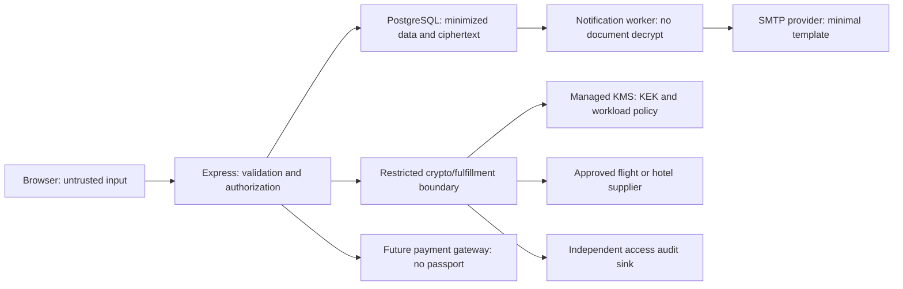

# Phase 1I-D — Passport encryption, key management and retention design

Date: 2026-10-23. Status: proposed architecture; no implementation authorization implied.

## 1. Executive decision and evidence boundary

Recommend application-layer AES-256-GCM envelope encryption for a passenger's travel-document bundle, with a fresh data-encryption key (DEK) per write and a separately managed key-encryption key (KEK). Ordinary booking reads must not decrypt. Add purpose-specific authorization before any exceptional retrieval. Retain the F07 DTO boundary and F06 pagination unchanged. Minimize collection before introducing cryptography.

This is a documentation-only deliverable. No application code, schema, migration, environment file, record, key or infrastructure changed. No database connection, integration test, SMTP, supplier or payment operation was performed. Public documentation research is distinct from provider API execution. Branch inspected: development; existing working-tree changes preserved. The owner reports seven applied migrations and 16/16 prior PostgreSQL tests. The Phase 1I-C report records 334 isolated passes and 16 skipped integration cases. Neither result was rerun here; F07/F06 live validation remains open.

Policy record: planning=deep; context_depth=dependency; verification_depth=impact; delegation=none. Allowed write scope: this report only. Completion evidence: source inspection, documentation coverage/path checks and repository diff checks; not proof of cryptographic or operational correctness.

Reviewed the three Phase 1I-A/B/C reports and current source. The older audit describes pre-fix behavior; current DTOs override those historical exposure findings. Skills applied: Gravitas, Caveman for chat brevity, and security-best-practices with Express/Next.js/React guidance. All recommendations below remain proposals unless explicitly labeled confirmed.

## 2. Confirmed source inventory

Evidence anchors (repository-relative paths and inspected line numbers):

| ID | Source | Confirmed behavior |
|---|---|---|
| E1 | server/prisma/schema.prisma:374,401,419 | Booking stores customer contact, JSON and notes; BookingPassenger stores name, gender, DOB, passport number/expiry and nationality as ordinary strings. History stores reason/actor. Passenger deletion cascades with Booking. No issuing-country field in passenger model. |
| E2 | server/prisma/schema.prisma:217,243,268,293,318 | Four inquiry models store contact/itinerary/free-text notes; visa inquiry includes nationality/purpose. ContactMessage stores message/subject. No travel-document attachment model in inspected schema. VisaInfo.documents at line 198 describes requirements, not uploaded passports. |
| E3 | server/src/services/booking.service.ts:15,36,163,248 | Public creation and staff conversion assign sensitive passenger values directly. Creation's idempotency payload includes passenger input. No encryption in these paths. |
| E4 | server/src/utils/booking-dto.ts:6,27; server/src/controllers/booking.controller.ts:12,38,52,68,79 | Allowlisted guest/customer/admin output; raw passport/DOB/expiry omitted; admin gets passport suffix. Guest still gets basic passenger names/nationality. Success responses set no-store. |
| E5 | server/src/services/booking.service.ts:491 | Admin list reads plaintext passport internally to derive mask. Encryption must remove that need, not decrypt entire lists. |
| E6 | server/src/validators/booking.schemas.ts:3,11,21 | Calendar validation, bounded flat JSON, passenger ceiling 50. Free text can still contain misfiled sensitive values; allowlisting is not DLP. |
| E7 | server/src/routes/account.routes.ts:14; server/src/services/account.service.ts:115; server/src/routes/admin.routes.ts:26; server/src/middleware/auth.middleware.ts:28,35,56 | Authenticated account ownership; session validation; ADMIN/STAFF gate. No separate document-reveal capability established by these controls. |
| E8 | server/src/routes/bookings.routes.ts:17,25,31; server/src/services/booking.service.ts:301 | Optional authentication for creation; reference/email lookup, including GET email query. Email matching is not mailbox-control proof. |
| E9 | server/src/services/notification.service.ts:287,302,320,336; server/src/services/outbox.service.ts:106 | Outbox persists template params, recipient and subject. Verification/reset params include token-bearing URLs. Booking status accepts reason. No passport-specific notification parameter is required. |
| E10 | server/src/services/booking.service.ts:449 | Staff status reason is passed to customer status notification. DTO removal of internal reasons does not protect this separate email path. No real leaked value observed. |
| E11 | server/src/lib/logger.ts:9,15 | Error serializer omits arbitrary message/stack; generic logger metadata remains unrestricted. This is not global content filtering. |
| E12 | server/src/services/idempotency.service.ts:43,49,66; server/prisma/schema.prisma:130 | Canonical input SHA-256 and guest-email SHA-256 identifiers are persisted. They are not encryption; known-input guessing remains possible. |
| E13 | server/src/services/providers/flight.provider.ts:1; server/src/services/providers/hotel.provider.ts:1; server/src/services/hotel.service.ts:11 | Search contracts have no passport inputs and expose demo markers; hotel service instantiates MockHotelProvider. No fulfillment contract is established by these interfaces. |
| E14 | server/test/run-postgres-integration.mjs:9,33; server/test/reliability.integration.test.ts:25,53; server/test/idempotency.integration.test.ts:45,64 | Exact-target guards, serial fail-fast execution, external fetch blocking and setup-settlement/exact fixture cleanup exist. Preserve these. |
| E15 | client/src/lib/api/bookings.ts:8 | Client request type allows DOB and passport fields. Frontend transport typing is not a confidentiality boundary. |

No production backup, TLS termination, APM, export, support-system or KMS configuration was inspected. Absence from inspected source is not proof those external controls or stores do not exist. No current live traveler records were examined.

### Data-flow matrix

Periods below refer to proposed policy IDs in section 9; none is an approved purge schedule.

| Field | Source | Destination | Purpose | Storage location | Sensitivity | Current / proposed access | Supplier requirement | Retention | Protection proposal |
|---|---|---|---|---|---|---|---|---|---|
| Passport number | Booking request/staff conversion E3 | Express → Prisma | Potential fulfillment | BookingPassenger E1 | Restricted identity | Internal service/admin masking / purpose grant only | Flight route/provider dependent; hotel not presumed | R3–R5 | Document envelope; no general response |
| Passport expiry | Same | Same | Document validity | BookingPassenger | Restricted | Internal service / purpose grant | Contract dependent | R3–R5 | Same encrypted bundle |
| DOB | Same | Same | Traveler/age fulfillment | BookingPassenger | Restricted, includes children | Internal service / purpose grant | Some fares and manifests; not every hotel | R3–R5 | Bundle; keep age category separately only when needed |
| Issuing country | Not a modeled field | Future intake → fulfillment | Document jurisdiction | Not currently supported | Restricted with document | Future purpose grant | Ask supplier; nationality is not issuing country | R3–R5 | Add only after requirement; bundle |
| Nationality/gender | Booking input; visa nationality | Service/DTO or supplier later | Eligibility/manifest | Passenger, VisaInquiry | Personal/sensitive context | Names/nationality currently DTO-visible; gender omitted | Product-specific | R2–R7 | Minimize; move document-only attributes into bundle; separately approve DTO change |
| Passenger names | Booking request | Service → authorized DTO | Identify traveler | Passenger | Personal | Guest basic identity; owner/admin | Usually fulfillment | R3–R5 | Retain minimized manifest if justified; TLS/storage encryption; review guest reduction |
| Contact name/email/phone | Customer/staff | Booking/inquiry/account/outbox | Communication and ownership | User, Booking, four inquiries, ContactMessage | Personal | Owner/operations; guest contact minimized | Lead contact only if required | R2–R8 | Least-privilege projections; no passport in contact fields |
| Itinerary/bookingDetails/notes | Customer/staff | Booking/inquiry/history | Travel and support | JSON/text E1/E2 | Personal, potentially restricted free text | DTO whitelist; admin notes | Allowlisted itinerary only | R2–R8 | Prohibit documents in free text; legacy review separately approved |
| Document attachments | No supported path established | Future private upload only | Visa/fulfillment if required | None in inspected model | Restricted | Future isolated document service | Contract-specific | R7 | Do not introduce now; encrypted object store, malware scan, short-lived authorized download |
| Email payload and worker job | Notification service | Outbox → SMTP | Verification/status | Outbox JSON/recipient/error E9 | Personal; auth links are secrets | Worker / bounded operations | No supplier need | R9 | No passports; minimal template fields; short secret lifetime and payload expiry |
| Idempotency digests/principal | Canonical request | Durable replay record | Duplicate prevention | IdempotencyRecord | Pseudonymous; guessable inputs | Service only | None | R10 | Preserve semantics; versioned HMAC proposal, separate key, no raw payload |
| Supplier PNR/ticket/hotel reference | Future supplier response | Fulfillment → minimized booking view | Reservation/reconciliation | No dedicated fulfillment store verified | Personal/access-sensitive | Owner/assigned operations | Required after confirmed fulfillment | R6 | Opaque allowlist; encrypted where bearer-like; never unrestricted raw response |
| Logs/APM/export/backups | Services/infrastructure | Operator/storage vendor | Reliability/recovery | Logger confirmed; external systems unknown | Potentially all categories | Security/backup operators | None | R11–R13 | Drop bodies; encrypted restricted backups; export approval/inventory |

## 3. Threat model and boundaries



Browser authentication does not make input trusted. Authorize record ownership/purpose before reading ciphertext or invoking KMS. Database access must not confer KMS access. A process with broad KMS permission can decrypt after compromise: encryption does not cure application takeover. Prefer separate privileged workload identity for fulfillment/reveal; if initially colocated, explicitly accept this residual risk and do not claim process isolation.

| Risk | Priority / evidence | Proposed mitigation and residual |
|---|---|---|
| Database/backup theft exposes documents | High, E1/E3 | Envelope encryption; backup access and KEK separation. Names/contact still personal. |
| General staff bulk retrieval | High, E5/E7 | Lists use derived mask metadata; restricted per-record grant, rate limit and audit. Screenshots cannot be technically recalled. |
| Application credentials compromised | High, architectural threat | Separate identities, resource-scoped grants, short-lived workload credentials, egress restrictions; authorized process compromise remains material. |
| Email/notes/JSON leak | High for injected identity data, E6/E9/E10 | Separate internal reason from approved customer message; never include documents; historical review gate. |
| Cross-customer substitution | High potential, current ownership control E7 | Preserve userId predicates; bind ciphertext to booking/passenger/purpose via AAD; authorization tests. |
| Wrong key, tampered envelope or downgrade | High availability/confidentiality | Strict envelope schema, allowed versions/keys, authenticated finalization; no plaintext fallback on encrypted-state failures. |
| Key loss/compromise | High | Restore drills, protected old versions, revocation runbook; deleted keys cannot be recreated from IDs. |
| Migration exposes plaintext | High | Restricted batch job, no plaintext logs/files, CAS updates, bounded transition and restore review. |
| Supplier logs/retries or provider failure | High future | Minimal adapters, opaque job IDs, redacted errors, idempotency/reconciliation before retry. |
| Browser/proxy disclosure | Medium, E8 | No-store, TLS verification, remove GET email compatibly; no analytics/session replay on document UI. |
| Indefinite retention | Medium/high, no lifecycle metadata E1 | Policy/hold model, approved purge, backup expiry and restore suppression. |

## 4. Encryption boundary and algorithm

Application encryption sits between validated logical input and persistence, after the caller's purpose/ownership checks. Decrypt only inside a narrow service operation; never through a universal Prisma middleware that transparently decrypts every query. Public/list DTOs accept safe projections and do not receive plaintext bundles.

Use Node's supported AES-256-GCM primitive or a vetted envelope library selected in D2. Standard authenticated encryption, not a custom cipher. Initial protected bundle: passportNumber, passportExpiry, dateOfBirth; add issuingCountry only when required. Include nationality/gender only where their document-specific purpose and separate general manifest needs are resolved. Do not collect document scans, biometrics, payment-card data or passports during search. Names/contact need access controls and infrastructure encryption; extending field encryption to them is a separate query/workflow design, not an implied protection here.

Group document fields per passenger because their access and deletion purposes align. Per-field envelopes permit independent retention/reveal but increase keys, storage and KMS calls; choose them only if a required DOB retention period differs. Do not encrypt all booking JSON into one broad decryptable blob.

Proposed limits: document plaintext at most 4 KiB; strict UTF-8 JSON schema; envelope at most 16 KiB including provider wrapped-key overhead, revised only against chosen KMS limits. Random 32-byte DEK and 12-byte nonce for every encryption/write, using CSPRNG. A DEK is used for one encryption only; updates and retries generate a new pair. Never derive nonce from timestamps or IDs. Enforce a 16-byte authentication tag, algorithm allowlist and exact byte lengths. Do not release any decipher.update output before successful final/tag verification. Node documents these authenticated-cipher APIs in [crypto](https://nodejs.org/api/crypto.html).

This candidate follows authenticated-encryption guidance in [OWASP cryptographic storage](https://cheatsheetseries.owasp.org/cheatsheets/Cryptographic_Storage_Cheat_Sheet.html). It needs adversarial tests and independent review before implementation approval.

## 5. Envelope, binding and search

Conceptual format only, no usable ciphertext or generated keys:

```text
formatVersion: 1
algorithm: A256GCM
dataSchemaVersion: 1
keyProvider: approved provider identifier
wrappingKeyRef: allowlisted immutable key resource/version
wrappedDek: base64url bytes
nonce: base64url 12 bytes
ciphertext: base64url bytes
tag: base64url 16 bytes
aadVersion: 1
```

Authenticated data uses a documented canonical, length-delimited encoding of application namespace, environment, Booking ID, BookingPassenger ID, purpose=document-bundle, format/data-schema/AAD versions and algorithm. IDs must exist in memory before encryption. Do not bind mutable email, user ownership, booking status or KEK version into content AAD: guest linking/status changes and KEK rewrap must remain possible. KMS wrap context binds the same immutable identity where supported. Context is not secret and can appear in cloud audit logs; use opaque internal identifiers, never passport/email. Validate wrapping key references against deployment policy, not arbitrary database URLs/resources.

An attacker swapping envelopes across passengers fails AAD verification. This alone does not detect rollback to an older valid envelope for the same passenger. Add document revision/CAS for concurrent updates; adversarial database rollback needs independent audit/restore detection. State this limitation explicitly.

Store a separately minimized hasDocument and optional last-four display value only if product approves disclosure of the suffix. Never decrypt to render a list. Mask data remains personal and must be removed with documents. Full ciphertext and wrapped DEK are not API fields.

No current passport search requirement exists in reviewed listing contracts. Do not add blind indexes or deterministic encryption. If future duplicate detection is justified, separately review normalized keyed HMAC with distinct key/version, collision handling, leakage and rotation. Existing F01 payload comparison must remain over validated logical input before randomized encryption. The current unkeyed payload hash is not a passport blind index: retain replay compatibility during initial migration, then separately design versioned HMAC and legacy verification. Rotating an HMAC key without versioned replay compatibility would break idempotency.

## 6. Key lifecycle and serverless operation

Use managed KMS rather than a single long-lived encryption secret in Vercel variables. Candidate options: AWS customer-managed KMS or Google Cloud KMS; Azure/other equivalent requires separate capability review. No provider selected. [Google envelope guidance](https://docs.cloud.google.com/kms/docs/envelope-encryption) supports storing a wrapped DEK beside ciphertext while keeping KEK management separate. [AWS KMS documentation](https://docs.aws.amazon.com/kms/latest/developerguide/concepts.html) describes customer-managed policy/lifecycle/audit control. Provider region, residency, cross-cloud latency, workload federation and cost remain D2 decisions.

| Lifecycle | Proposed rule |
|---|---|
| Environment | Separate accounts/projects, KEKs and workload identities for dev/staging/prod. Local tests use ephemeral synthetic test keys only in later D4; never production decrypt access. |
| Generation/storage | KEK created in managed service under separate approval. DEKs generated in restricted runtime; only wrapped DEKs persisted. No JWT-secret reuse, NEXT_PUBLIC secret or key file committed. |
| Permissions | General API/list and notification identities cannot unwrap document keys. Fulfillment/reveal may unwrap within approved resource/context. Provisioning administrator cannot routinely decrypt; dual approval for destructive key changes. |
| Injection | Inject nonsecret key references plus short-lived identity credentials through supported private workload federation. If provider cannot support this hosting topology, approve a separate crypto service instead of quietly deploying static broad credentials. |
| Rotation | Proposed annual KEK review/rotation plus immediate incident rotation; cadence subject to owner approval. New writes use current key reference. Retain usable old versions for existing envelopes/backups. Provider internal rotation may retain stable resource ID; adapter records its actual semantics. |
| Rewrap | Authorized job unwraps/rewraps DEK or uses provider re-encryption capability; does not need document plaintext. CAS metadata update; verify new unwrap before retiring old wrapping key. Backups still require old keys. |
| Compromise | Stop grants/fulfillment, isolate identity, inventory impacted key versions, preserve audit evidence. Rewrap does not undo an attacker copying old ciphertext/keys. DEK compromise requires new encryption; incident response and notification decisions remain separate. |
| Key loss | Restore approved key access/version/replica where supported. Never invent replacement material under same ID. If destroyed irrecoverably, records cannot be decrypted; controlled recollection may be necessary. |
| DR | Encrypted database backups plus provider-supported key availability/region recovery and policy recovery. Test restore in isolated environment; do not export KEKs by default. Choose RPO/RTO with owner before activation. |
| Availability | Bounded timeout and retries for transient KMS errors; no retries for tag/policy failures. Return generic unavailable for document operations. Safe list/search continues without decrypt. Never store plaintext when encryption unavailable. |
| Memory | Request-local DEK/cleartext, buffers zeroed best effort; avoid strings/copies/core dumps. JavaScript GC prevents guaranteed zeroization. No cross-request plaintext cache initially. |
| Audits | KMS usage plus application actor/purpose/record/revision/result/request-ID; independent restricted sink. No document, ciphertext, tokens or key material. Alert on bulk/denied/out-of-hours access. |

Audit admission should fail closed for privileged reveal if the durable audit intent cannot be recorded. Record intent before decryption, then completion/denial; reconcile incomplete intents after crashes. Metrics distinguish policy denial, key unavailable, unsupported version and integrity failure without exposing record contents.

## 7. Role and purpose-based retrieval

These capabilities do not exist merely because ADMIN/STAFF roles exist. Proposed grants must be enforced server-side on every operation, including jobs, and expire independently of UI state.

| Actor / operation | Ordinary response | Raw document access proposal |
|---|---|---|
| Customer list/detail | Existing minimized DTO | No general reveal. Future correction flow requires ownership, recent authentication and purpose; prefer replacement without echo. |
| Guest lookup | Existing minimized DTO, review remaining names/nationality | Never by reference/email alone. Future mailbox proof before any expanded personal view. |
| STAFF / ADMIN list or mutation | Safe mask and operational fields | None; role alone never grants decrypt. |
| Assigned fulfillment operator | Booking detail metadata | Explicit document:fulfill grant, booking assignment, field subset, valid lifecycle, recent MFA/re-auth and approved reason code. |
| Exceptional manual reveal | No bulk export | Short grant (proposed 5 minutes), single booking/passenger/field set, durable audit, no-store POST/origin enforcement; second approver for break-glass. |
| Supplier job | Opaque job/booking identifiers | Machine grant scoped to supplier, action and booking; retrieve minimum immediately before send. No plaintext queue payload. |
| Notification worker | Minimal email parameters | Never document-key unwrap. Auth email secrets need separate protection and lifetime policy. |
| Support/auditor | Redacted history and access events | Support cannot decrypt by default; audit role sees events, not contents. |

Browser reveal, if approved, uses no localStorage/sessionStorage or URL data, no analytics/session replay, short UI lifetime, TLS, no-store and cache verification. Clipboard/export requires a separate business decision. Screen capture cannot be prevented reliably. Preserve F02 origin checks, existing session revocation and ownership predicates; add capabilities rather than weakening role checks.

## 8. External inventory and fulfillment boundary

Public [Akij Air workflows](https://akijair.com/) were viewed only as a product reference (flight/visa/hotel/holiday organization). No inference about its private code, suppliers, security or database is made.

FlyWithSafe owns no airline/hotel inventory. Existing provider search interfaces are not proof of real reservation capability. Keep demo data unmistakable. A database Booking row or staff CONFIRMED transition must not be treated as airline ticket issuance or a hotel confirmation. Later phases must define supplier-backed lifecycle evidence and server-authoritative quote currency/price/expiry before payment or fulfillment. Current request price/model fields are not that authority (E3/E6).

Flight search sends route/date/passenger counts/cabin only. At a supplier-required fulfillment step collect required names and, only where mandated, DOB/document/nationality/issuing country. Hotel search sends destination/dates/occupancy; ordinary hotel fulfillment may require guest/contact details without passports. Local hotel check-in law or a specific supplier can differ; obtain its contract rather than sharing flight identity data automatically.

Future flow: validated quote → authorized booking intent → restricted document collection → encrypted persistence → opaque fulfillment job → purpose authorization → just-in-time decrypt → supplier-specific allowlist over authenticated TLS → minimized normalized response. Approved adapters have fixed destinations and credential scopes; no user-supplied URL. Authenticate callbacks separately (signature/replay protection), not by blanket browser-CSRF exemptions. Payment gateway receives payment/order/contact minimum, never passports.

Retries carry opaque operation IDs and preserve supplier idempotency. Ambiguous timeouts require status reconciliation before a second reservation. Never log raw request/response/error bodies. Store normalized status, supplier reference, currency/amount, timestamps and correlation IDs; allowlist any diagnostic code. PNRs/ticket IDs can enable itinerary access and need ownership controls. Contract review must establish controller/processor roles, subprocessor locations, breach handling, return/deletion obligations and supplier-retained copies. Local deletion cannot promise deletion from an independent airline's lawful records.

## 9. Retention policy proposal and legal dependencies

All numeric durations below are engineering proposals, not approved statutory conclusions. Counsel and operations must approve a field-specific schedule, lawful basis, notices, child-data handling, transfer rules and hold authority before collection or deletion automation.

Authoritative Bangladesh research found the official [2025 ordinance page](https://bdlaws.minlaw.gov.bd/act-print-1574.html) marks it repealed by the Personal Data Protection Act 2026 (Act 63). The [official 2026 listing](https://bdlaws.minlaw.gov.bd/act-details-1692.html?lang=en) was discoverable, but full-text retrieval timed out. Therefore this report does not rely on old ordinance transfer/localization clauses as current law. Counsel must verify the current Act, commencement, rules and applicable classifications against the authoritative Bengali text before selecting hosting/KMS/supplier regions. This remains a release gate.

[VAT and Supplementary Duty Act 2012, section 107](https://bdlaws.minlaw.gov.bd/act-print-1106/section-print-42401.html) addresses five-year economic/accounting record preservation for registered persons and continued preservation of unresolved-proceeding records. Applicability, start event and required record classes need tax advice. This does not establish a five-year passport retention requirement. Separate financial evidence from document bundles.

Cross-border review must identify traveler markets, supplier/hosting countries and each contract. [EU GDPR official text](https://eur-lex.europa.eu/eli/reg/2016/679/oj/eng) is a conditional review reference, not a finding that GDPR applies to every Bangladesh booking. Full article content was not retrieved here; obtain counsel's applicability/transfer assessment before any EU-scope claim. No universal airline/hotel retention term is assumed.

| Policy | Purpose / category | Start event | Proposed period / dependency | Deletion or minimization | Authorized actor / evidence / exceptions |
|---|---|---|---|---|---|
| R1 | Unsubmitted search | Browser session end | No server identity/document retention; anonymous metrics at most 30 days if needed | Drop session input; aggregate without identifiers | Product/privacy owner; telemetry inventory; no identity in analytics |
| R2 | Unfinished inquiry | Last meaningful customer activity or closure | 90 days, review contact/visa obligations | Remove contact/notes or delete exact inquiry when relationships permit | Approved retention worker; policy version/count audit; hold/reopened case suspends eligibility |
| R3 | Pending/abandoned booking documents | Expired fulfillment/quote or explicit abandonment | 30 days proposed; no indefinite PENDING exemption | Purge bundle and mask; retain minimum booking record | Operations confirms not active; compare revision; retry safe on partial failure |
| R4 | Confirmed active trip | Last required travel segment | Until fulfillment need ends; review at completion | Do not delete documents needed for active travel | Assigned operations; schedule recalculated on changed trip; hold narrowly scoped |
| R5 | Completed/cancelled booking | Completion or finalized cancellation | Documents 30 days after event, subject to documented supplier/dispute need; financial record schedule separately approved | Purge document fields/mask; minimize manifest/contact later | Retention service with hold check; audit no values; cannot reconstruct after backup expiry |
| R6 | Supplier references/refunds/disputes | Final fulfillment, refund or dispute resolution | Contract/tax/claims period unresolved; 90-day review cadence for open cases | Retain minimal settlement/reference evidence, not full passenger bundle by default | Finance/legal approval; explicit release of holds; no repeated blanket extension |
| R7 | Visa documents (future) | Case decision/return or abandonment | Proposed 30 days after closure; consular/contract terms unresolved | Delete encrypted objects, metadata and access links | Visa lead/privacy approval; no uploads until policy and storage design approved |
| R8 | Support/contact records | Ticket closure | 90 days proposed, longer documented claims hold only | Redact/remove identity and attachments; preserve nonpersonal statistics | Support privacy owner; exact case scope and deletion audit |
| R9 | Notification payloads | Delivery submission, suppression or final failure; token expiry for auth mail | Token-bearing payload expires no later than token validity; ordinary payload 7 days after terminal state; metadata 90 days proposed | Remove secret/body data; preserve dedup tombstone and outcome | Worker must reject expired dispatch/redrive; do not leave PROCESSING lease stuck; field purge design needed |
| R10 | Idempotency evidence / unsuccessful intent | Accepted operation or final failure | Replay horizon unresolved; must cover retries/fulfillment ambiguity | Minimize digest/principal with approved durable tombstone; never delete uniqueness casually | Reliability owner; preserve F01 semantics; expired keys rejected rather than duplicated |
| R11 | Application logs/security audit | Event | Body-free operational logs 30 days; access audit 365 days proposed | Expire restricted logs; retain legal hold partition only | Security owner; audit access to audit logs; no raw identifiers in public reports |
| R12 | Backups/exports | Snapshot/export creation | 35-day rolling backup proposal; export max 7 days unless justified | Managed encrypted expiry; track copies; restore into quarantine and reapply erasure ledger before serving | Backup operator + approval; hold-specific backups isolated; verify provider actual expiry |
| R13 | Customer deletion request | Verified request acceptance | Applicable legal response deadline unresolved | Verify identity; erase eligible documents/contact; retain only justified accounting/hold data | Privacy owner; communicate exceptions and supplier scope; no automatic cascade promise |

Retention service design requires explicit state (legacy/encrypted/purged/never-collected), dueAt, policyVersion, revision and independently controlled legal-hold records with reason, owner, review date and release evidence. A missing/failed policy or hold lookup stops deletion. Holds preserve only required fields and do not permit unrestricted access. Bulk purge needs dry-run counts, exact record predicates, transaction/lease ownership, bounded batches and immutable completion events. Never reuse integration cleanup for production retention.

Deleting the live wrapped DEK is not immediate cryptographic erasure when backups retain it and the KEK remains usable. Do not destroy a shared KEK to erase one passenger. True immediate per-record cryptographic erasure would need a separately designed key/tombstone system covering backups. Restore procedures must reapply approved deletions before any customer traffic; recovery must not resurrect erased documents. External supplier deletion acknowledgment is tracked separately.

## 10. Legacy migration design — future approval only

Recommended expand/transition/contract, never overwrite text columns with ciphertext silently.

1. Approve fields, lawful purpose, key provider/identity, policy and threat model. Verify safe nonproduction target and backups/key restore capability. Do not assume any current database contains only synthetic data.
2. Prepare additive schema review: nullable envelope, state/version/revision, mask metadata, retention metadata and hold/audit support. Review all seven existing migration checksums unchanged. New migration execution requires separate approval.
3. Deploy compatible readers and F07 DTO support with encryption feature disabled. Old application binaries must be excluded before encrypted-only writes. Explicit legacy state permits a bounded legacy read path; corrupt encrypted state never falls back to plaintext.
4. Enable new encrypted-only writes after KMS health/authorization verification. Preallocate immutable IDs. Compute F01 logical comparison before encryption; wrap/encrypt outside long-running DB transactions, then atomically persist booking, passenger envelope and idempotency outcome. Failed transaction leaves no durable plaintext; retries may produce new ciphertext while preserving logical idempotency.
5. Separately approve a bounded backfill. Read exact legacy records privately; encrypt; decrypt-verify in memory; CAS on state/revision/original snapshot to avoid overwriting edits; commit ciphertext and version atomically. No plaintext files, logs, report samples or hashes exposed. Record counts/errors/checkpoints only. On mismatch stop/quarantine; do not mark encrypted.
6. Verify coverage, round trips, tenant/AAD binding, retry semantics, mask/DTO behavior and restore compatibility. Legacy plaintext remains an exposure until explicitly cleared. Establish a short approved transition deadline; alert rather than silently retain legacy fallback forever.
7. Separate approval to clear verified plaintext fields in bounded CAS batches. Do not clear on failed decrypt. Backups/replicas/export copies follow retention policy; clearing live columns is not complete erasure.
8. Disable legacy readers after zero eligible legacy records and restore rehearsal. Only later approve dropping old columns. Never edit historical migrations or run db push.

Rollback: before encrypted-only writes, disable feature and fix forward. After encrypted rows exist, rollback only to an envelope-aware binary; older binaries can lose data or recreate plaintext. If backfill fails, stop at checkpoint, preserve both versions, investigate without automatic destructive retry. If plaintext was cleared, restore access through verified keys/envelopes, not plaintext rehydration. Key unavailability is not repaired by an application rollback. Reintroducing a plaintext backup requires a distinct incident approval and quarantine plan.

## 11. Schema options and trade-offs

| Option | Assessment |
|---|---|
| Reuse passport string for encoded ciphertext | Reject: ambiguous legacy format, unsafe old readers/masks, weak lifecycle metadata. |
| Nullable envelope JSON plus explicit lifecycle columns on BookingPassenger | Preferred minimum for this model; strict app parser plus future database invariants for state/nullability/version. Co-located wrapped DEK is acceptable; KMS KEK remains separate. |
| Separate PassengerDocument table with tighter DB privileges | Stronger data-access separation and multiple documents; more joins/lifecycle work. Prefer if privileged service gets a separate DB role or multiple documents become real requirements. |
| Per-field binary columns | Strong explicit typing, larger migration/API surface and many versions/nonces; justified only for independently managed field purposes. |

Schema changes are expected for the recommended safe transition and retention/hold state. No Prisma models or SQL are supplied for execution in this phase. Exact table choice, constraints, audit sink and indexes require D2/D3 approval. Existing pagination columns remain readable; encryption does not change F06 summary query. Do not add document lookup indexes without an approved use case. Optional F06 userId-leading indexes remain a separate measured performance proposal.

## 12. Errors, logs and operational rules

Continue generic external failures and safe serializeError. Log fixed codes such as DOCUMENT_KEY_UNAVAILABLE or DOCUMENT_INTEGRITY_FAILURE with request/opaque operation identifiers; never serialize submitted values, provider errors, envelopes or authentication URLs. Do not include raw data in traces, support tickets, exception breadcrumbs, heap snapshots or metric labels. Review infrastructure collectors explicitly; code-only sanitization cannot prove their configuration.

Separate internal status reason from customer-safe notification text before real document handling. Strict notification parameter DTOs must exclude dbClient and arbitrary object properties; current generic params persistence is not a future secure envelope. Protect token-bearing outbox data separately, prohibit redrive after token expiry, preserve truthful FAILED/suppressed semantics and lease fencing. A document purge must not delete reliability/dedup records needed to prevent repeat delivery or booking.

## 13. Security verification matrix — planned, not executed

| Class | Cases / acceptance evidence |
|---|---|
| Offline crypto | Synthetic round trip; empty/Unicode/size limits; different ciphertext for repeated writes; exact nonce/tag/key sizes; wrong key; each mutated envelope component; truncated tag; cross-passenger/booking/environment AAD; no plaintext released before final; unsupported versions/algorithms fail closed. |
| Offline compatibility | Explicit legacy/encrypted/purged states; encrypted corruption never legacy fallback; DOB-only/no-document passengers; rotation version dispatch; deterministic F01 comparison despite randomized encryption; mismatched payload remains conflict. |
| Mocked KMS | Timeout, denied identity, unavailable version, malformed wrapped DEK, retry exhaustion; no plaintext persistence; no ordinary list unwrap; old-key decrypt and rewrap CAS; missing audit blocks reveal. |
| HTTP/access | Customer A/B isolation; guest reference/email cannot reveal; STAFF/ADMIN without grant denied; expired/reused/wrong-purpose grant; revoked session; CSRF/origin; no-store; F07 DTO and bookingDetails regressions; body/error/log canaries. |
| Supplier mocked | Flight/hotel-specific allowlists; no passport in search/payment; no raw retry payloads/logs; ambiguous timeout reconciles; idempotent resend; signed callback replay rejection; unapproved endpoint blocked. |
| Retention offline | Lifecycle start events; changed travel dates; active refund/legal hold exclusions; missing policy fail closed; idempotent purge; document and mask removed together; token-expired outbox cannot redrive; replay tombstone survives. |
| Approved database-writing | Additive migration compatibility; transactional encrypted booking+idempotency; concurrent updates/backfill CAS; purge/hold race; constraints; exact fixtures and cleanup. Extend rather than weaken existing 16-case guard. |
| Approved staging | Actual KMS IAM isolation, region/latency/rate limits, denied workloads, audit durability, rotation/restore rehearsal, browser caching/analytics exclusion, supplier sandbox only, email capture only. |
| Separate incident/DR exercise | Key disabled/lost, service interruption, restored backup erasure ledger, recovery RPO/RTO; no production key deletion for testing. |

Preserve the existing 16-case PostgreSQL runner, literal local target guard, matching runtime/CLI/test URLs, empty-outbox preflight, network blocks, setup settlement and exact fixture cleanup. Future cases require new execution approval naming target and cleanup scope. Current F06 live query/order/count/performance and F07 browser behavior remain separate outstanding gates.

## 14. Dependency plan and closure evidence

| Stage | Scope | Evidence to close |
|---|---|---|
| 1I-D1 | Inventory/threat requirements | This source-backed design plus owner confirmation of real collection purposes, hidden stores and supplier requirements. Documentation complete; business unknowns remain. |
| 1I-D2 | Crypto/key architecture approval | Signed choice of provider/region/identity boundary, envelope/AAD/schema option, access grants, rotation/restore plan; independent security review. |
| 1I-D3 | Retention/legacy approval | Counsel/operations schedule, legal holds, backup/export obligations, versioned rollout and exact migration/backfill/rollback approvals. Can be refined alongside D2; must precede data changes. |
| 1I-D4 | Code-only primitives/regressions | Separate authorization; synthetic offline tests and mocked KMS, no real keys/data. No automatic feature activation or schema dependency. |
| 1I-D5 | Schema/data rollout | Separate target-specific schema approval, staging proof, separately approved backfill and plaintext clearing; migration/coverage/restore evidence. |
| 1I-E | Live security validation | Renewed disposable PostgreSQL scope plus staging KMS/browser/supplier sandbox permissions; F07/F06, reliability and retention evidence. |

Finish Phase 1 acceptance gates before Phase 2. This design does not authorize payments, real inventory activation or future phases.

## 15. Open decisions and release blockers

- Owner/security: approve exact document collection trigger, fields, grant authority and whether manual reveal is genuinely necessary.
- Infrastructure: choose KMS provider/region, workload federation, separate privileged runtime, audit sink, backup RPO/RTO and budgets.
- Legal/privacy: verify current Bangladesh Act/rules, transfer/localization and child-traveler obligations; approve field-specific retention and supplier agreements. Full current-law text retrieval was incomplete here.
- Product: decide issuing country support, guest name/nationality reduction, masked suffix persistence and internal/customer message separation.
- Reliability: versioned HMAC/idempotency retention strategy, expired auth outbox handling and deletion tombstones must not break replay or redrive.
- Operations: inventory existing plaintext JSON/log/backups/support exports under separately approved private inspection; no assumption about their content.
- Testing: 334 offline passes and prior 16 live passes are historical; no encryption implementation or live F06/F07 verification is claimed.

## 16. Explicit approval gates

This report alone permits none of the following: real key provisioning or IAM changes; code implementation; schema migration; legacy record inspection/backfill/plaintext clearing; retention job activation; database-writing tests/cleanup; supplier/SMTP/payment requests; staging/production deployment. Each later request must name its scope, environment, preservation rules and stop conditions. Remote/original databases are never covered by local integration approval.

No approval question is required to finish this design. The next review is D2 architecture selection and D3 policy decisions; implementation follows a separate instruction.

## 17. Acceptance and verification record

Design acceptance: inventory and trust boundaries documented; confirmed/source behavior separated from recommendations; authenticated envelope and key lifecycle specified; role/purpose and supplier boundaries defined; retention/legal uncertainty explicit; migration/rollback and classified tests proposed; future approvals identified. No production-readiness or legal-compliance claim.

Verification scope: this document only. Check the 17 numbered sections, evidence paths, absence of unintended file edits, and git diff whitespace. Application/unit/database tests are intentionally not rerun for documentation-only work. Prior security, pagination, integration safety and application changes remain outside the write scope.
