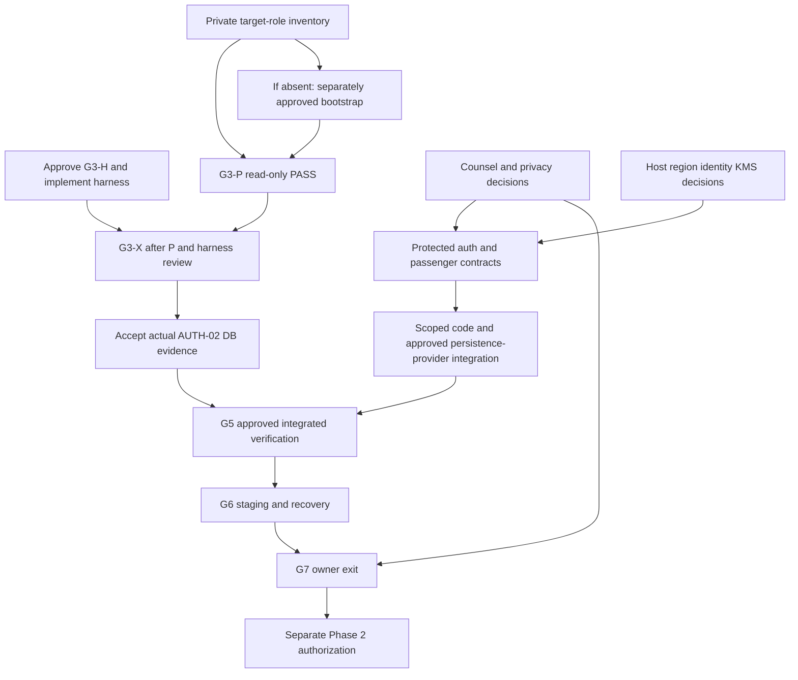

# FlyWithSafety — Accelerated Phase 1 Execution and G7 Exit Plan

2026-10-25, Asia/Dhaka. **COMPLETION PATH DEFINED — PHASE 1 EXIT BLOCKED.** This consolidates existing approved work and specific next decisions; it is not another roadmap, a legal clearance or implementation permission. All L-01–L-14 decisions remain BLOCKED. Current authorization permits this document and read-only inspection/research only.

## 1. Executive Verdict

AUTH-02 is implemented and owner-accepted offline. The immediate missing deliverable is a safe real-PostgreSQL verification harness and an approved usable target, not another synthetic crypto prototype. **Recommend one next owner decision: approve G3-H's exact two-file implementation and offline validation (§18).** It can proceed without DB access while the operator establishes target/role readiness. G3-P and G3-X remain separate decisions.

Next measurable closure: accepted AUTH-02 database evidence with exact cleanup, then protected issuance/outbox/lifecycle integration, required key/passenger/persistence controls, G5 integration, G6 staging/recovery and explicit G7 exit. Legal and infrastructure facts progress in parallel. No completion date, blanket scope reduction or next-session Phase 2 entry is promised.

Use existing detailed evidence rather than duplicating it: [G3-D matrix/algorithms](PHASE_1I_D_G3_AUTH_02_DATABASE_VERIFICATION_PLAN.md), [G3 readiness/bootstrap requirements](PHASE_1I_D_G3_APPROVAL_AND_EXECUTION_READINESS.md), [legal evidence and source index](PHASE_1I_D_LEGAL_EVIDENCE_REVIEW.md), [interim unit/acceptance inventory](PHASE_1_INTERIM_STATUS_AND_EXIT_CHECKLIST.md), [adopted roadmap](PHASE_1I_D_PRODUCTION_INTEGRATION_ROADMAP.md), [G0 adoption](PHASE_1I_D_G0_ROADMAP_ADOPTION.md) and [project master plan](FLYWITHSAFE_PHASE_1_TO_6_GATED_EXECUTION_PLAN.md). Original records remain unchanged.

## 2. Current Project Phase and Numbering Clarification

Current project phase: **Phase 1 — security, reliability and production readiness**, with Phase 1I-D incomplete. Project phases: 0 audit/recovery; 1 security/readiness; 2 authoritative booking/payment foundation; 3 payment gateway; 4 authorized supplier search; 5 supplier booking/fulfillment; 6 deployment/launch acceptance.

Security gates G0–G7 are approval checkpoints inside this work: roadmap, package design, scoped implementation, database approvals, KMS/infrastructure, integrated verification, staging/recovery and Phase 1 exit. **G7 is not Phase 7.** G3-D/P/H/X distinguish design, read-only preflight, harness coding and fixture-writing execution; none authorizes another automatically. Phase 1I-E maps to explicitly approved G5 scope and Phase 1J to explicitly approved G6 scope, not automatic entry.

Real inventory/pricing/reservations/ticketing/fulfillment belong to authorized external suppliers. FlyWithSafety owns secure orchestration and customer/internal workflows. Akijair.com is a public workflow reference, not an assumed API. Supplier/payment product work remains later separately approved scope.

## 3. Verified Completed Milestones

| Milestone | Accepted state | Evidence boundary |
|---|---|---|
| G0 | OWNER-ADOPTED | Planning baseline/exit discipline, no blanket execution |
| D-1 / D-2 / D-3B | OWNER-ACCEPTED — SYNTHETIC ONLY | Existing [D-1](PHASE_1I_D_D1_FORMAL_ACCEPTANCE.md), [D-2](PHASE_1I_D_D2_FORMAL_ACCEPTANCE.md), [D-3B](PHASE_1I_D_D3B_FORMAL_OWNER_ACCEPTANCE.md) records; no production crypto/provider proof |
| G1 AUTH-02 | OWNER-APPROVED — DESIGN ONLY | [Accepted design](PHASE_1I_D_G1_AUTH_02_DESIGN_AND_APPROVAL.md) and separate G2 authorization |
| G2 AUTH-02 | OWNER-ACCEPTED — OFFLINE ONLY | Historical 90 distinct cases per bundled/native loader; current implementation still present, no rerun now |
| Phase 1H / F01–F07 foundations | Existing historical evidence/code retained | Prior real16-case DB suite does not prove new AUTH-02 SQL or changed encryption flows; DTO privacy is not encryption |

Source inspected again: server/src/services/auth.service.ts uses exact-row SELECT FOR UPDATE, subsequent clock_timestamp() AT TIME ZONE 'UTC' conditional consumption, exact identity/cardinality checks and atomic user/session effects, ReadCommitted/maxWait2000/timeout5000 ms. Current schema needs no new column for AUTH-02 alone. Runtime/source presence is verified; live UTC storage, adapter, locks and durability are not.

## 4. Current Critical Security Gaps

- AUTH-02 actual DB concurrency/expiry/rollback/timeout/retry behavior unexecuted; G3-D prepared, G3-P/H/X not authorized.
- AUTH-01/03 and OUT-01/02: existing issuers/jobs are not protected, atomically linked production authentication delivery; raw credential URLs still enter ordinary params/recipient storage. Durable generation/revocation and trusted worker admission remain open.
- OUT-03/04: legacy inventory/disposition unknown; residual raw error sinks need scoped correction. Existing retry/suppression/fencing improvements remain valuable and must survive integration.
- KMS-01/02/03 and DB-01/02/03/04: production key/identity/envelope/passenger/persistence/digest choices and integration remain incomplete or conditional. Passenger String fields remain plaintext despite minimized response DTOs.
- Applicable legal decisions, current deployment/identity/provider facts, G5/G6 proof and G7 acceptance are missing. A plan or synthetic acceptance cannot close these requirements.

The inspected paths and detailed evidence are in the interim inventory §2. No private DB inventory, real customer record, actual KMS or deployed environment was examined.

## 5. G3-P Readiness and Approval Request

**Planning identifiers confirmed by owner:** 127.0.0.1:5432 / flywithsafe_g3_auth02_disposable / flywithsafe_g3_auth02_test. Actual existence, owner, disposable contents, schema and role privileges remain UNVERIFIED. Reject protected flywithsafe_integration, flywithsafe_phase1h_integration, remote targets, aliases/overrides and default-database fallback.

Current value-suppressed local inspection reconfirmed: server/.env DATABASE_URL and DIRECT_URL each have one definition and do not match the planning tuple; INTEGRATION_TEST_DATABASE_URL and G3_AUTH02_DATABASE_URL are absent. Those four variables are absent in the agent process. server/.env.example is not a matching configuration. No URL/password was printed; no env file or variable changed. Runtime lib/prisma.ts reads DATABASE_URL; CLI prisma.config.ts reads DIRECT_URL and loads dotenv. Do not invoke that CLI or production singleton to discover target readiness.

Minimum role/target requirements remain G3 readiness §§2–3: private authentication; restricted nonowner role without superuser/create/replication/bypass privileges; public schema USAGE; fixture DML on User/EmailVerificationToken/PasswordResetToken/Session only; catalog/history/outbox counts read-only; no DDL/TRUNCATE/history writes; reviewed inherited PUBLIC/membership/authentication access and exclusivity. No assumption that a narrow grant cancels PUBLIC privileges.

Existence path: first an owner-private operator inventory, or separately authorize target-only authentication/preflight and stop if absent/inaccessible. An admin maintenance-catalog connection to database postgres is a different scope requiring its own explicit approval; never try it silently. If objects exist, inspect/preserve them. If absent, conditionally approve only the exact new DB/role, private authentication, target-only privileges and exact seven-migration bootstrap from readiness §3. An operator must verify the exact local server first. Existing objects cause refusal, not overwrite. Bootstrap failure stops without retry/resolve/reset; preserve state for separately approved recovery. Do not drop the DB/role or restore historical data as rollback.

Expected migration names/order and raw/LF/CRLF-aware checksums are pinned in G3-D §3: 20260926202822_init; 20260927082715_full_schema; 20261009000000_auth_sessions_and_password_resets; 20261011000000_inquiry_idempotency; 20261011120000_notification_outbox; 20261022000100_contact_status_new; 20261022000200_booking_contact_schema. Require exactly seven complete nonrolled-back records, no unknown/failed/pending entries, and matching auth types/FKs/indexes/defaults. Count of tables alone is insufficient. No migration execution is approved.

**Latest restriction takes precedence:** G3-P may not alter settings. Earlier G3-D examples containing SET LOCAL statement_timeout are not authorized under this directive. Use read-only transactions, client-only connection/query deadlines and inspect existing server limits; no SET, ALTER, PGOPTIONS or startup server-setting injection. A client query timeout does not prove server execution stopped. If existing server limits cannot provide the required bounded inspection, stop and request a separately reviewed limit/cancellation scope; do not change server/session settings to force PASS.

Prospective private operator entry command, NOT RUN; password stays in private prompt, connect_timeout is client-side:

```powershell
& 'C:\Program Files\PostgreSQL\18\bin\psql.exe' -X -W -v ON_ERROR_STOP=1 -P pager=off -d 'host=127.0.0.1 port=5432 dbname=flywithsafe_g3_auth02_disposable user=flywithsafe_g3_auth02_test connect_timeout=2'
```

Proposed first SQL, NOT RUN. ON_ERROR_STOP must terminate on any failed gate; require actual complete output, not mere process exit. No settings are changed:

```sql
BEGIN READ ONLY;
SELECT 1 / CASE WHEN COALESCE(
 current_database()='flywithsafe_g3_auth02_disposable'
 AND current_user='flywithsafe_g3_auth02_test'
 AND session_user='flywithsafe_g3_auth02_test'
 AND host(inet_server_addr())='127.0.0.1'
 AND inet_server_port()=5432
 AND current_setting('transaction_read_only')='on',false)
 THEN 1 ELSE 0 END AS identity_gate;
SELECT current_database(),current_user,host(inet_server_addr()),inet_server_port();
SELECT d.datname,r.rolname AS database_owner
 FROM pg_database d JOIN pg_roles r ON r.oid=d.datdba
 WHERE d.datname=current_database();
SELECT 1 / CASE WHEN setting::integer BETWEEN 1 AND 5000 THEN 1 ELSE 0 END
 AS existing_statement_bound_gate
 FROM pg_settings WHERE name='statement_timeout';
```

Only after identity and existing-limit checks pass, run the reviewed G3-D §14 catalog SELECTs (omit its SET lines and old psql quit gate), compare each result with its schema/hash/privilege manifest, require intended schema owner and zero unknown fixtures/outbox, then ROLLBACK. Use fixed labels only. Missing statement bound blocks this version of P, not permission to amend settings. Future machine execution also requires a reviewed client-side 5-second query deadline; the interactive entry command alone is not an automated preflight implementation or PASS. No existing target guard is weakened.

**Copy-ready G3-P request:**

> Authorize READ-ONLY G3-P on 127.0.0.1:5432/flywithsafe_g3_auth02_disposable as flywithsafe_g3_auth02_test only, using private authentication and the reviewed identity/catalog checks. Confirm owner/disposability, effective role privileges, exact seven migrations/checksums, auth schema/index/FK/default/timestamp metadata, existing settings/connection bounds and non-sensitive counts. Require client connect2s/query5s bounds and acceptable existing server statement limits. No settings changes, DDL, provisioning, migration, fixture write, authentication test or cleanup. Stop on missing target/role, failed identity/limits/history/schema/privilege/data checks; no historical/remote/admin-default fallback. Return PASS/BLOCKED with sanitized evidence only. This grants no G3-X authority.

## 6. G3 Harness Implementation Approval Request

Use the newly named **G3-H** checkpoint from this directive; it is a coding approval, not a new project phase. Exact proposed files remain:

1. server/test/auth-consumption.pg.test.ts
2. server/test/auth-consumption.pg.vitest.config.ts

Static feasibility: self-contained guarded setup, real clients and ledger can live in the test file; config isolates it without a third helper. Dynamically bind the unchanged real auth.service.ts to separately owned real Prisma/pg clients; mock only unsafe env/notification composition, not transaction/lock/query results. Guard-before-import, explicit target matching, real bcrypt, bounded independent pools and source preservation are mandatory. No production file edit, accepted offline-suite edit, historical runner reuse or new dependency. Loader/module-affinity feasibility still requires implementation verification; if two files are insufficient, stop for an exact amended allowlist.

**Copy-ready G3-H request:**

> Authorize only server/test/auth-consumption.pg.test.ts and server/test/auth-consumption.pg.vitest.config.ts for G3-H implementation according to the existing G3-D matrix and current restrictions. Permit offline source/config/import/safety analysis and standalone strict no-emit TypeScript only. No PostgreSQL connection, live-client initialization, fixture creation, migration, environment/dependency change or DB test execution, including collection modes that initialize a client. Preserve auth.service.ts, existing tests and all unrelated files. Missing execution opt-ins fail closed before driver/service initialization. Stop if another file/helper or production correction is needed. Report evidence and await separate G3-P/G3-X permissions.

## 7. G3-X Execution Readiness and Approval Request

Required groups, unchanged: LOCK-01–06 (6); TX-01–10 (10); UTC-01–08 (8); COMMIT-01–06 (6): **30 groups**, not a fabricated test count. Target and reviewed harness must be ready; G3-P must pass first. Retain G3-D's methods and labels: UNWRAPPED REAL SERVICE, REAL DB + HARNESS INJECTION, SQL PREDICATE ONLY, BLOCKED/NOT RUN.

Initial limitations: TX-08 actual connection interruption; true wire ambiguity within COMMIT-04; exact production-clock equality within UTC-04. SQL-only equality and an acknowledgment-loss throw after real commit are useful distinct evidence, not substitutes. Mandatory gaps require explicit review/approved bounded method before an unconditional G3 acceptance. Source fixes, subprocess helper files, network proxies or server termination are not implicitly allowed.

Execution budget proposed unchanged: service pools8+8 plus <=3 fixture/blocker/observer connections, total<=19; 2/8/16 contender levels, three fresh-fixture repetitions per purpose; existing ReadCommitted/maxWait2000/tx5000ms. X may separately authorize session-only lock3500/statement4500/idle-in-tx6000ms and UTC/Asia-Dhaka test profiles. For TX-07 propose lock/statement5500ms and idle6000ms to distinguish the existing Prisma5000ms deadline, with test<=15000ms and exact overrun reporting. This special profile must be explicitly reviewed in X, not inherited by P or silently adjusted. Resource limits/capacity are unverified; unsupported levels stay BLOCKED.

Exact IDs are allocated and privately ledgered per run before writes; synthetic example.invalid users/tokens/passwords only. No registration, OAuth, outbox worker or supplier. Cleanup awaits setup/in-flight settlement, rechecks identity, exact IDs/ownership/counts/unexpected references and deletes owned children then users. Unknown records or unresolved late operations are preserved for separate review. No prefix/domain deletion, truncate/reset, cascading unknown-data cleanup or automatic recovery writes.

**Copy-ready G3-X request, later only:**

> After passing G3-P and reviewing G3-H, authorize AUTH-02 G3-X solely on the confirmed disposable target/role above. Permit synthetic auth-table fixtures, exact-row locks, the reviewed 30-group matrix, approved normal/special session profiles, bounded pools/concurrency, fixed controlled pre-commit/post-commit simulations and exact-ledger cleanup. Execute the two reviewed loaders sequentially; second only after first success and clean postcheck. Generate docs/proposals/PHASE_1I_D_G3_AUTH_02_VERIFICATION_REPORT.md with actual counts/timings/classified evidence/cleanup/source preservation. No migration, other table write, server termination, remote/historical target, real email/KMS/provider or production source change. Stop on safety/invariant/cleanup failure; true interruption/wire ambiguity/new files need separate approval. G3 owner acceptance and later phases remain separate.

Later commands from server, NOT RUN; both files remain uncreated:

```powershell
& .\node_modules\.bin\vitest.cmd run --config test/auth-consumption.pg.vitest.config.ts --bail=1
& .\node_modules\.bin\vitest.cmd run --config test/auth-consumption.pg.vitest.config.ts --configLoader native --bail=1
```

Privately matched DATABASE_URL=DIRECT_URL=INTEGRATION_TEST_DATABASE_URL, explicit RUN_AUTH02_POSTGRES, APPROVED_DISPOSABLE_DATABASE and G3_AUTH02_MODE opt-ins, disabled email/worker and strict routing guards remain required. No current variable changes. No JSON/file reporter, unsafe default suite or Prisma CLI side effects. Actual report must distinguish failures/skips/blocked cases; no tests ran in this session.

## 8. L-01–L-14 Legal Clearance Matrix

Exact original subjects retained. Evidence IDs S01–S14 resolve to official URLs/publication details and provision-specific findings in the existing [legal evidence review](PHASE_1I_D_LEGAL_EVIDENCE_REVIEW.md); this table adds the shortest decision/action and earliest affected operation. All rows remain **BLOCKED**. Names of individual reviewers are not supplied; roles must be assigned. Current synthetic coding/local synthetic G3 can proceed only under its own scope and real-data exclusion; these legal rows are not blanket bans on fake fixtures.

| Legal ID | Issue — exact register subject | Evidence | Missing decision / owner action | Blocking effect / units | Required reviewer | Earliest affected gate | Status |
|---|---|---|---|---|---|---|---|
| L-01 | Act identity, application, commencement — §1 | S01/S11/S12 | Authenticate operative text/notices/applicability and adopt release baseline | All real-processing units | Bangladesh counsel + privacy owner | G4/G5 activation; G7 baseline | BLOCKED |
| L-02 | Data classification — §2 | S02/S10 | Approve actual field/purpose/classification inventory | AUTH-01/03, OUT-01/04, KMS-01–03, DB-01/03/04 | Privacy/counsel/security | G4/G5 affected controls | BLOCKED |
| L-03 | Lawful basis/consent — §§5–8 | S03 | Basis/notices/processor terms per registration/recovery/traveler/payment workflow | AUTH-01–03, OUT-01/02, DB-01/02 | Counsel + product/privacy | G5 changed real collection/notification | BLOCKED |
| L-04 | Child travelers — §9 | S02/S03 | Guardian/age workflow and applicable rules, or approved enforceable feature exclusion | KMS-02/03, DB-03, child processing | Product/privacy/counsel | G5/G6 enabled child flows | BLOCKED |
| L-05 | Confidentiality/security — §§16–17, 22 | S05/S09 | Required standards and evidence of control adequacy, not prototype acceptance | All security units | Security/privacy/counsel | G4/G5; G7 | BLOCKED |
| L-06 | Data subject rights — Chapter III | S04 | Approve authenticated intake, procedures/exceptions/timelines and propagation | AUTH-03, KMS-03, DB-02/03, OUT-03 | Privacy/support/counsel | G5 real rights/deletion | BLOCKED |
| L-07 | Retention — §18 | S06 | Approve category/start-event/hold/restore schedule; no fixed passport duration assumed | OUT-03, DB-01–04, passenger/backup data | Privacy/DBA/counsel | G3 real data-disposition design, G5 activation | BLOCKED |
| L-08 | Processing records — §19 | S07 | Define minimal processing register separately from raw passport values | AUTH-01, OUT-04, DB metadata | Privacy/security operations/counsel | G5/G6 audit readiness | BLOCKED |
| L-09 | Breach response — §20 | S08 | Confirm current thresholds/recipients/rules/timing and incident owner | OUT-04, KMS incidents, recovery | Security operations/privacy/counsel | G6 readiness; affected G5 | BLOCKED |
| L-10 | Data protection planning — §22 | S09 | Name owners; approve risk/standards/control assessment | All14 units and exit evidence | Project/privacy owner + counsel/security | G4/G5 risk acceptance; G7 | BLOCKED |
| L-11 | Classification and international transfer — Chapter VII, starting §29 | S10 | Countries/classification/scale/rules/contracts opinion before disclosure | KMS/hosting/mail/supplier/backup flows | Counsel/privacy + infrastructure/supplier | G4 regions, G5 transfers | BLOCKED |
| L-12 | Repeal/authoritative language — §§44–45 | S11/S12 | Confirm authoritative Bangla/version/savings and current instruments | Legal baseline for all activation | Bangladesh counsel/privacy | G4/G5, G7 baseline | BLOCKED |
| L-13 | VAT/accounting vs passport retention and start events | S13 | Finance facts + scoped tax-record/start-event/holds opinion; not passport-retention inference | OUT-03/DB-03; finance records | Tax/legal counsel + finance/privacy | G3 disposition design; G5/G7 | BLOCKED |
| L-14 | Cross-border supplier/hosting processing and any EU scope | S10/S14 | Actual establishment/marketing/countries/subprocessors; jurisdiction/transfer opinion | KMS/hosting/suppliers; later payment processor | Privacy counsel + supplier/infra/business owner | G4/G5 actual transfer; later feature activation | BLOCKED |

Official [§1](https://bdlaws.minlaw.gov.bd/act-1692/section-57267.html), [§17](https://bdlaws.minlaw.gov.bd/act-print-1692/section-print-57283.html) and [§18](https://bdlaws.minlaw.gov.bd/act-print-1692/section-print-57284.html) pages were rechecked this session; they remain evidence of the cited text, not complete current regulation/applicability/counsel clearance. Do not infer fixed retention, universal consent, transfer permission or commencement of deferred sections. Existing research gaps in the source index remain open; no redundant broad research cycle was undertaken.

G7 requires dispositions of laws actually applicable to Phase1's enabled/retained data and operating scope. Child/supplier/payment-specific additional obligations may be later-activation dependencies only after factual, approved exclusions and retained-data handling are established. Payment processing remains later product scope, but payment-related personal/financial data already retained would still need present review. No blanket deferral of all legal questions or assumption that every row has identical scope. Counsel/owner must record applicable, conditional, later-only or justified nonapplicability decisions; no row is cleared here.

## 9. Remaining Fourteen Change Units

Consolidated dashboard; detailed source/rollback/test mapping remains in interim §2 and roadmap §10. Each row ties a G7 requirement to one concrete next action. Implementation scopes below are proposals, not file-edit authority; tests are required future evidence, not passes.

| Task | Status | Priority | Dependency | Approval | Evidence required | Blocker/risk | Next action | Manual owner task | Phase 2 impact |
|---|---|---|---|---|---|---|---|---|---|
| AUTH-01 | PENDING: split issuer/job writes | P0 | OUT-01, DB-01/selected02, KMS-01 | Exact G1/G2/G3/G4/G5 | Issuance/enqueue rollback/retry/supersession; no raw persisted URL | Orphan/duplicate/plaintext credential | Finalize one protected issuance contract in auth/notification paths | Approve atomicity/format scope | Required auth secrecy/atomicity at G7 |
| AUTH-02 | PENDING DB proof; offline accepted | P0 | G3-H + target/P | G3-P/H/X and acceptance | Real single-winner/UTC/rollback/timeout/cleanup | Unknown actual DB behavior | Implement two-file harness after approval | Approve §18; establish target | Closes independent consume requirement |
| AUTH-03 | PENDING production lifecycle | P0 | Selected DB-02, KMS-02 | G1/G2/G5 | Wrong recipient/customer/purpose/generation denied | Retarget/resurrection/revocation gaps | Set trusted recipient/generation policy | Approve lifecycle/identity boundaries | Required enabled auth flow security |
| OUT-01 | PENDING protected branch | P0 | AUTH-01, DB-01, KMS-01 | G1/G2/G3/G4 | Strict versioned dispatch, secrecy, no fallback | Plaintext params/recipient now | Specify minimal protected branch in existing notification/outbox | Approve payload/routing contract | Required secret-job confidentiality |
| OUT-02 | PENDING auth admission; fencing foundations exist | P0 | AUTH-03/KMS-02 | G2/G5 | Current token/grant/lease checks; retries/redrive/failures | Invalid sends or stale acknowledgments | Add reviewed admission around existing worker | Approve exact worker package | Required delivery integrity |
| OUT-03 | BLOCKED retained-data applicability | P0 if present | Private inventory, legal schedule/version policy | Inventory + G1/G2; each data action separate | Mixed-reader compatibility and exact disposition | Unknown legacy/backup exposure | Obtain scoped inventory approval, keep reader-compatible rollout | Approve private inventory, not purge | Must close legacy exposure or prove exclusion |
| OUT-04 | PENDING residual sink hardening | P0 for secrets | Existing safe serializer | Exact G2 + G6 | No sentinels in logs/errors/APM under faults | server.ts raw exception sinks remain | Propose narrow existing-sink patch | Approve file/test allowlist | Required non-disclosure at G7 |
| KMS-01 | BLOCKED production adapter/contracts | P1→P0 | Host/identity/region/provider decisions | G4 + exact G2/G5 | Real synthetic-data wrap/unwrap/denial/recovery | No approved provider/format | Select fixed provider/resource/version contract | Assign infra/security/finance decision | Required encryption trust |
| KMS-02 | BLOCKED real decrypt authority | P0 | Trusted issuer/IAM + KMS-01 | G1/G4/G2/G5 | Zero unwrap on denial, ownership/purpose/expiry and no cache | Caller-asserted grants insufficient | Define authentic workload/customer admission | Approve trust model | Required privileged-access control |
| KMS-03 | BLOCKED passenger encryption | P0 enabled storage | DB-03, KMS-01/02, collection policy | G1/G2/G3/G4/G5 | Encrypted persistence, immutable AAD, minimal DTO/masks | Current plaintext document strings | Specify minimal booking/passenger adapter | Approve field/grant scope | Required F07 storage closure |
| DB-01 | PENDING protected routing/link schema | P0 | AUTH-01/OUT-01 contract | G1/G3 preparation; migration separate | FK/unique/purpose/ordinary-row compatibility | No durable token-job linkage | Review additive routing/link schema only | Approve later exact schema package | Required atomic protected delivery |
| DB-02 | BLOCKED selected revocation/generation | P1→P0 if needed | AUTH-01/03 lifecycle choice | G1/G3/G2/G5 | Supersession/away-back/concurrent generation vectors | UsedAt is not durable revocation | Select minimum fields/invariants | Approve lifecycle persistence | Required if chosen policy depends on it |
| DB-03 | PENDING passenger schema | P0 enabled storage | KMS-03/AAD/mask/CAS policy | G1/G3/G2; each data action separate | Reader-first migration/CAS/restore compatibility | Legacy plaintext/rollback risk | Review additive envelope/revision layout | Approve schema, later backfill separately | Required protected passenger storage |
| DB-04 | BLOCKED conditional digest decision | P1→P0 if needed | ADR-14/key policy | G1, selected G2/G3/G5 | Historical logical replay/customer conflict/rotation | SHA256 exists; random ciphertext breaks equality | Decide versioned keyed-digest applicability | Security/reliability disposition | Preserve idempotency, don't erase unresolved threat |

Existing DTOs, pagination, durable idempotency, F02 origin/F05 state and outbox leases are reused, not reimplemented. Existing SHA256 hashing is not labeled absent; the proposed keyed redesign remains conditional. Extra files/schema changes need exact package authorization. No unknown data is assumed absent.

## 10. Critical-Path Dependency Graph



Priority A completes the independent AUTH-02 proof. B integrates AUTH-01/OUT-01/DB-01 with required key contracts; C adds selected AUTH-03/OUT-02/03/04/DB-02 lifecycle/reliability; D completes KMS-02/03 and DB-03 passenger confidentiality; E verifies selected persistence/idempotency and all changed-path regressions. These workstreams overlap when contracts permit; letters do not override actual dependencies. Reuse accepted vectors, avoid another fake prototype. No finite completion date follows from this graph.

## 11. Infrastructure/KMS Readiness

| Minimum decision | Required evidence/owner | Consequence while unresolved |
|---|---|---|
| Hosting/runtime/topology | Infra/backend: actual Next/Express Node lifecycle, worker scheduling, supported dependencies/build | Compatible-hosting-first recommendation; no verified deployment claim |
| Prisma/PostgreSQL routing | DBA: pools, direct runtime targets, transaction affinity/capacity/cache freshness | G3/G5 actual proof; no remote fallback or sensitive query caching assumption |
| Secret/workload identity | Infra/security: environment separation, private secret delivery, short-lived issuer/audience/trust | No static-key shortcut, caller-supplied grants or production credentials |
| KMS provider/resource/region | Infra/security/privacy/finance: host identity, country rules, exact API/key/version, latency/quotas/cost | No provider approved, no AWS default or provisioning |
| Purpose separation/admission | Security: auth-delivery versus passenger versus JWT/OAuth/digest keys and trusted grants before unwrap | Ordinary APIs/worker must not gain broad passenger decrypt |
| Key lifecycle/recovery | Security/DBA/operations: rotation vs rewrap vs re-encryption, retained key versions, dual-control retirement | No key destruction as rollback, no restore-resurrection assumption |
| Worker/telemetry/restore | Reliability/ops: bounded execution, admission/fencing, safe logs/alerts, RPO/RTO/runbooks/quarantine | Minimum monitoring/recovery is P0, dashboard polish can wait |

Cloudflare remains intended DNS/security, not approved native hosting for the whole stack. Retain a compatible Node backend unless a separately approved runtime migration proves Express/Prisma/Passport/mail/worker/KMS behavior. Host and key choices require G4; actual access/provisioning/tests remain separately scoped. No vendor account, region, price or identity access was verified here.

## 12. Phase 1I-E Entry Requirements

Not authorized. Require explicit G5/I-E approval naming exact source version, implemented applicable G2 units, accepted relevant G3 evidence/schema/history, G4 selected key/identity contracts and permissions, approved disposable targets/provider endpoints, synthetic fixtures and cleanup, network/mail restrictions, test/report allowlist and stop/rollback controls. Mandatory tests cover auth correctness, token/job atomicity, secret persistence, trusted decrypt, passenger encryption, leases/redrive, idempotency/concurrency, recovery, privacy and pagination. Acceptance requires actual results per evidence class, safe cleanup and no hidden mandatory failures. Real-data/legal permissions remain distinct.

## 13. Phase 1J Entry Requirements

Not authorized. Require accepted applicable G5 evidence, explicit G6/1J staging package with domains/topology/identities/regions, staging-data and deployment/provider/mail/browser permissions, legal disposition, current client/server checks and named QA/security/operations owners. Exit requires OAuth/session/origin/cookie and account/booking/admin regressions, authorized transport-submission evidence, secrets/config isolation, alerts, backup/key recovery/restore quarantine, rollback rehearsal and accepted limitations. SMTP submission is not inbox receipt; staging acceptance is not public launch.

## 14. G7 Phase 1 Exit Checklist

Status vocabulary: VERIFIED, PENDING, BLOCKED, DEFERRED WITH JUSTIFICATION, NOT APPLICABLE WITH JUSTIFICATION. Scoped historical verification never becomes full-current integration verification. None of the conditional exclusions below has been newly approved.

| Acceptance requirement | Current status | Required closing evidence / accountable review |
|---|---|---|
| G0/G1 AUTH-02 and G2 offline acceptance | VERIFIED — scoped records | Existing owner decisions; no new production claim |
| AUTH-02 real DB single-use/atomicity/expiry | PENDING | Accepted G3-P/H/X evidence and explicit gap dispositions; auth/DBA/security |
| Protected issuance/enqueue, secrecy/no fallback | BLOCKED | AUTH-01/OUT-01/DB-01 actual code and real rollback/version/confidentiality tests |
| Recipient/revocation/supersession/grants | BLOCKED | AUTH-03/selectedDB-02/KMS-02 trusted lifecycle and negative tests |
| Worker retry/redrive/fencing/authorization | PENDING | Existing controls preserved plus protected-path G5/transport failure proof |
| Legacy compatibility and disposition | BLOCKED | Approved inventory and bounded access/disposition/backups; no unknown residuals |
| Trusted crypto/keys/passenger protection | BLOCKED | KMS-01–03/DB-03 actual storage/grant/version/rotation/recovery evidence |
| Safe logging, privacy and retention controls | PENDING | OUT-04, F07/F06 regression and applicable legal lifecycle decisions |
| Necessary schema/transactions/idempotency | PENDING | Approved additive changes/history/CAS, real concurrent/restart/replay tests, ADR-14 disposition |
| OAuth/origin/session safeguards | PENDING | Preserved source plus current scoped integration/staging browser evidence |
| Phase 1I-E / G5 | BLOCKED | Explicit approval, actual integrated evidence, cleanup and reviewer acceptance |
| Phase 1J / G6 operations/recovery | BLOCKED | Approved staging/restore/alerts/runbooks/transport and release review |
| Applicable legal clearance | BLOCKED | Named counsel/privacy/business decisions; later-only exclusions justified and enforced |
| Risk/owner Phase1 exit | BLOCKED | No critical unaccepted issue, accepted residual limitations, explicit G7 decision |
| New supplier/payment/domain features | DEFERRED WITH JUSTIFICATION — planning only | Later product/launch scope; no inventory/fulfillment claim; does not defer already applicable data obligations |

G7 requires all mandatory P0 evidence and applicable legal decisions, not a majority score or a signed roadmap. No generic risk acceptance removes a critical requirement. A feature exclusion must be complete, approved, enforced and cover retained data; UI hiding is insufficient.

## 15. Phase 2 Entry Requirements

Require explicit G7 Phase1 exit acceptance, current closure/risk/legal/exclusion register, accepted G5/G6 scope, authoritative booking/payment architecture, genuine supplier capability boundaries and exact separately authorized Phase2 files/tests/targets. No payment activation, supplier API, deployment or commercial capability is inferred. Phase2 is presently NOT ELIGIBLE for implementation authorization because these prerequisites are incomplete; a next-session target is a goal only.

## 16. Parallel and Deferred Work

P1 parallel: G3-H and private target readiness, counsel fact gathering, host/identity/region/KMS decisions, protected auth/legacy/generation schema contracts. Safe now only within documentation authority; coding/provider/data work needs its package grant. Independent secret-safe logging can be proposed as a small existing-sink correction, not executed under this document.

P2 candidates: unrelated Workers migration/hosting optimization, nonessential dashboards/DX, generic crypto framework, additional F06 indexes without query-plan/SLO evidence, domain purchase/payment activation/new supplier connector features. Assign later owners/triggers and approve deferral; do not defer minimal logs/alerts/recovery, required data controls or current-runtime compatibility. No new phases are created to organize the work.

## 17. Manual Owner Actions

1. **Next: approve G3-H (§18)** to produce the missing reviewable harness without waiting for DB access.
2. In parallel obtain private operator inventory for the confirmed target/role. If missing, separately authorize the exact conditional bootstrap; if present, preserve it and approve G3-P only. No passwords, URLs containing credentials or keys in chat.
3. Assign named counsel/privacy/finance owners to the 14 concrete legal questions and infra/security/finance owners to host/identity/region/KMS decisions. Supply actual fields/workflows/company/country facts, not more generic research requests.
4. Once preflight/harness pass, separately approve G3-X; then accept its bounded evidence or authorize a minimal corrective G2 scope if an actual defect appears. Later integration/staging/exit permissions are requested when their packages are reviewable.

## 18. Exact Next Approval Decision

**Recommended single decision: G3-H code-only approval, exactly as §6.** It removes an independently actionable bottleneck needed for every later G3-X run, without assuming target existence or requesting DB secrets. It does not waive G3-P and can proceed alongside operator readiness. No G3-H authorization is inferred from this planning directive; the owner must explicitly grant it.

After G3-H: review actual file diff, offline safety/type results and confirmed absence of unauthorized initialization; then request target-specific P/X separately. If target readiness is already resolved by the owner, P can proceed under its own explicit approval in parallel; no artificial serial planning gate is imposed.

## 19. Repository Preservation and Evidence

Entry development HEAD 7f8e569; four preexisting untracked proposal documents preserved. This output path was absent; related detailed plans already exist and are linked rather than rewritten. Baseline 658 tracked/nonignored-untracked files, aggregate SHA256 of sorted JSON [path,SHA256(bytes)] pairs: f3a66c475fb5778c1999443a0eac0410fd4013dc5bfbdf8a0444574adb0bcc44.

Current checks: source/document/status inspection; redacted configuration classification; limited official-source recheck. No completed synthetic verification repeated. No runtime/unit/compiler/database/provider/browser results were generated. Final static checks must prove 20 sections, exact14 legal subjects/BLOCKED cells, exact14 unit dashboard rows, 30 retained G3 groups, existing-file digest, absent proposed harness files, resolving local links and whitespace/git diff validation. Those checks establish document integrity only.

Final static verification: **PASS** — all20 sections; all14 original legal subjects matched and BLOCKED; all14 adopted unit rows; all30 existing G3 matrix groups retained; all658 preexisting files retain the recorded digest; proposed test files absent; local links resolve; no whitespace errors; git diff --check passed. This single document is the only addition from the current directive. No fresh runtime result is claimed.

## 20. Current Authorization Boundary

Only this consolidated document may be added. No accepted source/test, schema/migration, env/config, legal status, earlier report or roadmap edit. No PostgreSQL connection, database/role provisioning, settings change, migration, fixture/cleanup/test, KMS/cloud/SMTP/supplier/payment/deployment, Git commit/push/reset or automatic phase transition. All legal decisions BLOCKED; G3-P/H/X, I-E,1J and Phase2 execution remain unauthorized. Stop after presenting the precise next approval, not after starting another work package.
