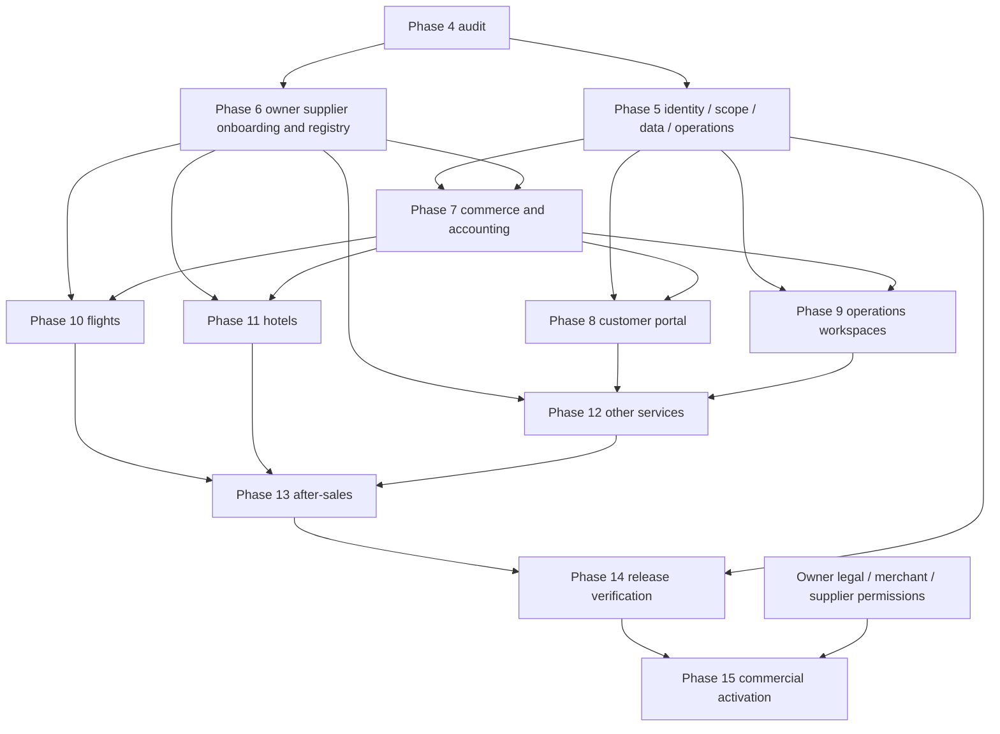

# Fly With Safety — Phase 4 Product & Architecture Rebaseline Audit

**Verdict — AUDIT COMPLETE.** Assessment date 7 November 2026, Asia/Dhaka. This report completes the requested repository and architecture audit. Phase 5–15 implementation requires a separately approved scope. Production payment and supplier activation require their respective release approvals.

## A. Executive summary and source of truth

The current product is an assisted-travel inquiry and booking application with accepted local security, booking and SSLCommerz sandbox foundations. It has usable customer and shared operations screens. Flight/hotel offers currently come from mock providers. Real supplier reservations, issuance, hotel vouchers and commercial settlement are future capabilities.

The Admin/Staff similarity has a server-side counterpart. The `/admin` router accepts both roles, and its list/update services do not implement department or assignment scope. Customer ownership is enforced on account/payment APIs. The proposed four-tier organization model requires additional policy, identity lifecycle and record-scope enforcement.

The canonical Master Plan was read in full through Google Docs, including its tables and Phase 0–15 roadmap. It is **Fly With Safety Final Document**, version 2.1, revised 7 November 2026, document ID `1REoREHwJkzFF9uOPEIZ29Ppicj6HvMEcNwHke1e6PnA`, revision `AHj4eMTjoQ6wug9SnGMzJtvTeT4ZI5F-IyLmw69V99qYpvqvleyq4p4iRqz2BPOm_juIddwuBIWmc-yAEAbW6ub-3Hu1PWCp7LkzaWqwns8`. Its role model and roadmap define the target. Current source and original acceptance records establish implementation evidence. The attached Phase 4 execution prompt authorizes this read-only audit and this report. [Canonical Master Plan](https://docs.google.com/document/d/1REoREHwJkzFF9uOPEIZ29Ppicj6HvMEcNwHke1e6PnA/edit)

| Repository observation | Actual result |
|---|---|
| Local branch and HEAD | `development`, `b5eb3164d02139f5fdf75a8c61b15c4ddb4b0c27` |
| HEAD subject | `feat: add phase 3 UAT transport tests and implementation` |
| Initial working tree | Clean, including accepted Phase 3 closure documents |
| Tracked files | 2,539 at audit start |
| Baseline content inventory | SHA-256 `59190F71243D240E7766A79CF96E90D073358A0CDBC6EFBF51D52564E31E0208`, computed over sorted tracked paths and their content hashes using `git ls-files` order |
| Installed stack inspected | Next.js 16.3.6, React manifest 19.2.8, Express 4.22.3, Prisma Client 7.10.0, PostgreSQL provider, TypeScript |
| Main Prisma schema | 22 models, eight migration directories. Separate Phase 1 protected-schema candidate also exists |
| Deployed runtime state | Not inspected. Deployment instructions and hardcoded public API address are source evidence only |
| Verification performed | Server and client TypeScript, each `tsc --noEmit --incremental false`, exit 0. Repository/source/static authorization inspection |
| Existing tests | Accepted reports reused. Existing Admin tests explicitly expect STAFF access. No broad or live test suite rerun |
| Skills | Google Drive/Docs, repository Gravitas and Security Best Practices guidance available locally. No additional installation needed |

Gravitas policy record for this task is `planning=deep`, `context_depth=dependency`, `verification_depth=impact`, `delegation=none`. Allowed write scope is this report. Evidence classifications below distinguish saved executed proof, current source behavior and future acceptance criteria.

### Evidence index

References E01–E30 identify the current local files used throughout this report. Linked line numbers are review entry points. The function and route names remain the primary identifiers.

| ID | Current evidence |
|---|---|
| E01 | [UserRole, User and Session schema](E:/Programming/Project/fly-with-safety/server/prisma/schema.prisma:12) |
| E02 | [Booking and gateway ledger models](E:/Programming/Project/fly-with-safety/server/prisma/schema.prisma:375) |
| E03 | [requireAuth, authenticatedUserFromToken and requireRole](E:/Programming/Project/fly-with-safety/server/src/middleware/auth.middleware.ts:26) |
| E04 | [Shared Admin/Staff route guard and operations](E:/Programming/Project/fly-with-safety/server/src/routes/admin.routes.ts:28) |
| E05 | [Customer account routes](E:/Programming/Project/fly-with-safety/server/src/routes/account.routes.ts:16) and [ownership-filtered services](E:/Programming/Project/fly-with-safety/server/src/services/account.service.ts:94) |
| E06 | [Registration, password hashing and sessions](E:/Programming/Project/fly-with-safety/server/src/services/auth.service.ts:11) and [reset/session revocation](E:/Programming/Project/fly-with-safety/server/src/services/auth.service.ts:266) |
| E07 | [Shared AdminPortal](E:/Programming/Project/fly-with-safety/client/src/components/admin/AdminPortal.tsx:15) |
| E08 | [Customer dashboard views](E:/Programming/Project/fly-with-safety/client/src/components/account/AccountDashboard.tsx:28) |
| E09 | [Auth routes](E:/Programming/Project/fly-with-safety/server/src/routes/auth.routes.ts:44) and [Origin protection](E:/Programming/Project/fly-with-safety/server/src/middleware/request-origin.ts:18) |
| E10 | [Booking create and plaintext passenger writes](E:/Programming/Project/fly-with-safety/server/src/services/booking.service.ts:15), [admin listing](E:/Programming/Project/fly-with-safety/server/src/services/booking.service.ts:475) and [minimized DTO](E:/Programming/Project/fly-with-safety/server/src/utils/booking-dto.ts:29) |
| E11 | [Quote/manual payment rules and row-lock persistence](E:/Programming/Project/fly-with-safety/server/src/services/booking-commercial.service.ts:45) |
| E12 | [Payment authorization, settlement and fulfillment projection](E:/Programming/Project/fly-with-safety/server/src/payments/payment-domain.ts:19) and [provider reconciliation](E:/Programming/Project/fly-with-safety/server/src/payments/payment.service.ts:79) |
| E13 | [Exact callback routes and payment/refund operations](E:/Programming/Project/fly-with-safety/server/src/payments/payment.routes.ts:20) and [sandbox-only configuration](E:/Programming/Project/fly-with-safety/server/src/payments/sslcommerz.ts:8) |
| E14 | [Mock-default flight aggregator](E:/Programming/Project/fly-with-safety/server/src/services/flight-aggregator.service.ts:20) |
| E15 | [Mock hotel provider selection](E:/Programming/Project/fly-with-safety/server/src/services/hotel.service.ts:11) |
| E16 | [API resolver including local fallback](E:/Programming/Project/fly-with-safety/client/src/lib/api/client.ts:1) |
| E17 | [Outbox fallback and batch processing](E:/Programming/Project/fly-with-safety/server/src/services/outbox.service.ts:82), [protected scheduler trigger](E:/Programming/Project/fly-with-safety/server/src/routes/outbox-worker.routes.ts:8) and [startup](E:/Programming/Project/fly-with-safety/server/src/server.ts:23) |
| E18 | [Protected data-plane activation boundaries](E:/Programming/Project/fly-with-safety/server/src/security/README.md:1), [inert composition](E:/Programming/Project/fly-with-safety/server/src/services/protected-phase1.composition.ts:23) and [separate protected schema](E:/Programming/Project/fly-with-safety/server/prisma/phase1/schema.prisma:475) |
| E19 | [Environment-supplied Admin seed and existing-user role upsert](E:/Programming/Project/fly-with-safety/server/prisma/seed.ts:262) |
| E20 | [App middleware, production proxy trust and mounted routes](E:/Programming/Project/fly-with-safety/server/src/app.ts:31) |
| E21 | [Explicit future 501 stubs](E:/Programming/Project/fly-with-safety/server/src/routes/future-stubs.routes.ts:19) |
| E22 | [Payment panel, refund and return UX](E:/Programming/Project/fly-with-safety/client/src/components/booking/GatewayPaymentPanel.tsx:10) |
| E23 | [Redacted logger](E:/Programming/Project/fly-with-safety/server/src/lib/logger.ts:10), [process-local rate limiting](E:/Programming/Project/fly-with-safety/server/src/middleware/rate-limit.ts:10) and [health](E:/Programming/Project/fly-with-safety/server/src/routes/health.routes.ts:21) |
| E24 | [Admin test contract allowing STAFF](E:/Programming/Project/fly-with-safety/server/test/admin.test.ts:162) |
| E25 | [Negative contract tests](E:/Programming/Project/fly-with-safety/server/test/phase3-negative-contract.test.ts:185) and [real PostgreSQL negative proof](E:/Programming/Project/fly-with-safety/output/phase3/negative-postgres-20261105-01/result.json) |
| E26 | [Phase 1 formal local G7](E:/Programming/Project/fly-with-safety/docs/proposals/PHASE_1_EVIDENCE_LOG.md:1242) |
| E27 | [Phase 2 formal 14/14](E:/Programming/Project/fly-with-safety/docs/proposals/PHASE_2_ACCEPTANCE_REPORT.md:1) and [local rename closure](E:/Programming/Project/fly-with-safety/docs/proposals/LOCAL_DATABASE_RENAME_ACCEPTANCE.md:1) |
| E28 | [Phase 3 final 10/10 and conditional Gate 4 decision](E:/Programming/Project/fly-with-safety/docs/proposals/PHASE_3_FINAL_GATES.md:190) |
| E29 | [Historical website audit/recovery findings](E:/Programming/Project/fly-with-safety/docs/WEBSITE_AUDIT_2026-10-22.md:1) |
| E30 | [Deployment instructions](E:/Programming/Project/fly-with-safety/DEPLOYMENT.md:1) and [inherited KMS gaps](E:/Programming/Project/fly-with-safety/docs/proposals/PHASE_1I_D_KMS_INFRASTRUCTURE_GAPS.md:11) |

## B. Accepted Phase 0–3 baseline

| Phase | Scope and evidence | Preserved boundary |
|---|---|---|
| 0 | Reported audit/recovery completion. E29 corroborates prior fixes and browser work. A standalone original Phase 0 formal acceptance artifact was not located | Treat the owner-reported historical milestone as the baseline. No reconstructed acceptance claim |
| 1 | Formal local G7 in E26. Existing cryptographic/worker modules and synthetic contracts are substantial | Production KMS, real sensitive-data permission, actual cloud recovery and Gate B/C obligations remain release work |
| 2 | Formal 14/14 in E27, with saved real PostgreSQL and browser proof | Accepted assisted booking, quotation, manual payment record, actor isolation and concurrency scope. Supplier issuance remains future work |
| Local rename | E27 records `flywithsafety_local_integration`, original OID 34701 and restricted-role proof | Historical old-name references in sealed scripts stay valid evidence |
| 3 | E28 formally ACCEPTED AND CLOSED, 10/10 | Genuine SUCCESS and FAILED accepted. CANCELLED authenticated return and matching authoritative query accepted under the explicit owner-approved conditional Gate 4 decision |

CANCELLED live signed IPN remains `NOT_OBSERVED`, provider generation/dispatch `UNKNOWN`, and the consumed CANCELLED runner retains `passed=false` and `TIMEOUT_INDETERMINATE`. The old PROCESSING intent remains unresolved and uncaptured. All referenced outcomes retain their original evidence labels. These qualifications carry into every subsequent release report.

## C. Canonical feature gap matrix

Status describes the bounded feature in that row. `IMPLEMENTED_AND_VERIFIED` requires applicable saved executed evidence. `IMPLEMENTED_UNVERIFIED` means code exists but the claimed end-to-end capability lacks reviewed proof. `PARTIAL` means required layers are incomplete. `MISSING` means no current implementation was found in the inspected entry points/schema. `CONTRACT_DEPENDENT` means supplier/partner rights are required. `PRODUCTION_RELEASE_GATED` means accepted local behavior requires production approval and verification.

| ID | Journey/capability | Current route or implementation | Status | Missing layer / required next proof | Priority / phase |
|---|---|---|---|---|---|
| C01 | Registration, login, verification, reset | `/auth/*`, E06/E09 | IMPLEMENTED_AND_VERIFIED | Preserve accepted local consumption/session tests. Production delivery/key cutover is R04 | P0 / 5 |
| C02 | Google login | `/auth/google`, OAuth state, Passport strategy | IMPLEMENTED_UNVERIFIED | Real deployed callback/client/consent configuration and interoperability proof | P1 / 5 |
| C03 | Own profile | PATCH `/account/profile`, name update only, E05/E08 | PARTIAL | Verified contact-change flow, identity policy, account settings | P1 / 8 |
| C04 | Authenticated change password | Profile explicitly directs to recovery | MISSING | Reauthentication, secure change, session revoke and tests | P1 / 5,8 |
| C05 | MFA for privileged identities | No main-schema MFA factor/challenge or route | MISSING | Enrollment, recovery, step-up and privilege guard | P0 / 5 |
| C06 | Sessions and device security | Session model, refresh/logout/reset revoke in E06 | PARTIAL | List devices, revoke one/all, suspicious login signals, suspension | P0 / 5,8 |
| C07 | Saved travelers and documents | BookingPassenger is booking-scoped, E02/E08 | MISSING | Reusable traveler ownership, consent, encrypted documents, authorized retrieval | P1 / 5,8 |
| C08 | Flight search/filter/compare | Flight results page, E14 | PARTIAL | Mock inventory today. Contracted live offers, repricing, terms and expired-offer handling | P1 / 6,10 |
| C09 | Flight reservation, PNR, e-ticket | Assisted inquiry → Booking, E10 | CONTRACT_DEPENDENT | Entitled reserve/issue adapter, supplier reference/e-ticket verification, servicing | P1 / 6,10 |
| C10 | Hotel search/filter | `/hotels/search`, E15 | PARTIAL | Mock provider today. Real properties, rooms, terms, rate validity | P1 / 6,11 |
| C11 | Hotel reservation/voucher | Assisted booking model, no reservation adapter | CONTRACT_DEPENDENT | Recheck rate, supplier-confirmed booking/voucher, cancellation | P1 / 6,11 |
| C12 | Visa information/inquiry | `/visa`, `/visa/:country`, `/visa/inquiry` | PARTIAL | Secure document upload, assigned case workflow, authority/outcome tracking | P1 / 8,12 |
| C13 | Holiday catalogue/inquiry | `/packages`, package model and inquiry | PARTIAL | Component availability, itinerary operations, deposit/terms and fulfillment | P1 / 7,12 |
| C14 | Activities/tours | No product-specific route/model found | MISSING | Authorized catalogue, capacity, order and voucher workflow | P2 / 12 |
| C15 | Transfers | No transfer route/model found | MISSING | Supplier, pickup/capacity, confirmation, dispatch and after-sales | P2 / 12 |
| C16 | Booking requests/history | `/bookings`, `/account/bookings`, E05/E10/E27 | IMPLEMENTED_AND_VERIFIED | Preserve assisted scope. Supplier states need separate model | P1 / 7,8 |
| C17 | Agency quote and manual payment record | Booking commercial command, E11 | IMPLEMENTED_AND_VERIFIED | Commercial lines remain JSON, recorded funds stay unverified. Accounting is R07 | P1 / 7 |
| C18 | Hosted payment and history | `/payments/*`, GatewayPaymentPanel, E12/E13/E22/E28 | PRODUCTION_RELEASE_GATED | Local sandbox accepted. Production merchant, keys, activation and deployment require release approval | P0 / 5,15 |
| C19 | Invoices and fiscal receipts | Commercial JSON `receipts` are command-deduplication records | MISSING | Numbered customer documents, legal/tax fields and immutable financial references | P1 / 7,8 |
| C20 | Refund/cancellation requests | Admin-gated sandbox refund service and generic booking status, E12/E22 | PARTIAL | Customer request, reason/policy, dual approval, supplier cancellation and settlement evidence | P1 / 7,13 |
| C21 | Notifications and support | Email outbox, contact form and operations contact tab, E17 | PARTIAL | In-app inbox, threaded support case, assignment, SLA and delivery/recovery evidence | P1 / 8,9,13 |
| C22 | Accessibility/mobile | Existing modal/focus/layout and 79 browser evidence, E08/E27/E29 | PARTIAL | New role journeys and all six service lines need keyboard/390px E2E proof | P1 / 8,9,14 |
| O01 | Admin customer account operations | No customer-directory/manage-user routes in current Admin router | MISSING | Search/minimized detail, support actions, suspension/reactivation and audit | P0 / 5,9 |
| O02 | Individual staff/admin provisioning | Only environment-controlled Admin seed, E19 | MISSING | Invitation, permitted role assignment, unique identity, MFA and recovery | P0 / 5 |
| O03 | Department/assigned work | No membership/assignment model, E01/E04 | MISSING | List/detail/write scope and direct API denials | P0 / 5,9 |
| O04 | Inquiry/booking operations | E04/E07/E10, saved Staff/Admin scope in E27 | IMPLEMENTED_AND_VERIFIED | Existing broad roles need enterprise restriction, R01 | P0 / 5,9 |
| O05 | Content operations | Destination/testimonial writes, package/visa list routes, E04 | PARTIAL | Full editorial workflow, per-action permissions and immutable audit | P2 / 9,12 |
| O06 | Supplier/contracts/rate governance | Only provider interfaces and research notes | MISSING | Capability registry, agreement evidence, credentials and pricing policy | P1 / 6,7,9 |
| O07 | Finance, settlement, reporting | Gateway events and manual records only | MISSING | Double-entry postings, payable/revenue/FX, reconciliation and period controls | P1 / 7,9 |
| O08 | Audit/security control center | Request logs, booking history, payment events | PARTIAL | Organization-wide audited governance, incident and approval records | P0 / 5,9 |
| O09 | Price alerts/wishlist/AI/tracker | Explicit 501 stubs, E21 | MISSING | Prioritize after launch-critical workflows | P3 / post-core |

## D. Customer dashboard audit

Current `/account` renders a client-authenticated dashboard with overview, requests, bookings and profile tabs. Read services bind to user ID. Booking detail projects minimized passenger/history data. Profile updates only name. Contact support links to the contact page. Customer quote acceptance and the sandbox payment panel reuse booking details.

The current page openly marks travelers/passports/loyalty profiles unavailable and links password changes to recovery. Session-device controls, security settings, support cases, refund requests, invoices, ticket/voucher downloads and in-app notifications require real services and durable data. They should replace those unavailable areas only after API ownership tests exist. Keep the existing query/filter/navigation and focus behavior where suitable. Evidence E05/E08/E22/E27 establishes the working foundation.

Recommended information architecture is `/account` with Profile, Security, Travelers, Orders, Payments, Documents, Requests and Support. Customer identity changes require verified channels and reauthentication. A customer can read only their own records, even when a reference/ID is known. Document consent and retention apply to travelers as separate individuals. Guest lookup remains a minimized support capability and needs a production threat-model review because reference plus email is its current credential pair.

## E. Super Admin / Admin / Staff audit

`/admin` renders one `AdminPortal` for STAFF and ADMIN. All four tabs remain available to both. The local variable `isSuperAdmin` means `user.role === 'ADMIN'` and selects badge styling. It creates no actual SUPER_ADMIN role. There is no `/owner` or `/staff` page in the current route inventory. E01/E04/E07/E24 establish these facts.

The server does reject unauthenticated users and CUSTOMER access to operations. The current weakness relative to the master plan is breadth within operations. STAFF can list all flight inquiries and bookings, change inquiry/booking statuses, reach content operations and inspect/redrive outbox through the common router. Query filters contain status/type/pagination, with no assignment principal. Payment operations similarly allow STAFF global operations visibility while refund execution is ADMIN-only and sandbox-gated. This is an authorization redesign requirement for the enterprise scope. The accepted earlier Staff/Admin contract remains historical evidence.

Target workspaces reuse components behind server policy: `/owner` for governance, `/admin` for customer operations and queues, `/staff` for assigned department work, `/account` for self-service. Legacy `/admin` links need role-aware compatibility redirects and identical backend permission enforcement. Unknown roles must fail closed in both frontend navigation and API policy.

## F. Target role and permission matrix

Every granted permission below also requires active identity/session, relevant MFA or step-up, permitted organization/department and resource scope. Audit visibility minimizes PII. Organization governance does not permit password viewing, financial-control bypass or automatic supplier fulfillment.

| Action | SUPER_ADMIN | ADMIN | STAFF | CUSTOMER |
|---|---|---|---|---|
| Create/assign SUPER_ADMIN | Explicit owner bootstrap/dual governance | Denied | Denied | Denied |
| Invite ADMIN | Audited governance + step-up | Denied unless a future separately approved delegation exists | Denied | Denied |
| Invite STAFF | Governance | Delegated departments and bounded role set | Denied | Denied |
| Configure permissions | Approved policy versions | Bounded delegation only | Denied | Denied |
| Customer directory and support | Authorized oversight | Daily operations owner | Assigned, minimized records | Own profile only |
| Suspend/reactivate customer | Policy/exception review | Reason, permission and session revocation | Request/escalate only | Self-service request |
| Booking/case read | Authorized oversight | Authorized queues | Department AND assigned record | Own only |
| Quote/booking operational update | Explicit permission | Permitted service/queue | Assigned record + action | Own quotation acceptance |
| Documents | Purpose-limited authorized read | Necessary case scope | Assigned processing scope | Own/consented traveler records |
| Refund | Exceptional approval, separation of duties | Bounded approval limit | Finance request only | Own request |
| Refund execution/settlement | Dedicated authorized worker after approval | Approval does not itself execute funds | Denied direct execution | Denied |
| Supplier terms/bank details | Step-up + dual approval | Approved commercial scope | Read only if required | Denied |
| Content | Governance | Content permission | Content department permission | Published content |
| Audit/security | Authorized global oversight | Department/operations scope | Own actions/report incident | Own security activity |
| Password recovery | Own secure recovery, audited break-glass | Initiate customer recovery | Guide to self-service | Own secure reset |
| Outbox redrive | Authorized operations + safe classification | Explicit permission | Denied by default | Denied |

### Additive role and identity transition design

1. Add `SUPER_ADMIN` alongside existing enum values and preserve every user ID, existing role and session lineage. Introduce reviewed department membership, explicit role-permission policy, account status/authz version, invitations, MFA factors/recovery, append-only security events and typed record assignments. Existing records are unassigned until an authorized assignment action occurs. Do not infer assignment from creator email.
2. Centralize policy evaluation on the server. Load current role/account status or a versioned authoritative policy snapshot during authentication. A demotion, suspension or permission reduction must invalidate existing sessions/authorizations immediately. Existing JWT role is insufficient by itself for that transition.
3. Introduce `/owner`, `/admin`, `/staff` experiences using the existing panels. Replace the permissive non-CUSTOMER UI branch with explicit recognized-role permissions. Enforce the same permission/scope in lists, counts, details, exports and mutations. Keep customer user-ID ownership filters.
4. Bootstrap the first owner only through a separately approved, private, exact-user-ID operation after identity verification and MFA setup. Preserve current ADMIN accounts. No automatic promotion, public role-assignment parameter or shared credential.
5. Invitations store a one-use hash, expiry, intended identity, permitted role and department. Accept through verified email and individual password/MFA setup. Replay, expired links, recipient mismatch and role tampering fail closed. Privileged policy and bank/refund actions require separation of requester and approver.
6. Roll out policy behind a reviewed activation flag after additive schema proof, populated explicit assignments and privileged MFA readiness. Compatibility behavior must never leave a STAFF endpoint broadly readable while presenting a restricted UI. Rollback disables new privileged capabilities and invalidates affected sessions. Preserve added schema and audit rows, including the enum value, until a separately reviewed data-safe rollback is approved.

## G. Database and architecture findings

| Area | Actual state | Recommended evolution |
|---|---|---|
| Identity | UserRole has three values. Session verifies sid/revoked/expiry. Department, permission and account suspension data absent | Additive RBAC + typed scope + authz-version lifecycle. Keep IDs and ownership |
| Product/order | Booking has FLIGHT/HOTEL/PACKAGE and AGENCY_INQUIRY/PROVIDER_REDIRECT/DIRECT_API labels | Add a canonical Order/OrderItem boundary with independent product and supplier state. A label does not establish real integration |
| Commercials | Accepted quote/manual records live in bounded versioned JSON with row lock, expectedRevision and request receipts | Preserve old reader and projections. Add normalized immutable quote lines and journal entries incrementally when commerce requirements are approved |
| Money | Existing booking money uses integer major units. Gateway uses exact minor-unit strings/BigInt | Define ISO-currency scale, deterministic rounding and tax/FX snapshots before multi-currency launch. Backfill only through approved reconciliation |
| Payment/refund | Gateway models have unique transaction, validation, bank and user/request IDs, JSON state, row locks and events | Reuse invariants and fencing. Separate funds state from supplier operations and accounting approval |
| Travelers | BookingPassenger stores passport/DOB as optional strings. Response DTO masks/minimizes | Activate protected writer/reader, secure object documents, purpose and retention only under Gate B/C approvals. Reusable traveler relationships require consent |
| Auditing | BookingStatusHistory and GatewayPaymentEvent exist. Some actor labels are email/string | Add immutable actor ID, effective permission/policy version, action, object, reason, correlation and approval lineage |
| Outbox | Durable ordinary outbox, protected candidate worker, lease/recovery designs and scheduler trigger | Review fallback/direct-send semantics and credential-content retention. Integrate the protected worker with real identity/KMS before sensitive production delivery |
| Schema lineage | Eight source migrations and separate Phase 1 candidate schema | Require target inventory/checksums/permissions and backup/recovery plan before any deployment migration. Candidate schema is not active main schema |
| Missing business entities | No supplier agreements, reservations, fulfillment records, accounting journal, reusable document or support-case models | Introduce only the models needed by a reviewed vertical slice with FKs and measured indexes |

### Canonical architecture decisions

- **ADR-P4-01 — Modular monolith.** Retain Next.js UI, Express APIs and PostgreSQL/Prisma. Modules are Identity/Policy, Customer, Catalog, Orders/Quotes, Payments, Supplier Operations, Documents, Support and Finance. Async workers handle delivery/reconciliation/fulfillment with durable idempotent commands.
- **ADR-P4-02 — Independent state machines.** Payment status, supplier reservation state and fulfillment state have separate ownership. A provider success is followed by supplier confirmation and verified issuance before a ticket/voucher state is published. Unknown outcomes create reconciliation work and prohibit blind charge/rebooking retries.
- **ADR-P4-03 — Supplier adapter boundary.** Normalize offer identity, exact provider source, retrieved/expiry time, rate/fare terms, bookable scope and trace references. Reprice before commitment. Persist supplier-operation request IDs and retrieval outcomes. Duplicate transport delivery must not produce duplicate issuance.
- **ADR-P4-04 — Financial authority.** Keep server-side payment validation and protected immutable identity. Accounting postings, supplier payable and refunds require their own idempotent events and approvals. UI badges cannot authorize these transitions.
- **ADR-P4-05 — Data release boundary.** Local synthetic data, private staging, truthful public preview and commercial production have separate identities, DBs, secrets, flags, key access and operator permissions. Main Cloud is outside this audit's execution boundary.

## H. Supplier and commercial integration readiness

Public documentation was reviewed on 7 November 2026. No supplier API was called. No signed commercial agreement, partner approval, sandbox credential entitlement, booking/issuance right or production certification was established from repository evidence.

| Supplier/service candidate | Public evidence | Current code | Account/contract/entitlement evidence | Required capability proof |
|---|---|---|---|---|
| Airline/GDS/NDC/consolidator | Duffel official guide covers offers, refreshing an offer and booking. IATA publishes accreditation models | Generic flight search interface + mock provider | Not supplied | Contract, market/carrier access, search/reprice/reserve/issue/void/change/refund and support responsibility |
| Hotelbeds/HBX | Official pricing models distinguish net and commissionable terms, including mandatory selling rate | Generic hotel search interface + mock provider | Not supplied | Approved availability/checkrate/booking/cancel, property mapping, rates and settlement |
| Booking.com | Demand docs distinguish content/redirect and search-look-book integrations. Prerequisites require managed affiliate registration, agreed contract/Partner Centre and API credentials | None found | Not supplied | Exact product and integration-level entitlement, permitted distribution and post-booking rights |
| Trip.com | Official ANT distribution site provides a cooperation route. Tours & Tickets has public partner API documentation | None found | Not supplied | Confirm exact distribution/API program, contracting entity, product coverage, credentials, booking and refund rights |
| Visa assistance | Information and inquiry only | VisaInfo/VisaInquiry | No processing-partner agreement supplied | Necessary collection fields, permitted processing, case SLA and disclosure/retention |
| Packages/activities/transfers | Catalogue/inquiry partial for packages, remaining service adapters absent | Package/inquiry models | No operator rights supplied | Availability, confirmations/vouchers, cancellation policies, liability and servicing |

Sources support documented possibilities and onboarding conditions. They do not establish Fly With Safety entitlement. The Duffel guide specifically calls for refreshing a selected offer as offers become stale. The Amadeus production guide URL was unavailable in this review and supplies no verified conclusion here. [Duffel guide](https://duffel.com/docs/guides/getting-started-with-flights) · [IATA accreditation](https://www.iata.org/en/services/travel-agency-program/accreditation-travel/) · [Booking.com prerequisites](https://developers.booking.com/demand/docs/getting-started/prerequisites) · [Booking.com integration types](https://developers.booking.com/demand/docs) · [Trip.com ANT](https://travelagents.trip.com/) · [Trip.com Tours & Tickets](https://ttdstp.ctrip.com/apiplatform/product_en.jsp)

### Capability registry and pricing contract

Proposed registry records supplier legal identity, agreement/version/effective dates, approved markets/services/distribution channels, sandbox and production entitlements separately, credentials reference, enabled capability, certification evidence, settlement currency, credit/deposit, cancellation deadlines, SLA and support contacts. Capabilities are `SEARCH`, `REPRICE`, `RESERVE`, `BOOK`, `ISSUE`, `RETRIEVE`, `MODIFY`, `CANCEL`, `REFUND`, `WEBHOOK`, `CREDIT`, `SETTLEMENT`. Missing or expired entitlement fails closed. A disabled booking capability may still permit a truthful inquiry workflow.

Pricing policy must bind supplier agreement, offer/rate identity, net/base amount, taxes, fees, commission, permitted markup, discounts, FX snapshot, final payable amount, rounding and expiry. Display mandatory selling rates where required. Record gross booking value separately from revenue, supplier payable and gateway costs. The HBX documentation permits markup on net rates subject to `hotelMandatory`; commissionable selling rates are final. Store exact agreement applicability before offering a BDT 30,000 net product at BDT 35,000. [HBX pricing models](https://developer.hotelbeds.com/documentation/hotels/knowledge-base/pricing-models/)

## I. Production-specific residual obligations

| Release obligation | Evidence/current limitation | Required release proof |
|---|---|---|
| Real sensitive data / Gate B | E18 protected modules remain inert in current route composition | Trusted key/identity integration, authorized access, retained-data disposition, retention and secure deletion governance |
| Production security / Gate C | Local acceptance and source checks only | Privileged MFA, RBAC/scope denial, origin/proxy topology, secrets, monitoring and incident readiness |
| Merchant production | E13 explicitly rejects production environment and nonapproved DB target | Merchant approval and separately scoped production gateway implementation, configuration and activation acceptance |
| Cloud migration | Local migrations/rename accepted, actual deployed DB inventory absent | Non-destructive cloud schema/ledger reconciliation, private backup and restore proof, least privilege and approved rollout |
| Supplier operations | Mock adapters, no verified distribution/issuance rights | Per-product contract, API entitlement, certification, servicing and financial responsibility |
| Infrastructure | E30 documents Netlify/Vercel instructions. Current deployed configuration was not fetched | Reviewed host/regions, private backend/data boundaries, pool/worker budget, backups, alerting and cost |
| Legal/company/banking | Bangladesh business owner responsibility under the Master Plan | Owner obtains qualified current advice and applicable registrations, merchant KYC, contracts and customer policies before commercial activation |
| Public preview | Booking forms/API remain functional assisted flows | Explicit preview mode disables booking/payment/supplier mutations, hides false availability, reviews claims and keeps admin/private data protected |

Ordinary engineering and synthetic tests can proceed in parallel with owner paperwork. A truthful limited public preview requires a separate deployment scope. Commercial activation is product-specific and depends on the relevant approvals.

## J. Security, scalability and reliability assessment

Existing defenses include bcrypt cost 12, hashed opaque refresh/reset credentials, session expiry/revocation, strict request-Origin policy for ambient cookie writes, OAuth state handling, masked/minimized booking DTOs, input validation, bounded API pagination, redacted error fields, outbox worker authentication, gateway idempotency, row locking and capture/fulfillment separation. Their accepted local tests are evidence of those bounded contracts.

The current runtime has a single-hop production `trust proxy` setting and process-local request limit stores. The actual edge/proxy and multi-instance topology are unverified. Flight provider timeout shielding does not itself cancel supplier HTTP work or establish quotas/backpressure. Health returns HTTP 200 even when its body says database `down`, so a deployment readiness check must evaluate the body. The normal Prisma adapter has no explicit pool budget in its construction. These are deployment/scale decisions requiring measured limits, not capacity claims.

### Proposed measurable acceptance standards

These are initial targets for owner approval and workload calibration, not measured current performance or contractual SLAs.

| Area | Candidate launch acceptance |
|---|---|
| Authorization | Every protected action has anonymous, customer, assigned/unassigned staff, wrong department, admin and owner cases. Immediate revocation/demotion denial. Zero unauthorized rows in counts/list/detail/export |
| Financial concurrency | Concurrent duplicate command yields one funds/supplier effect. Unknown provider outcome stays reconcilable. Paid+supplier-failed creates an explicit exception and compensation path |
| Performance | In isolated staging, 100 concurrent representative users for 30 minutes. Internal read p95 ≤500ms, mutation p95 ≤1s excluding supplier time. Error rate <1%, zero financial divergence |
| Supplier latency | Separate dependency budgets, timeout and cancellation propagation. Report p95 by supplier and product. Search timeout must show unavailable/partial results with freshness metadata |
| DB/queue | Per-instance pool caps derived from DB max connections and instance count. No unbounded queue growth. Alerts on reconciliation age and oldest outbox item, bounded retries and dead-letter handling |
| Availability | Provisional 99.5% monthly application target with dependency exclusions explicitly defined before launch |
| Recovery | Proposed RPO ≤15 minutes, RTO ≤4 hours, demonstrated isolated restore and financial reconciliation. Key recovery must be included |
| UX | Keyboard-only, focus restoration, labelled errors, screen-reader status, no horizontal overflow at 390px and complete role journeys |
| Release | Dependency/advisory review, secret scanning without value disclosure, protected schema verification and rollback rehearsal in the approved environment |

## K. Prioritized Phase 4–15 implementation backlog

The following keeps the Master Plan's revised numbering. Older source 501 messages and historical plans use earlier phase numbers and should be interpreted as historical labels.

| Phase / ticket | Deliverable and priority | Dependency | Measurable acceptance / regression |
|---|---|---|---|
| 4 / P4-AUDIT | This canonical rebaseline, P0 | Read Master Plan/current source | A–P complete, evidence and limitations recorded, only report added |
| 5 / P5-IDENTITY | Individual privileged identities, MFA, invitation/recovery and revocation, P0 | Owner role policy, local additive-schema approval | One-use invites, no self-promotion, suspension/demotion immediately denied |
| 5 / P5-SCOPE | Current-state policy and department/assignment enforcement, P0 | P5-IDENTITY | All existing privileged APIs covered, foreign/unassigned list/detail/write denied |
| 5 / P5-DATA | Protected-data and credential-delivery composition, P0 | Provider/identity/key decision, Gate B/C | Active encrypted path, no raw fallback, retained-data and key-recovery proof |
| 5 / P5-OPS | Hosting/pool/worker/recovery baseline, P0 | Owner environment choice | Runtime probes, bounded workers, alerts, restore rehearsal and rollback |
| 6 / P6-SUPPLIER | B2B capability/contract registry, P1 | Owner supplier evidence, P5 secrets | Entitlement absence/expiry disables operation; sandbox/production clearly separated |
| 7 / P7-COMMERCE | Orders, quote lines, pricing policies and accounting, P1 | P5, P6 agreement semantics | Exact-currency totals, immutable journal balanced per transaction, supplier payable/refund reconciliation |
| 8 / P8-CUSTOMER | Account/security/travelers/documents/requests UX, P1 | P5, P7 | Own records only, encrypted consented docs, mobile/accessibility E2E |
| 9 / P9-OPS | Owner/Admin/Staff workspaces, P1 | P5 scope, P6/P7 | Unique role journeys, backend denial parity, audit and exception queues |
| 10 / P10-FLIGHT | Real flights and servicing, P1 | Approved flight contract, P6/P7, P5 security | Search/reprice, reserve/issue, retrieve, void/change/refund, sold-out and unknown-order handling |
| 11 / P11-HOTEL | Hotel reservations/vouchers, P1 | Approved hotel contract, P6/P7 | Rate/terms recheck, duplicate protection, voucher, changes/cancellation/refund |
| 12 / P12-SERVICES | Visa, packages, activities and transfers, P1/P2 | Partners, P8/P9 | Assigned case/document processing and verified service confirmations/vouchers |
| 13 / P13-AFTERSALES | Fulfillment and customer/staff after-sales, P1 | Product adapters + Finance | Supplier-paid-failure handling, request→approval→provider→ledger reconciliation |
| 14 / P14-RELEASE-UAT | Security/load/recovery/business UAT, P0 before launch | Product-ready features and infrastructure | J targets met, restore/key drill, zero unresolved critical issue, residuals explicitly signed |
| 15 / P15-LAUNCH | Controlled commercial launch, P0 gate | Applicable legal/merchant/supplier approvals and P14 | Per-product go/no-go, operator ownership, deployment rollback and incident runbook |

## L. Dependency graph and critical path

Critical path is secure identity/scoped authorization → canonical quote/order/financial model → entitled product reservation/fulfillment → after-sales/recovery → release sign-off. Supplier outreach and legal paperwork can run in parallel. Search API access alone cannot remove the issuance or booking-right dependency. Preview readiness is an independent, explicitly disabled-transaction release path.

## M. Prioritized risk register

Severity describes impact if the current design is used for the target enterprise/production capability. Source findings are not claims of a reproduced production exploit.

| ID | Current evidence | Severity | Business impact | Required fix | Target phase | Acceptance test |
|---|---|---|---|---|---|---|
| R01 | E04/E10/E24 permit STAFF broad operations without assignment | HIGH | Staff can reach other departments' customer/booking information and actions under existing policy | Central action permission AND record assignment/department filtering | 5,9 | Wrong department/owner/assignment denied on list/count/detail/write/export; no UI-only fix |
| R02 | E01/E07 lack SUPER_ADMIN, MFA, invitations and suspension lifecycle | HIGH | Privileged account governance unavailable | Additive identity lifecycle and explicit owner bootstrap | 5 | Invitation recipient/expiry/replay and role escalation denied, privileged MFA enforced |
| R03 | E03 reads role from JWT after checking only active session | HIGH | A changed role can remain effective in an already-issued access token until expiry or session revocation | Current authz version/status lookup plus atomic session revocation on role changes | 5 | Existing token fails immediately after downgrade/suspend; refresh cannot resurrect privileges |
| R04 | E18 inert protected composition; ordinary auth reset/verification still enqueue credential URLs | HIGH, release gate | Sensitive credential payload retention and production key/worker boundary remain unresolved | Complete trusted composition, protected delivery and retained-data policy | 5 | No plaintext credential outbox/export, no fallback on KMS failure, recovery authorization proof |
| R05 | E02/E10 persist passport/DOB strings on ordinary booking writes | HIGH, release gate | Real traveler document exposure if enabled before protected-data rollout | Protected writer/reader, storage/retention/consent and field minimization | 5,8 | Denied caller cannot decrypt, cross-owner request denied, corrupt envelope fails closed |
| R06 | E14/E15 are mocks, supplier entitlement evidence absent | HIGH, activation gate | Unbacked inventory/fulfillment or prohibited distribution claims | Registry and contract-authorized real adapters, truthful UI labels | 6,10–12 | Real offer IDs and timestamps, entitlement denial, unavailable service fails honestly |
| R07 | E11 major-unit JSON commercial records, no accounting journal | HIGH, commercial gate | FX/tax/fees and settlement may diverge as multi-supplier commerce grows | Exact-currency lines, immutable balanced accounting and reconciliation | 7 | Rounding, discount limits, double posting, supplier payable and refund balance invariants |
| R08 | E19 seed can promote an existing matched identity to ADMIN; exposed historic seed credential reported | HIGH if active | Privilege/bootstrap misuse and compromised login risk | Remove bootstrap from normal seeding path in approved batch, exact-ID governance; private rotation and session revocation plan | 5 | No accidental role upsert, one-use bootstrap, no secret output; owner proves affected credential retired |
| R09 | E17 ordinary outbox has nontransactional direct-send fallback; current delivery is not exactly-once | MEDIUM/HIGH for sensitive delivery | Ambiguous/repeated or nondurable notification and token exposure | Classify message type, durable send admission, protected worker and bounded redrive | 5,13 | Fault before/after send, lease loss and ambiguous outcome handled without unsafe replay |
| R10 | E20 one-hop proxy trust, E23 memory limiter, unverified deployed topology | MEDIUM, production gate | Spoofed identity/rate bypass or inconsistent quotas across instances | Topology-specific proxy overwrite, shared/quota-aware abuse controls | 5,14 | XFF spoof denied under actual edge, quotas hold across instances |
| R11 | E16 unpinned local resolver can select deployed API | HIGH for test isolation if unpinned | Local experiment can send authenticated requests to cloud backend | Per-environment API pin and fail-closed test-host startup | 5 | Local/SSR tests cannot fall back to cloud, even on health failure |
| R12 | E23 health always responds 200; Prisma pool defaults and no workload proof | MEDIUM | Deployment may route traffic to degraded instance or exhaust connections | Semantic liveness/readiness, pool and worker budgets, J load tests | 5,14 | DB-down readiness fails, graceful recovery, pool cap verified under burst |
| R13 | E04 sparse validation on destination writes and no universal security event store | MEDIUM | Malformed content/operational changes and incomplete accountability | Strict DTOs and per-action immutable audit | 5,9 | Unknown fields rejected, permitted updates audited with actor/object/reason |
| R14 | E10 public booking accepts caller price/model as PENDING inquiry metadata | HIGH if reused for direct sales | Client quote could be mistaken for authoritative supplier price | Server-bound accepted quote + offer reprice before any commitment | 7,10,11 | Tampered client price/model never authorizes payment/issue; PENDING inquiry preserves truth |
| R15 | Flight results demo notice also claims official issuance through travel desk, no supplier rights evidenced | MEDIUM, preview gate | Public capability claim can exceed verified rights | Review all publication claims against owner supplier entitlement | 6,15 | Preview content and feature flags accurately show unavailable issuance |
| R16 | Google callback passes provider email without a verified-email flag into email-based account linking | HIGH, privileged-login release gate | Existing identity linking needs explicit provider-email authority and privileged account takeover protections | Require verified provider email evidence and approved linking/reauthentication policy, especially for operations accounts | 5 | Unverified provider email cannot create or link an account; a different provider subject cannot silently obtain a privileged local identity |

R16 is a source-level verification gap. The callback reads the first email value and the service links by normalized email. Production Google profile behavior and a real takeover were not exercised. The current OAuth state protection remains a separate implemented defense. [Callback](E:/Programming/Project/fly-with-safety/server/src/controllers/auth.controller.ts:163) · [Email-based link](E:/Programming/Project/fly-with-safety/server/src/services/auth.service.ts:295)

## N. First recommended complete engineering batch

**P5-IDENTITY/SCOPE — Secure individual account and authorization foundation.** Approve a dedicated implementation scope before code work. This batch covers identity governance and one complete assigned-booking vertical slice, with fail-closed coverage of every existing operations endpoint.

| Included work | Completion evidence |
|---|---|
| Additive role, account status, MFA, invitation, membership, typed assignment and audit schema design | Reviewed migration/rollback artifacts, generated types, compatibility tests. Live application requires separate local DB approval |
| Current-state authorization service | Role/status/version changes invalidate existing tokens/sessions; unknown roles denied |
| Owner-only privileged provisioning and delegated staff invitations | Exact role/department grant bounds, one-use invitation, individual credentials/MFA, no public privilege input |
| Assigned booking list/detail/update and customer operations authorization | Assignment and department apply consistently. Existing customer ownership and financial invariants retained |
| All existing Admin, commercial, payment, content and outbox endpoints mapped to explicit permission | Unmapped/unassigned staff actions deny by default. Admin legacy behavior remains available only through its approved permission set |
| Minimal `/owner` and `/staff` shells and compatible `/admin` navigation | Actual role-aware entry and API denials, reuse existing tables/forms, no decorative capability tabs |
| Rotation/bootstrap runbook | Identify exact affected identities privately, revoke compromised seed sessions and tokens under separate approval, verify personal replacement access and rollback recovery |

Batch acceptance must cover anonymous access, each recognized role, unknown role, forged role input, foreign owner, wrong department, unassigned resource, revoked assignment, expired invitation, replayed invite, recipient mismatch, inactive account, stale access token after demotion, privilege self-promotion, last-owner removal protection, MFA enrollment/recovery, high-risk step-up, duplicate assignment and concurrent revocation. An admin must never create an owner or view/set another user's password. Saved payment tests continue to enforce verified-capture preservation and no fulfillment from payment alone.

Google identity linking must also enforce explicit verified-email evidence and controlled linking for privileged identities before production OAuth activation.

Rollout requires additive migration review, disposable/local synthetic tests, exact actor/fixture ownership, bounded writes and protected snapshots. Report source-only checks separately from actual PostgreSQL/browser evidence. Financial provider calls, supplier issuance and production deployment sit outside this batch. Rollback preserves IDs/history, invalidates affected sessions, disables new privileged capabilities and restores a reviewed application version without destructive schema removal.

## O. Owner actions and engineering ownership

| Owner/manual responsibility | Codex engineering responsibility after scoped approval |
|---|---|
| Approve four-role delegation/department policy and named first owner identity privately | Implement the approved P5 identity/scope slice and its local tests |
| Confirm which previously exposed seed identities are active; authorize private credential retirement and verify access | Prepare exact-ID, secret-safe rotation/revocation procedure and verification |
| Choose staging/production hosting, recovery and key-provider budget | Produce concrete environment/pool/KMS/worker contracts and measured readiness proof |
| Pursue supplier agreements, product permissions, API access and servicing terms | Implement only entitled adapters/capabilities, contract tests and financial reconciliation |
| Handle applicable Bangladesh registration, tax, banking and merchant KYC with qualified advisers | Keep truthful preview and commercial feature gates aligned with actual approvals |
| Approve live local schema/data scopes and subsequent production release scopes | Prepare reviewed additive migrations, guards, backups and bounded execution packages |

No secret values are requested for this audit. Later engineering will need approved environment access and supplier credential references through private configuration, plus test-role permissions and approved synthetic data boundaries.

## P. Phase 4 acceptance checklist and final verdict

| Audit criterion | Result |
|---|---|
| Complete canonical Master Plan read and revised 0–15 roadmap mapped | PASS |
| Current local branch/HEAD, clean initial tree, actual schemas/migrations and route inventory inspected | PASS |
| Accepted Phase 0–3 scope and exact Phase 3 qualification preserved | PASS, Phase 0 historical status explicitly owner-reported |
| Customer/Admin/Staff feature gaps grounded in code with required status vocabulary | PASS |
| Backend role breadth distinguished from UI-only similarity | PASS, source and existing test contract inspected |
| Additive owner/RBAC/invitation/MFA/assignment migration and rollback defined | PASS, design only |
| Supplier/commercial capability and authorization dependencies explicit | PASS, no entitlement inferred |
| Production residuals and legal/preview/commercial boundaries explicit | PASS |
| Prioritized backlog, critical path, risk register, first batch and acceptance tests included | PASS |
| Server/client non-emitting TypeScript | PASS, both exit 0 |
| New functional/browser/load/provider/database tests | Not executed during audit. Accepted evidence reused. Existing test setup can import environment/Prisma and requires separate safe-loader selection before rerunning |
| Scope preservation | Only this requested report is added. Final tracked-content inventory is checked against the baseline |

**Phase 4 verdict — AUDIT COMPLETE.** The next recommended task is the separately approved P5-IDENTITY/SCOPE implementation brief in section N. All production and supplier capabilities retain their per-product release gates. This audit does not establish deployed configuration, active credential status, current database contents, live supplier rights or measured load capacity.
